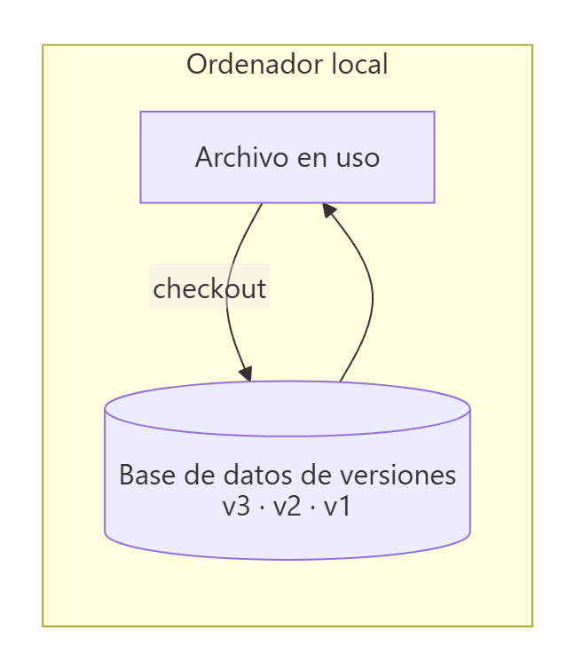
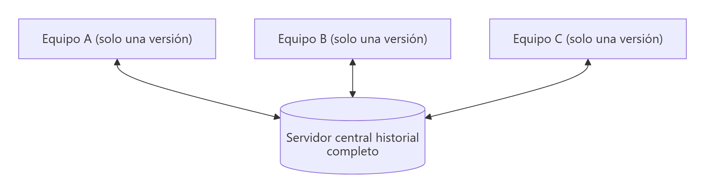
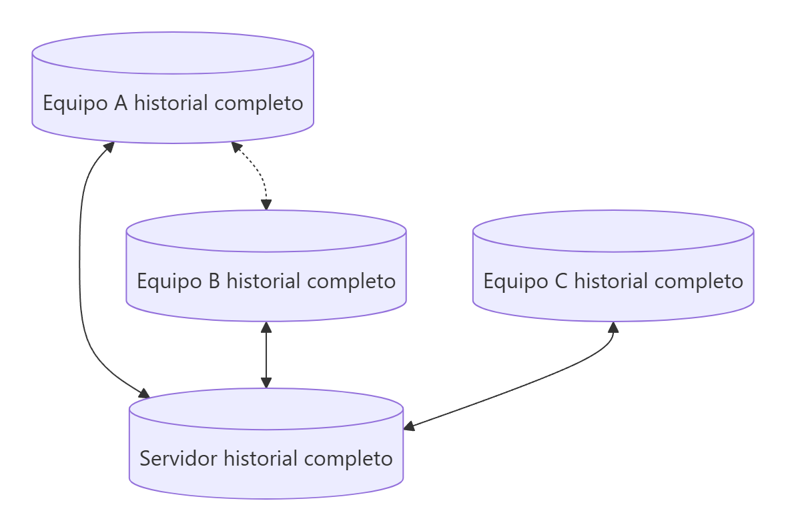
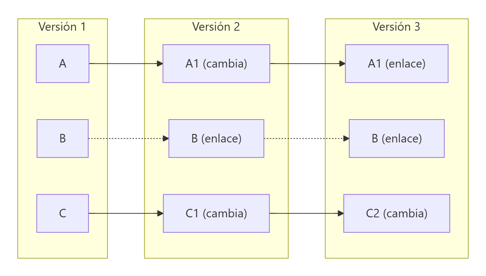
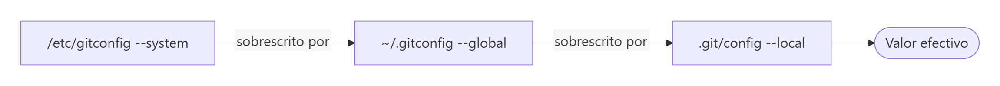

# Introducción al control de versiones, instalación y configuración de Git

> **Autor:** Martín Gil Blanco  
> **Curso:** Control de versiones con Git en contextos académicos y profesionales  
> **Tema 0** · Última revisión: octubre de 2026

---

## Índice

- [1. ¿Qué es un sistema de control de versiones?](#1-qué-es-un-sistema-de-control-de-versiones)
  - [1.1. Sistemas locales](#11-sistemas-de-control-de-versiones-locales)
  - [1.2. Sistemas centralizados](#12-sistemas-de-control-de-versiones-centralizados-cvcs)
  - [1.3. Sistemas distribuidos](#13-sistemas-de-control-de-versiones-distribuidos-dvcs)
- [2. Breve historia de Git](#2-breve-historia-de-git)
- [3. Fundamentos de Git](#3-fundamentos-de-git)
- [4. Repositorios Git y plataformas de alojamiento](#4-repositorios-git-y-plataformas-de-alojamiento)
- [5. Instalación de Git](#5-instalación-de-git)
- [6. Configuración del entorno de trabajo](#6-configuración-del-entorno-de-trabajo)
  - [6.1. Niveles de configuración](#61-niveles-de-configuración)
  - [6.2. Identidad](#62-identidad)
  - [6.3. Editor por defecto](#63-editor-por-defecto)
  - [6.4. Herramienta de diferencias y fusión](#64-herramienta-de-diferencias-y-fusión-vs-code)
  - [6.5. Rama por defecto](#65-nombre-de-la-rama-por-defecto)
  - [6.6. Caché de credenciales](#66-caché-de-credenciales-https)
  - [6.7. Alias](#67-alias)
  - [6.8. Comprobar la configuración](#68-comprobar-la-configuración)
- [7. Cómo obtener ayuda](#7-cómo-obtener-ayuda)
- [8. Resumen](#8-resumen)

---

## 1. ¿Qué es un sistema de control de versiones?

Un **sistema de control de versiones** (*VCS, Version Control System*) es un sistema que **registra los cambios** realizados sobre un archivo o conjunto de archivos a lo largo del tiempo, de modo que se puedan **recuperar versiones concretas** más adelante.

Aunque normalmente se usa con código fuente, sirve para casi cualquier tipo de archivo (documentación, apuntes, diseños, configuraciones…). Un VCS permite:

- Volver a una versión anterior de un archivo o del proyecto completo.
- Comparar cambios a lo largo del tiempo.
- Saber **quién** modificó algo, **cuándo** y **por qué**.
- Recuperar archivos perdidos o estropeados.
- Trabajar en equipo de forma ordenada.

### 1.1. Sistemas de control de versiones locales

El método más primitivo es **copiar los archivos a otra carpeta** (`proyecto_v1`, `proyecto_final`, `proyecto_final_DEFINITIVO`…). Es sencillo, pero muy propenso a errores: es fácil sobrescribir el archivo equivocado.

Para resolverlo surgieron los VCS locales (como **RCS**), que guardan en una base de datos local los **parches** (diferencias) entre versiones.



### 1.2. Sistemas de control de versiones centralizados (CVCS)

Para poder **colaborar**, aparecieron los sistemas centralizados (**CVS, Subversion, Perforce**): un **único servidor** guarda todas las versiones y los clientes descargan de él la versión con la que trabajan.



| Ventajas | Inconvenientes |
|---|---|
| Todo el mundo sabe en qué trabajan los demás | **Punto único de fallo**: si el servidor cae, nadie puede confirmar cambios |
| Administración y permisos centralizados | Si el disco del servidor se corrompe sin copias, se pierde todo el historial |
| Más sencillo que gestionar bases de datos locales | Casi todas las operaciones necesitan red |

### 1.3. Sistemas de control de versiones distribuidos (DVCS)

En los sistemas distribuidos (**Git, Mercurial, Bazaar…**) cada cliente **replica el repositorio completo**, con todo su historial. Cada clon es una copia de seguridad íntegra: si el servidor se pierde, puede restaurarse desde cualquier clon.



Además, permiten trabajar con **varios repositorios remotos** a la vez y montar flujos de trabajo (jerárquicos, con revisión, etc.) imposibles en un sistema centralizado.

---

## 2. Breve historia de Git

| Año | Hito |
|---|---|
| 1991‑2002 | Los cambios del kernel de Linux se intercambian mediante parches y archivos comprimidos. |
| 2002 | El proyecto del kernel empieza a usar **BitKeeper**, un DVCS propietario. |
| 2005 | BitKeeper deja de ser gratuito. **Linus Torvalds** crea **Git**. |
| Hoy | Git es el sistema de control de versiones más utilizado del mundo. |

Objetivos de diseño de Git:

- **Velocidad**.
- **Diseño sencillo**.
- Gran soporte para **desarrollo no lineal** (miles de ramas en paralelo).
- **Completamente distribuido**.
- Capaz de manejar **proyectos enormes** (como el kernel de Linux) de forma eficiente.

> 💡 Git es **libre y de código abierto**.

---

## 3. Fundamentos de Git

### Instantáneas, no diferencias

La mayoría de VCS guardan la información como **una lista de cambios** sobre cada archivo. Git, en cambio, guarda **instantáneas** (*snapshots*) del proyecto completo en cada confirmación. Si un archivo no ha cambiado, Git no lo vuelve a guardar: almacena un **enlace** a la versión idéntica anterior.



### Casi todas las operaciones son locales

Como el historial completo está en tu disco, consultar el historial, comparar versiones o confirmar cambios es **casi instantáneo** y se puede hacer **sin conexión** (en un tren, en un avión…). Solo necesitas red para sincronizar con un remoto.

### Git tiene integridad

Todo en Git se verifica mediante una **suma de comprobación SHA‑1** antes de guardarse: una cadena de **40 caracteres hexadecimales** calculada a partir del contenido.

```text
24b9da6552252987aa493b52f8696cd6d3b00373
```

Es imposible modificar un archivo o directorio sin que Git lo detecte. Git guarda todo **por el hash de su contenido**, no por el nombre del archivo.

### Git generalmente solo añade información

Casi todas las acciones en Git **añaden** datos a su base de datos. Una vez confirmado (*commit*) algo, es muy difícil perderlo, sobre todo si se envía periódicamente a otro repositorio. Lo que **sí** se puede perder son los cambios que **todavía no se han confirmado**.

### Los tres estados

Este es el concepto más importante de Git (se desarrolla en el [Tema 1](01-areas-y-estados.md)):

| Estado | Significado |
|---|---|
| **Modificado** (*modified*) | El archivo ha cambiado pero aún no se ha confirmado. |
| **Preparado** (*staged*) | El archivo modificado se ha marcado para ir en la próxima confirmación. |
| **Confirmado** (*committed*) | Los datos están guardados de forma segura en la base de datos local. |

### La línea de comandos

Existen muchas interfaces gráficas para Git (VS Code, GitHub Desktop, GitKraken…), pero **la línea de comandos es el único sitio donde están disponibles todos los comandos**. Si sabes hacer algo en la terminal, sabrás hacerlo en una interfaz gráfica; lo contrario no siempre es cierto. En estos apuntes trabajaremos desde la terminal (Git Bash en Windows, Terminal en macOS/Linux).

---

## 4. Repositorios Git y plataformas de alojamiento

Un **repositorio** es un espacio de almacenamiento que contiene archivos y carpetas **junto con todo su historial de cambios**. Puede estar:

- **Online**, en una plataforma de alojamiento.
- **Offline**, en un servidor local o en tu propio equipo.

Las tres plataformas más populares para alojar repositorios online son:

| Plataforma | Propietario | Características destacadas |
|---|---|---|
| **GitHub** | Microsoft | La más usada; Pull Requests, Actions, GitHub Pages, programa *GitHub Education* gratuito para estudiantes |
| **GitLab** | GitLab Inc. | Muy usada en empresas; CI/CD integrado; se puede instalar en servidor propio |
| **Bitbucket** | Atlassian | Integración con Jira y Trello |

> 🎓 **GitHub Education / GitHub Campus**: los centros educativos adheridos dan acceso gratuito a herramientas de desarrollo para estudiantes. Normalmente hay que registrarse con el correo del centro y acreditar la matrícula.

La creación de repositorios en GitHub y GitLab se explica en el [Tema 5](05-repositorios-remotos.md).

---

## 5. Instalación de Git

Para trabajar con repositorios (locales o remotos) hay que instalar Git en el equipo.

### Linux

Mediante el gestor de paquetes de la distribución:

```bash
# Debian / Ubuntu
sudo apt update && sudo apt install git

# Fedora
sudo dnf install git
```

### macOS

La forma más sencilla es instalar las **Xcode Command Line Tools**: basta con ejecutar `git` en la terminal y el sistema ofrecerá instalarlas. También se puede usar el instalador de <https://git-scm.com/download/mac> o Homebrew:

```bash
brew install git
```

### Windows

Descargar **Git for Windows** desde <https://git-scm.com/download/win>. Incluye **Git Bash**, una terminal con comandos de tipo Unix (`ls`, `cat`, `nano`…) que es la que usaremos en los ejemplos.

### Comprobar la instalación

```bash
git --version
```

---

## 6. Configuración del entorno de trabajo

Git incluye la herramienta **`git config`**, que permite consultar y establecer las variables de configuración que controlan su aspecto y funcionamiento. Esta configuración se hace **una sola vez** por equipo y se mantiene entre actualizaciones.

### 6.1. Niveles de configuración

| Nivel | Opción | Archivo | Alcance |
|---|---|---|---|
| Sistema | `--system` | `/etc/gitconfig` | Todos los usuarios del equipo (requiere privilegios de administrador) |
| Global | `--global` | `~/.gitconfig` o `~/.config/git/config` | Tu usuario, en todos tus repositorios |
| Local | `--local` (por defecto) | `.git/config` | Solo el repositorio actual |

Los archivos se leen en ese orden y **cada nivel sobrescribe al anterior**: los valores de `.git/config` tienen prioridad sobre `~/.gitconfig`, y este sobre `/etc/gitconfig`.



> 🪟 **Windows**: Git busca `.gitconfig` en el directorio `$HOME` (normalmente `C:\Users\<usuario>`). El archivo de sistema está en la carpeta de instalación de Git.

### 6.2. Identidad

Lo primero que hay que hacer tras instalar Git es configurar el **nombre** y el **correo electrónico**. Cada commit los incluye de forma **inmutable**.

```bash
git config --global user.name "Martín Gil Blanco"
git config --global user.email "tu_correo@ejemplo.com"
```

Si no se configuran, Git intenta deducirlos del nombre de usuario del sistema y del nombre del equipo, pero el resultado no suele ser correcto.

Para usar una identidad distinta en un proyecto concreto (por ejemplo, el correo del trabajo), ejecuta los comandos **sin `--global`** dentro de ese repositorio.

> ⚠️ Usa el mismo correo que tienes registrado en GitHub/GitLab para que los commits se asocien a tu cuenta.

### 6.3. Editor por defecto

Cuando Git necesita que escribas un mensaje (por ejemplo, un commit sin `-m` o un merge), abre un editor. Por defecto suele ser **Vim** o **Nano**. Para usar otro:

```bash
# Nano
git config --global core.editor "nano"

# Visual Studio Code (comprueba antes que funciona: code --version)
git config --global core.editor "code --wait --new-window"
```

La opción `--wait` hace que Git espere a que cierres la pestaña del editor antes de continuar.

> 💡 Si acabas dentro de **Vim** sin querer: pulsa `i` para escribir, `Esc` para salir del modo edición y escribe `:wq` + Intro para guardar y salir (o `:q!` para salir sin guardar).

### 6.4. Herramienta de diferencias y fusión (VS Code)

VS Code puede usarse como herramienta gráfica para ver diferencias (`git difftool`) y resolver conflictos (`git mergetool`):

```bash
git config --global diff.tool vscode
git config --global difftool.vscode.cmd 'code --wait --diff $LOCAL $REMOTE'
git config --global difftool.prompt false

git config --global merge.tool vscode
git config --global mergetool.vscode.cmd 'code --wait $MERGED'
git config --global mergetool.prompt false
```

Su uso se explica en el [Tema 4](04-etiquetas-y-diferencias.md) y en el [Tema 9](09-resolucion-de-conflictos.md).

### 6.5. Nombre de la rama por defecto

Históricamente la rama principal se llamaba **`master`**. Desde 2020, GitHub, GitLab y otras plataformas usan **`main`**. Para que `git init` cree directamente `main`:

```bash
git config --global init.defaultBranch main
```

> 📌 En algunos temas de estos apuntes (y en sus capturas) aparece `master`; el funcionamiento es idéntico, solo cambia el nombre.

### 6.6. Caché de credenciales (HTTPS)

Si trabajas con HTTPS, Git puede recordar las credenciales durante un tiempo para no pedirlas en cada `push`:

```bash
# Guardar en memoria durante 1 hora (3600 s). Por defecto son 900 s (15 min)
git config --global credential.helper 'cache --timeout=3600'
```

En Windows, Git for Windows instala **Git Credential Manager**, que guarda las credenciales de forma segura en el sistema. La alternativa recomendada es **SSH** ([Tema 8](08-claves-ssh.md)).

### 6.7. Alias

Los alias permiten crear atajos para comandos largos o muy usados:

```bash
git config --global alias.co checkout
git config --global alias.br branch
git config --global alias.ci commit
git config --global alias.st status
git config --global alias.unstage 'reset HEAD --'
git config --global alias.last 'log -1 HEAD'
git config --global alias.lg "log --oneline --graph --decorate --all"
```

A partir de ese momento, `git st` equivale a `git status` y `git lg` muestra el grafo completo del repositorio.

Si el alias empieza por `!`, se ejecuta un **comando externo** en lugar de un subcomando de Git:

```bash
git config --global alias.visual '!gitk'
```

### 6.8. Comprobar la configuración

```bash
git config --list                  # Toda la configuración (puede haber claves repetidas)
git config --list --show-origin    # Indica de qué archivo sale cada valor
git config user.name               # Valor de una clave concreta
```

Si una clave aparece varias veces (por estar en varios niveles), **Git usa el último valor leído**.

---

## 7. Cómo obtener ayuda

Hay tres formas equivalentes de consultar el manual de cualquier comando, incluso sin conexión:

```bash
git help <comando>
git <comando> --help
man git-<comando>
```

Para una ayuda breve con las opciones más comunes:

```bash
git <comando> -h
```

Otros recursos: el libro oficial **Pro Git** (<https://git-scm.com/book/es/v2>) y la documentación de GitHub (<https://docs.github.com>).

---

## 8. Resumen

- Un VCS registra la evolución de los archivos y permite volver atrás y colaborar.
- Git es un sistema **distribuido**: cada clon contiene **todo el historial**.
- Git guarda **instantáneas** identificadas por **hashes SHA‑1**, trabaja de forma **local** y **casi nunca pierde información** confirmada.
- Antes de empezar: instala Git y configura **`user.name`**, **`user.email`**, el **editor** y la **rama por defecto**.

---

[Índice](README.md) · [Siguiente: Áreas de un repositorio Git ➡](01-areas-y-estados.md)
