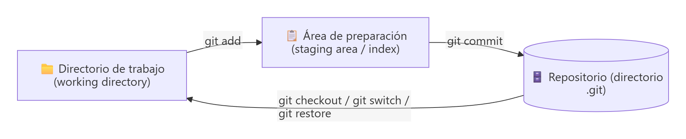
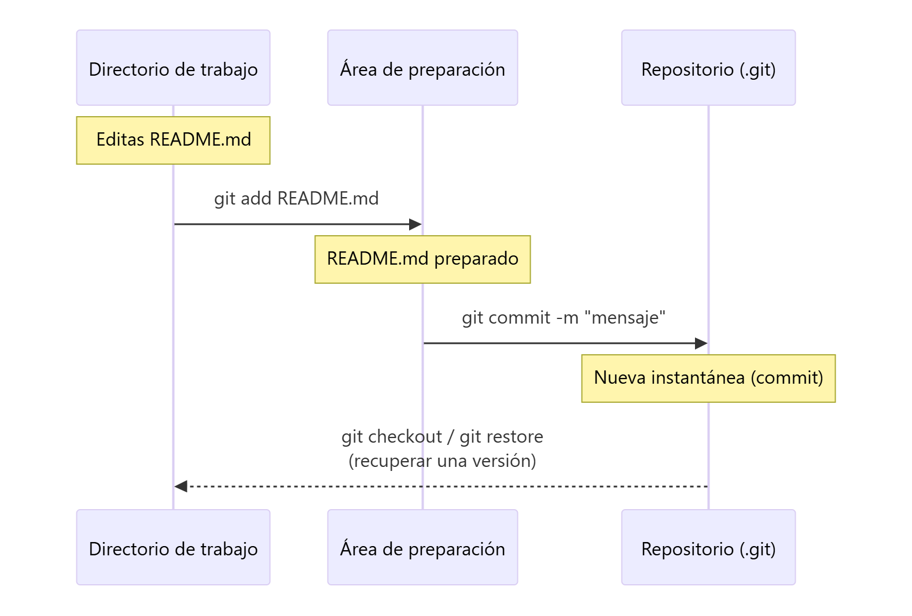
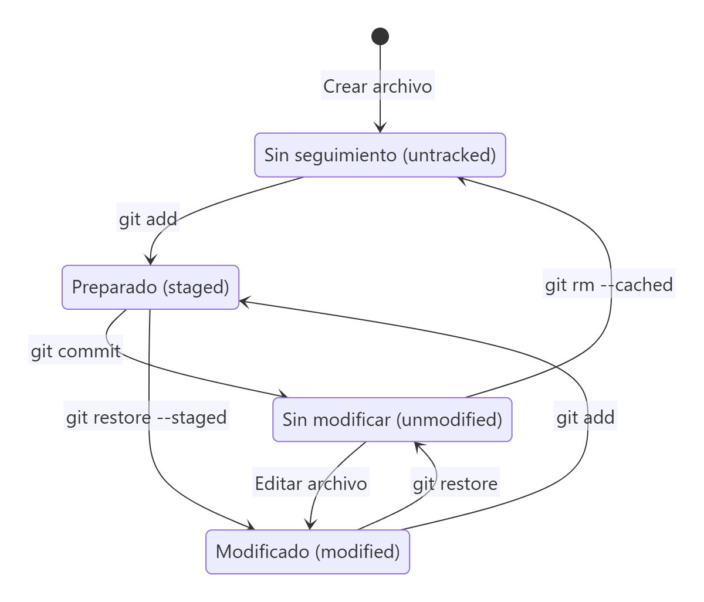
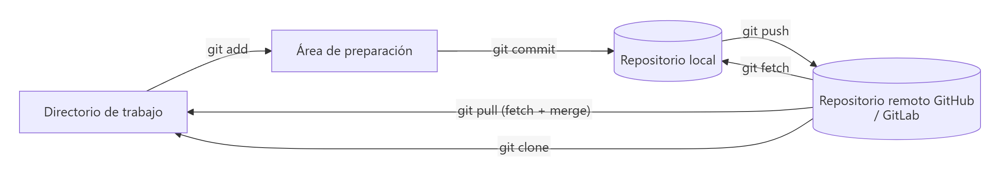

# Áreas de un repositorio Git y estados de los archivos

> **Autor:** Martín Gil Blanco  
> **Curso:** Control de versiones con Git en contextos académicos y profesionales  
> **Tema 1** · Última revisión: octubre de 2026

---

## Índice

- [1. Las tres áreas de un proyecto Git](#1-las-tres-áreas-de-un-proyecto-git)
  - [1.1. Directorio de trabajo](#11-directorio-de-trabajo-working-directory)
  - [1.2. Área de preparación](#12-área-de-preparación-staging-area-o-índice)
  - [1.3. Repositorio (directorio `.git`)](#13-repositorio-directorio-git)
- [2. Flujo de trabajo básico](#2-flujo-de-trabajo-básico)
- [3. Estados de un archivo](#3-estados-de-un-archivo)
- [4. Ciclo de vida de un archivo](#4-ciclo-de-vida-de-un-archivo)
- [5. Consultar el estado: `git status`](#5-consultar-el-estado-git-status)
- [6. El repositorio remoto: la cuarta área](#6-el-repositorio-remoto-la-cuarta-área)
- [7. Resumen](#7-resumen)
- [Actividad práctica](#actividad-práctica)

---

## 1. Las tres áreas de un proyecto Git

Todo proyecto Git se organiza en **tres secciones** principales:




### 1.1. Directorio de trabajo (*working directory*)

Es la **carpeta del proyecto** tal y como la ves en tu equipo: contiene la versión de los archivos con la que estás trabajando ahora mismo.

- Sus archivos se extraen de la base de datos comprimida del directorio `.git` y se colocan en el disco para que puedas usarlos y modificarlos.
- Es la única de las tres áreas que editas directamente (con un editor, un IDE, etc.).
- Cuando te mueves a otro commit o a otra rama, **Git cambia automáticamente su contenido**.

### 1.2. Área de preparación (*staging area* o índice)

Es una **zona intermedia** donde se colocan los cambios que formarán parte del **próximo commit**.

- Técnicamente es un archivo (`.git/index`) que guarda información sobre lo que irá en la siguiente confirmación.
- También se llama **índice** (*index*).
- Permite **elegir qué cambios se confirman** y cuáles no: puedes modificar diez archivos y confirmar solo tres.

> 💡 Piensa en el área de preparación como el **"carrito de la compra"** del próximo commit: añades (`git add`) lo que quieres llevarte y, cuando está listo, pasas por caja (`git commit`).

### 1.3. Repositorio (directorio `.git`)

Es donde Git guarda los **metadatos** y la **base de datos de objetos** del proyecto: todas las instantáneas, el historial completo, las ramas, las etiquetas y la configuración local.

- Es la parte más importante de Git y lo que se copia al **clonar** un repositorio.
- Se crea con `git init` (o `git clone`) y es una carpeta **oculta**.
- Si borras la carpeta `.git`, el proyecto deja de ser un repositorio y **pierdes todo el historial**.

Contenido típico de `.git`:

| Elemento | Función |
|---|---|
| `HEAD` | Indica la rama (o commit) en la que estás |
| `config` | Configuración local del repositorio |
| `index` | El área de preparación |
| `objects/` | Base de datos de objetos (archivos, árboles, commits, etiquetas) |
| `refs/` | Punteros a commits: ramas (`heads/`), etiquetas (`tags/`), remotos (`remotes/`) |
| `hooks/` | Scripts que se ejecutan ante ciertos eventos |

---

## 2. Flujo de trabajo básico

1. **Modificas** archivos en el directorio de trabajo.
2. **Preparas** los cambios que quieres confirmar, añadiéndolos al área de preparación (`git add`).
3. **Confirmas** los cambios (`git commit`): Git toma los archivos tal y como están en el área de preparación y guarda esa instantánea de forma permanente en el repositorio.



---

## 3. Estados de un archivo

Cada archivo del directorio de trabajo puede estar **rastreado** (*tracked*) o **sin rastrear** (*untracked*):

- **Rastreados**: estaban en la última instantánea o se han añadido al índice. Pueden estar sin modificar, modificados o preparados.
- **Sin rastrear**: cualquier otro archivo del directorio de trabajo que Git no conoce todavía.

| Estado | Descripción |
|---|---|
| **Sin seguimiento** (*untracked*) | Git no lo controla. No se incluirá en ningún commit hasta que se añada con `git add`. |
| **Sin modificar** (*unmodified*) | Rastreado e idéntico a la última versión confirmada. |
| **Modificado** (*modified*) | Rastreado y con cambios respecto a la última confirmación, pero esos cambios aún no están preparados. |
| **Preparado** (*staged*) | Sus cambios están en el área de preparación y entrarán en el próximo commit. |
| **Confirmado** (*committed*) | La versión está almacenada de forma segura en el repositorio. |

Relación entre **estados** y **áreas**:

| Si la versión del archivo… | …se considera |
|---|---|
| está en el directorio `.git` | **confirmada** |
| ha cambiado y se ha añadido al área de preparación | **preparada** |
| ha cambiado pero no se ha preparado | **modificada** |

---

## 4. Ciclo de vida de un archivo



Cuando **clonas** un repositorio, todos los archivos están **rastreados y sin modificar**. Al editarlos pasan a **modificados**; los preparas, los confirmas y el ciclo vuelve a empezar.

> ⚠️ Un mismo archivo puede aparecer **a la vez** como preparado y como modificado: ocurre si lo editas **después** de hacer `git add`. Git prepara el archivo tal y como estaba en el momento del `git add`; para incluir la última edición hay que volver a ejecutar `git add`.

---

## 5. Consultar el estado: `git status`

`git status` es la herramienta principal para saber en qué estado están los archivos:

```bash
git status
```

```text
On branch main
Changes to be committed:
  (use "git restore --staged <file>..." to unstage)
        new file:   README.md

Changes not staged for commit:
  (use "git add <file>..." to update what will be committed)
  (use "git restore <file>..." to discard changes in working directory)
        modified:   index.html

Untracked files:
  (use "git add <file>..." to include in what will be committed)
        notas.txt
```

| Sección de la salida | Significado |
|---|---|
| `Changes to be committed` | Archivos **preparados** (área de preparación) |
| `Changes not staged for commit` | Archivos **modificados** sin preparar |
| `Untracked files` | Archivos **sin seguimiento** |
| `nothing to commit, working tree clean` | Directorio de trabajo **limpio**: no hay cambios |

### Estado abreviado

```bash
git status -s      # o git status --short
```

```text
 M README
MM Rakefile
A  lib/git.rb
M  lib/simplegit.rb
?? LICENSE.txt
```

La salida tiene **dos columnas**: la izquierda indica el estado en el **área de preparación** y la derecha el estado en el **directorio de trabajo**.

| Código | Significado |
|---|---|
| `??` | Sin seguimiento |
| `A ` | Nuevo archivo preparado |
| `M ` | Modificado y preparado |
| ` M` | Modificado sin preparar |
| `MM` | Preparado y vuelto a modificar después |
| `D ` | Eliminado y preparado |

---

## 6. El repositorio remoto: la cuarta área

Cuando se trabaja con GitHub o GitLab aparece una **cuarta área**: el **repositorio remoto**, una copia del repositorio alojada en un servidor.



El flujo habitual cuando se parte de un repositorio remoto es:

```text
git pull  →  editar archivos  →  git add  →  git commit  →  git push
```

Los repositorios remotos se estudian en el [Tema 5](05-repositorios-remotos.md) y el [Tema 12](12-ramas-remotas.md).

---

## 7. Resumen

| Área | Qué contiene | Comando para llegar |
|---|---|---|
| Directorio de trabajo | Los archivos con los que trabajas | Editar / `git checkout` / `git restore` |
| Área de preparación | Los cambios del próximo commit | `git add` |
| Repositorio local (`.git`) | Todo el historial | `git commit` |
| Repositorio remoto | Copia compartida en un servidor | `git push` |

---

## Actividad práctica

Busca información y explica con tus palabras las tres áreas de un proyecto Git (directorio de trabajo, área de preparación y repositorio). Comprueba en un repositorio de prueba cómo cambia la salida de `git status` al crear, preparar y confirmar un archivo. Entrega un documento PDF con las capturas de pantalla y las explicaciones correspondientes.

---

[⬅ Anterior: Introducción e instalación](00-introduccion-y-configuracion.md) · [Índice](README.md) · [Siguiente: Inicializar repositorio local ➡](02-inicializar-repositorio.md)
