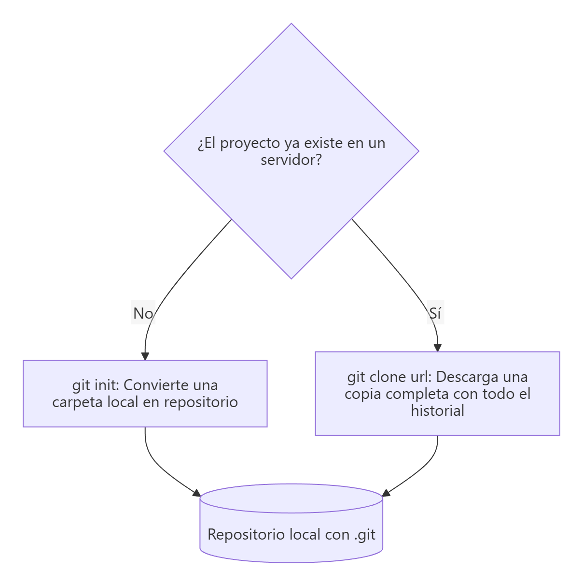
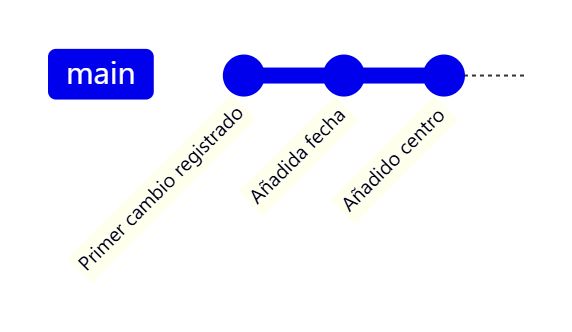

# Inicializar un repositorio y registrar cambios

> **Autor:** Martín Gil Blanco  
> **Curso:** Control de versiones con Git en contextos académicos y profesionales  
> **Tema 2** · Última revisión: octubre de 2026

---

## Índice

- [1. Dos formas de obtener un repositorio](#1-dos-formas-de-obtener-un-repositorio)
- [2. Práctica: crear un repositorio local](#2-práctica-crear-un-repositorio-local)
- [3. `git add` en detalle](#3-git-add-en-detalle)
- [4. `git commit` en detalle](#4-git-commit-en-detalle)
- [5. Eliminar y renombrar archivos](#5-eliminar-y-renombrar-archivos)
- [6. Clonar un repositorio existente](#6-clonar-un-repositorio-existente)
- [7. Resumen de comandos](#7-resumen-de-comandos)
- [Actividad práctica](#actividad-práctica)

---

## 1. Dos formas de obtener un repositorio



1. **`git init`**: convierte una carpeta (vacía o con archivos) en un repositorio Git.
2. **`git clone`**: copia un repositorio que ya existe en otro sitio (GitHub, GitLab, un servidor…). Se ve en el [apartado 6](#6-clonar-un-repositorio-existente).

---

## 2. Práctica: crear un repositorio local

Vamos a crear un repositorio en nuestro PC, añadir y modificar algunos archivos y registrar los cambios, todo desde la terminal.

### 2.1. Crear una carpeta para el proyecto

Usa tu nombre en el nombre de la carpeta:

```bash
mkdir pruebas-martin
cd pruebas-martin
```

### 2.2. Comprobar que la carpeta está vacía

```bash
ls -la
```

### 2.3. Inicializar el repositorio

```bash
git init
```

```text
Initialized empty Git repository in /home/martin/pruebas-martin/.git/
```

> 💡 Si quieres que la rama inicial se llame `main` sin haberlo configurado globalmente: `git init -b main`.

### 2.4. Comprobar que se ha creado la carpeta `.git`

Es la carpeta donde se registrarán todos los cambios. Todavía no hay ningún archivo bajo seguimiento: solo el "esqueleto" del repositorio.

```bash
ls -la
```

> ⚠️ **Nunca crees un repositorio dentro de otro** ni ejecutes `git init` en tu carpeta personal: Git rastrearía todo lo que hay debajo.

### 2.5. Crear un archivo `README.md`

```bash
nano README.md
```

### 2.6. Añadir una línea al archivo

Escribe una línea con tu nombre y apellidos y guarda el archivo (en nano: `Ctrl+O`, Intro, `Ctrl+X`).

Si ahora ejecutas `git status`, verás `README.md` como archivo **sin seguimiento** (*untracked*).

### 2.7. Registrar los cambios en el repositorio

Se hace en **dos pasos**:

1. Añadir al **área de preparación**:

   ```bash
   git add README.md
   ```

2. Confirmar en el **repositorio**:

   ```bash
   git commit -m "Primer cambio registrado"
   ```

```text
[main (root-commit) 8b670f6] Primer cambio registrado
 1 file changed, 1 insertion(+)
 create mode 100644 README.md
```

La salida indica la **rama** (`main`), el **hash abreviado** del commit (`8b670f6`), el número de archivos cambiados y las líneas añadidas/eliminadas.

### 2.8. Repetir el proceso dos veces más

1. Añade una línea con la **fecha actual** → `git add README.md` → `git commit -m "Añadida fecha"`.
2. Añade una línea con el **nombre de tu centro** → `git add README.md` → `git commit -m "Añadido centro"`.



### 2.9. Ver los cambios realizados

```bash
git log
git log --oneline
```


Deberían aparecer **3 commits**, del más reciente al más antiguo.

> 📌 No borres este repositorio local: lo seguiremos usando en los temas siguientes.

---

## 3. `git add` en detalle

`git add` es un comando **multipropósito**. Conviene entenderlo como *"añade este contenido a la próxima confirmación"* más que como *"añade este archivo al proyecto"*. Sirve para:

- Empezar a rastrear archivos nuevos.
- Preparar archivos modificados.
- Marcar como resueltos los archivos en conflicto ([Tema 9](09-resolucion-de-conflictos.md)).

| Comando | Qué prepara |
|---|---|
| `git add archivo.txt` | Un archivo concreto |
| `git add carpeta/` | Todos los archivos de la carpeta (recursivamente) |
| `git add *.html` | Los archivos que coinciden con el patrón |
| `git add .` | Todos los cambios del directorio actual y subdirectorios |
| `git add -A` | Todos los cambios del repositorio (incluidos borrados) |
| `git add -p` | Permite elegir **trozo a trozo** qué cambios preparar |

> 💡 `git add` puede ejecutarse **varias veces** antes de un commit. Si editas un archivo después de prepararlo, tendrás que volver a ejecutar `git add` para incluir la última versión.

---

## 4. `git commit` en detalle

Un **commit** es una **instantánea** del área de preparación. Todo lo que no esté preparado sigue en el directorio de trabajo como modificado.

| Comando | Efecto |
|---|---|
| `git commit` | Abre el editor configurado para escribir el mensaje |
| `git commit -m "mensaje"` | Mensaje en la propia línea de comandos |
| `git commit -v` | Muestra en el editor el *diff* de lo que se va a confirmar |
| `git commit -a -m "mensaje"` | **Salta el área de preparación**: prepara automáticamente todos los archivos **rastreados** modificados y los confirma |
| `git commit --amend` | Rehace el último commit (ver [Tema 6](06-deshacer-cambios.md)) |

> ⚠️ `git commit -a` **no incluye archivos nuevos** (sin seguimiento); solo los que Git ya conocía.

### Buenas prácticas en los mensajes de commit

- Una primera línea **breve** (≈ 50 caracteres) que resuma el cambio.
- Escrita en **imperativo** o de forma descriptiva y consistente: *"Añade validación del formulario"*, *"Corrige error en el cálculo de la edad"*.
- Si hace falta, una línea en blanco y después una explicación más detallada del **porqué**.
- Commits **pequeños y atómicos**: un commit = un cambio lógico.

```text
Corrige el cálculo de la categoría por edad

El rango de "adolescente" incluía los 12 años y solapaba
con "niño". Se ajusta el límite inferior a 13.
```

---

## 5. Eliminar y renombrar archivos

### Eliminar archivos: `git rm`

Si borras un archivo con `rm`, aparece como *"deleted"* en los cambios **no preparados**. Con `git rm` el borrado se **prepara** directamente:

```bash
git rm PROJECTS.md
git commit -m "Elimina PROJECTS.md"
```

| Comando | Efecto |
|---|---|
| `git rm archivo` | Borra el archivo del disco **y** prepara el borrado |
| `git rm -f archivo` | Fuerza el borrado si el archivo estaba modificado y preparado |
| `git rm --cached archivo` | **Deja de rastrearlo** pero lo **mantiene en el disco** (útil si olvidaste añadirlo a `.gitignore`) |
| `git rm log/\*.log` | Admite patrones (la `\` evita que la terminal expanda el `*`) |

### Renombrar o mover archivos: `git mv`

```bash
git mv README.md LEEME.md
git status
```

```text
Changes to be committed:
        renamed:    README.md -> LEEME.md
```

Git no guarda metadatos de renombrado; **lo detecta** comparando contenidos. `git mv` equivale a:

```bash
mv README.md LEEME.md
git rm README.md
git add LEEME.md
```

---

## 6. Clonar un repositorio existente

Para obtener una copia de un repositorio que ya existe se usa `git clone`. A diferencia de otros sistemas, **se descarga todo el historial**, no solo la última versión.

```bash
git clone https://github.com/libgit2/libgit2
```

Esto:

1. Crea la carpeta `libgit2`.
2. Inicializa dentro un directorio `.git`.
3. Descarga todos los datos del repositorio.
4. Extrae una copia de trabajo de la última versión.
5. Configura automáticamente el remoto con el nombre **`origin`** y la rama local para que siga a la remota.

Para clonar en una carpeta con otro nombre (debe estar vacía o no existir):

```bash
git clone https://github.com/libgit2/libgit2 mylibgit
```

Git admite varios protocolos:

| Protocolo | Ejemplo de URL |
|---|---|
| HTTPS | `https://github.com/usuario/repo.git` |
| SSH | `git@github.com:usuario/repo.git` |
| Git | `git://servidor/repo.git` (solo lectura, poco usado) |
| Local | `/ruta/al/repo.git` |

> 🔐 GitHub **no admite contraseñas** para operaciones Git por HTTPS desde agosto de 2021: hay que usar un **token de acceso personal** o, mejor, **SSH** ([Tema 8](08-claves-ssh.md)).

---

## 7. Resumen de comandos

| Comando | Descripción |
|---|---|
| `git init` | Crea un repositorio en la carpeta actual |
| `git clone <url> [carpeta]` | Copia un repositorio remoto |
| `git status` / `git status -s` | Estado de los archivos |
| `git add <ruta>` | Prepara cambios |
| `git commit -m "msg"` | Confirma lo preparado |
| `git commit -am "msg"` | Prepara los rastreados y confirma |
| `git rm [--cached] <archivo>` | Elimina (o deja de rastrear) un archivo |
| `git mv <origen> <destino>` | Renombra/mueve un archivo |
| `git log [--oneline]` | Muestra el historial |

---

## Actividad práctica

Realiza los pasos del [apartado 2](#2-práctica-crear-un-repositorio-local) y entrega un documento PDF con las capturas de pantalla y las explicaciones pertinentes. Deben verse los tres commits en la salida de `git log --oneline`.

---

[⬅ Anterior: Áreas de un repositorio Git](01-areas-y-estados.md) · [Índice](README.md) · [Siguiente: Revisar commits realizados ➡](03-historial-de-commits.md)
