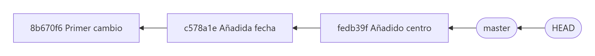
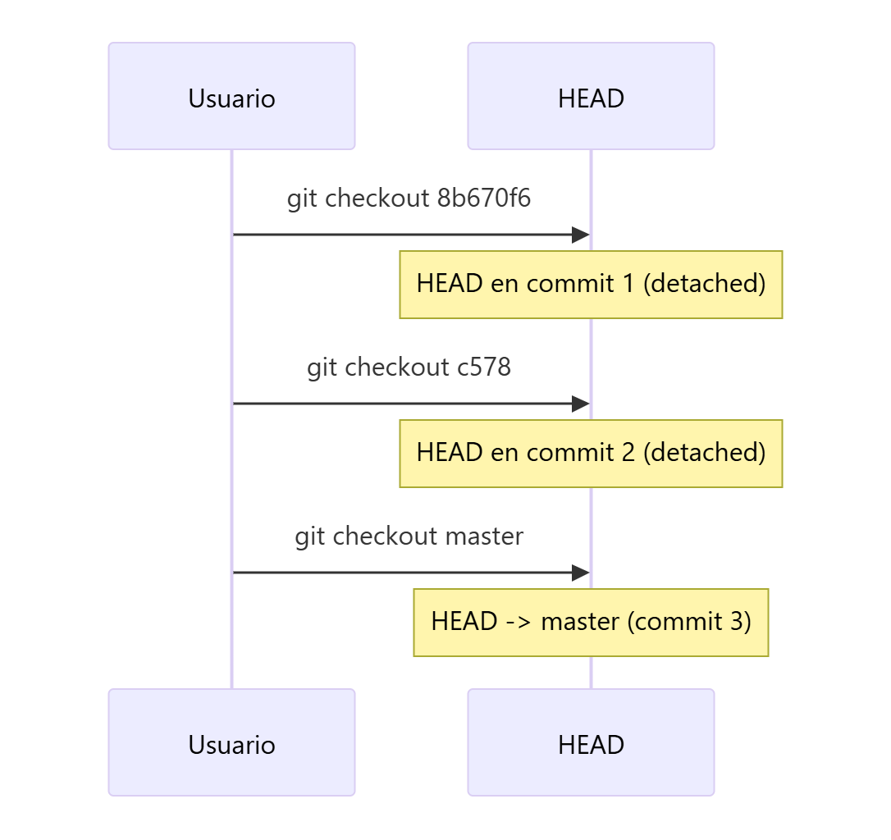
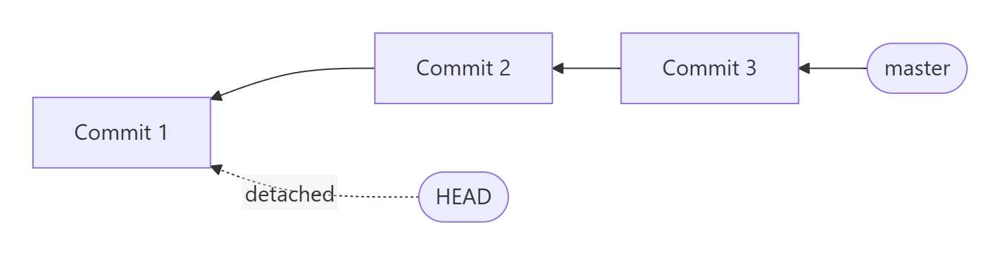

# Revisar el historial y moverse entre commits

> **Autor:** Martín Gil Blanco  
> **Curso:** Control de versiones con Git en contextos académicos y profesionales  
> **Tema 3** · Última revisión: octubre de 2026

---

## Índice

- [1. Ver el historial: `git log`](#1-ver-el-historial-git-log)
- [2. Hash, HEAD y rama](#2-hash-head-y-rama)
- [3. Práctica: moverse entre commits](#3-práctica-moverse-entre-commits)
- [4. El estado *detached HEAD*](#4-el-estado-detached-head)
- [5. Referencias relativas: `~` y `^`](#5-referencias-relativas--y-)
- [6. Opciones de formato de `git log`](#6-opciones-de-formato-de-git-log)
- [7. Limitar la salida de `git log`](#7-limitar-la-salida-de-git-log)
- [8. Resumen](#8-resumen)
- [Actividad práctica](#actividad-práctica)

---

## 1. Ver el historial: `git log`

Antes de nada, comprueba que tienes al menos 3 commits:

```bash
git log --oneline --all
```

- `--oneline`: muestra cada commit en una sola línea (hash abreviado + mensaje).
- `--all`: muestra los commits de **todas** las ramas, no solo de la actual.


Sin opciones, `git log` muestra los commits en **orden cronológico inverso** (el más reciente primero) con su hash completo, autor, fecha y mensaje:

```text
commit fedb39f6a1c0b2... (HEAD -> master)
Author: Martín Gil Blanco <tu_correo@ejemplo.com>
Date:   Mon Oct 12 18:30:11 2026 +0200

    Añadido centro
```

> 📌 En las capturas de este tema la rama principal se llama `master`. En repositorios nuevos suele llamarse `main`; el funcionamiento es idéntico.

---

## 2. Hash, HEAD y rama

En la salida de `git log --oneline`:

- **Primera columna**: el **hash** (identificador SHA‑1 abreviado) de cada commit. No sigue ningún orden; cada persona tendrá hashes distintos.
- **Segunda columna**: el mensaje del commit.
- **`HEAD`**: referencia especial que apunta al commit **en el que estás situado** ahora mismo.
- **`master`** (o `main`): la **rama**. Apunta siempre al **último commit de la rama**.



> 💡 Normalmente `HEAD` apunta a una **rama** y la rama apunta a un **commit**. Cuando haces un commit nuevo, la rama avanza y `HEAD` va con ella.

Para mover `HEAD` a otro commit y ver cómo estaban los archivos en ese momento se usa:

```bash
git checkout <hash>
# Equivalente moderno (Git 2.23+):
git switch --detach <hash>
```

---

## 3. Práctica: moverse entre commits

### 3.1. Ver el contenido actual de `README.md`

```bash
cat README.md
```

Deben aparecer tres líneas: tu nombre, la fecha y el centro.

### 3.2. Moverse al primer commit

```bash
git checkout 8b670f6
```

Usa el hash que tengas tú. Aparecerá un aviso de **estado *detached HEAD*** (ver [apartado 4](#4-el-estado-detached-head)).

```bash
cat README.md
```

Solo aparece una línea con tu nombre: es el contenido que tenía el archivo en ese commit.

### 3.3. Ver en qué posición nos encontramos

```bash
git log --oneline --all
```


Fíjate en que `HEAD` ya no está junto a `master`.

> ⚠️ **MUY IMPORTANTE**: cada vez que te mueves de un commit a otro, **Git cambia automáticamente el contenido del directorio de trabajo**. En esta práctica **no modifiques** ningún archivo: solo estamos mirando.

### 3.4. Moverse al segundo commit

```bash
git checkout c578
```

No es necesario escribir el hash completo: basta con los primeros caracteres (mínimo 4) siempre que no sean ambiguos.

```bash
cat README.md
```

Deben aparecer 2 líneas: tu nombre y la fecha.

### 3.5. Comprobar la posición de `HEAD`

```bash
git log --oneline --all
```

`HEAD` debe estar en el segundo commit.

### 3.6. Volver al último commit de la rama

```bash
git checkout master
# o bien:
git switch master
```

```bash
git log --oneline --all
```

Todo vuelve a estar en su sitio: `HEAD -> master` en el último commit.



> 📌 No borres el repositorio local: lo usaremos en el siguiente tema.

---

## 4. El estado *detached HEAD*

Cuando `HEAD` apunta **directamente a un commit** en lugar de a una rama, se dice que está **"despegado"** (*detached HEAD*).



- Es un estado **seguro para mirar** versiones antiguas.
- Puedes hacer commits, pero **no pertenecen a ninguna rama**: si vuelves a otra rama sin crear una nueva, esos commits quedarán "huérfanos" y Git acabará eliminándolos.
- Si quieres conservar el trabajo hecho en ese estado, crea una rama antes de salir:

```bash
git switch -c nueva-rama      # o: git checkout -b nueva-rama
```

Esto se practica en el [Tema 10](10-creacion-de-ramas.md).

---

## 5. Referencias relativas: `~` y `^`

En lugar de copiar hashes, puedes referirte a commits **relativos a otro**:

| Referencia | Significado |
|---|---|
| `HEAD` | Commit actual |
| `HEAD~1` o `HEAD~` | Un commit hacia atrás (el padre) |
| `HEAD~2` | Dos commits hacia atrás (el abuelo) |
| `HEAD~n` | *n* commits hacia atrás siguiendo el primer padre |
| `HEAD^` | El primer padre (igual que `HEAD~1`) |
| `HEAD^2` | El **segundo padre** (solo en commits de fusión) |
| `master~3` | Tres commits por detrás del extremo de `master` |

```bash
git checkout HEAD~2
git show HEAD~1
```

---

## 6. Opciones de formato de `git log`

| Opción | Descripción |
|---|---|
| `--oneline` | Una línea por commit (hash abreviado + mensaje) |
| `--graph` | Dibuja un gráfico ASCII con ramas y fusiones |
| `--decorate` | Muestra ramas, etiquetas y `HEAD` junto a cada commit |
| `--all` | Incluye todas las ramas |
| `-p` | Muestra el parche (*diff*) introducido en cada commit |
| `--stat` | Estadísticas de archivos modificados en cada commit |
| `--shortstat` | Solo la línea de resumen de `--stat` |
| `--name-only` | Lista de archivos afectados |
| `--name-status` | Archivos afectados indicando si se añadieron, modificaron o eliminaron |
| `--abbrev-commit` | Hash abreviado |
| `--relative-date` | Fecha relativa ("hace 2 semanas") |
| `--pretty=<formato>` | `oneline`, `short`, `full`, `fuller` o `format:"..."` |

La combinación más útil del día a día:

```bash
git log --oneline --graph --decorate --all
```

```text
* 2d3acf9 (HEAD -> main) Corrige errores de SIGCHLD
*   5e3ee11 Merge branch 'feature'
|\
| * 420eac9 Añade método para obtener la rama actual
* | 30e367c Código de timeout y pruebas
|/
* d6016bc Requiere time para xmlschema
```

### Formato personalizado

```bash
git log --pretty=format:"%h - %an, %ar : %s"
```

```text
ca82a6d - Martín Gil Blanco, hace 2 días : Cambia el número de versión
```

| Especificador | Salida |
|---|---|
| `%H` / `%h` | Hash del commit (completo / abreviado) |
| `%T` / `%t` | Hash del árbol (completo / abreviado) |
| `%P` / `%p` | Hashes de los padres (completos / abreviados) |
| `%an` / `%ae` | Nombre / correo del **autor** |
| `%ad` / `%ar` | Fecha de autoría (absoluta / relativa) |
| `%cn` / `%ce` | Nombre / correo del **confirmador** |
| `%cd` / `%cr` | Fecha de confirmación (absoluta / relativa) |
| `%s` | Asunto (mensaje) |

> 💡 **Autor** es quien escribió el cambio; **confirmador** (*committer*) es quien lo aplicó al repositorio. Normalmente coinciden, pero pueden ser distintos (por ejemplo, al aplicar un parche de otra persona o tras un *rebase*).

---

## 7. Limitar la salida de `git log`

| Opción | Descripción |
|---|---|
| `-<n>` | Solo los últimos *n* commits (`-3`) |
| `--since`, `--after` | Commits posteriores a una fecha (`--since=2.weeks`, `--since="2026-01-15"`) |
| `--until`, `--before` | Commits anteriores a una fecha |
| `--author="texto"` | Commits cuyo autor coincide |
| `--committer="texto"` | Commits cuyo confirmador coincide |
| `--grep="texto"` | Busca en los mensajes de commit |
| `-S "cadena"` | Commits que **añaden o eliminan** esa cadena en el código |
| `--no-merges` | Excluye los commits de fusión |
| `-- <ruta>` | Solo commits que afectan a esa ruta (siempre al final) |

Ejemplo:

```bash
git log --pretty="%h - %s" --author="Martín" --since="2026-09-01" --no-merges -- src/
```

> ⚠️ Si combinas `--author` y `--grep`, se muestran los commits que cumplen **cualquiera** de las dos; añade `--all-match` para exigir ambas.

---

## 8. Resumen

| Comando | Descripción |
|---|---|
| `git log --oneline --all --graph` | Historial compacto con todas las ramas |
| `git checkout <hash>` / `git switch --detach <hash>` | Moverse a un commit (detached HEAD) |
| `git checkout <rama>` / `git switch <rama>` | Volver a una rama |
| `HEAD~n`, `HEAD^` | Referencias relativas |
| `git show <commit>` | Detalle de un commit ([Tema 4](04-etiquetas-y-diferencias.md)) |

---

## Actividad práctica

Realiza los pasos del [apartado 3](#3-práctica-moverse-entre-commits) y entrega un documento PDF con las capturas de pantalla y las explicaciones pertinentes (contenido de `README.md` en cada commit y posición de `HEAD`).

---

[⬅ Anterior: Inicializar repositorio local](02-inicializar-repositorio.md) · [Índice](README.md) · [Siguiente: Etiquetas y diferencias ➡](04-etiquetas-y-diferencias.md)
