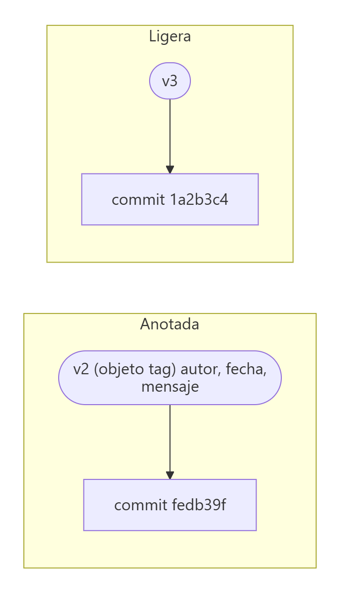
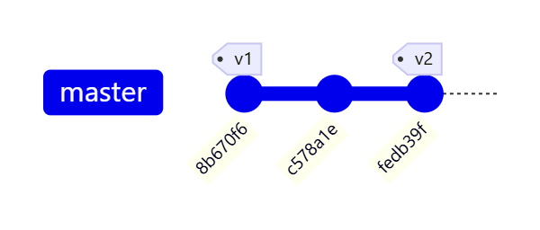
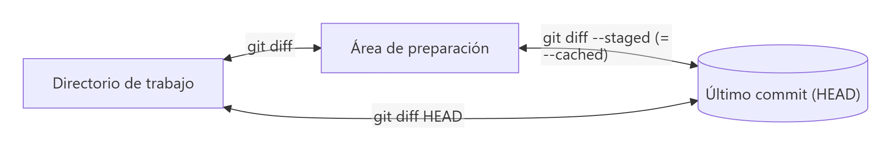

# Etiquetar commits y ver diferencias

> **Autor:** Martín Gil Blanco  
> **Curso:** Control de versiones con Git en contextos académicos y profesionales  
> **Tema 4** · Última revisión: octubre de 2026

---

## Índice

- [1. Introducción](#1-introducción)
- [2. Etiquetas: `git tag`](#2-etiquetas-git-tag)
  - [2.1. Tipos de etiquetas](#21-tipos-de-etiquetas)
  - [2.2. Práctica: etiquetar commits](#22-práctica-etiquetar-el-primer-y-el-tercer-commit)
  - [2.3. Listar, consultar y borrar etiquetas](#23-listar-consultar-y-borrar-etiquetas)
  - [2.4. Usar etiquetas para movernos](#24-usar-etiquetas-para-movernos)
  - [2.5. Compartir etiquetas](#25-compartir-etiquetas)
  - [2.6. Versionado semántico](#26-versionado-semántico)
- [3. Ver los cambios de un commit: `git show`](#3-ver-los-cambios-de-un-commit-git-show)
- [4. Ver diferencias: `git diff`](#4-ver-diferencias-git-diff)
  - [4.1. Entre commits](#41-entre-commits)
  - [4.2. Entre áreas](#42-entre-las-áreas-de-git)
  - [4.3. Cómo leer un diff](#43-cómo-leer-la-salida-de-un-diff)
- [5. `git show` frente a `git diff`](#5-git-show-frente-a-git-diff)
- [6. Comparaciones gráficas: `git difftool`](#6-comparaciones-gráficas-git-difftool)
- [7. Resumen](#7-resumen)
- [Actividad práctica](#actividad-práctica)

---

## 1. Introducción

En este tema veremos tres comandos:

- **`git tag`**: pone **etiquetas** a commits importantes. No se etiquetan todos los commits, solo las *releases* (versiones publicadas) que deseemos.
- **`git show`**: muestra los cambios de **un commit respecto al anterior**.
- **`git diff`**: muestra los cambios **entre dos puntos cualesquiera** (commits, ramas, áreas…).

---

## 2. Etiquetas: `git tag`

### 2.1. Tipos de etiquetas

| Tipo | Cómo se crea | Qué guarda | Uso recomendado |
|---|---|---|---|
| **Anotada** | `git tag -a v1.0 -m "msg"` | Objeto completo en la base de datos: checksum, nombre y correo de quien etiqueta, fecha, mensaje; puede firmarse con GPG | Versiones públicas |
| **Ligera** | `git tag v1.0` | Solo un puntero a un commit (como una rama que no se mueve) | Marcas temporales o privadas |



### 2.2. Práctica: etiquetar el primer y el tercer commit

- El **primer** commit será la **versión 1** → etiqueta `v1`.
- El **tercer** commit será la **versión 2** → etiqueta `v2`.
- El segundo commit no se etiqueta.


Sintaxis:

```bash
git tag -a nombre_etiqueta -m "Mensaje" commit_a_etiquetar
```

En mi caso:

```bash
git tag -a v1 -m "Versión 1" 8b67
git tag -a v2 -m "Versión 2" fedb
```

- `-a` (*annotate*): crea una etiqueta **anotada**.
- `-m`: mensaje de la etiqueta (si no se indica, Git abre el editor).
- Al final, el commit a etiquetar. Si se omite, se etiqueta el commit actual (`HEAD`). Esto permite etiquetar commits **mucho tiempo después** de haberlos creado (*etiquetado tardío*).



### 2.3. Listar, consultar y borrar etiquetas

| Comando | Descripción |
|---|---|
| `git tag` | Lista las etiquetas (orden alfabético) |
| `git tag -l "v1.*"` | Lista las etiquetas que siguen un patrón |
| `git show v1` | Muestra la información de la etiqueta y del commit |
| `git tag -d v2` | Borra una etiqueta **local** |
| `git push origin --delete v2` | Borra una etiqueta del **remoto** |

Si te equivocas al crear una etiqueta, bórrala y vuelve a crearla. Por ejemplo, me equivoqué en el mensaje de `v2`:


```bash
git tag -d v2
git tag -a v2 -m "Versión 2" fedb
```

### 2.4. Usar etiquetas para movernos

Las etiquetas permiten referenciar commits de forma más cómoda que con el hash:

```bash
git checkout v1        # más cómodo que git checkout 8b67
git checkout master    # volver al último commit
```

> ⚠️ Una etiqueta **no se mueve**. Al hacer `checkout` de una etiqueta quedas en *detached HEAD*. Si quieres trabajar a partir de esa versión, crea una rama: `git switch -c version1 v1` (o `git checkout -b version1 v1`).

### 2.5. Compartir etiquetas

Por defecto, **`git push` no envía las etiquetas** al remoto. Hay que hacerlo explícitamente:

```bash
git push origin v1        # una etiqueta concreta
git push origin --tags    # todas las etiquetas que no estén en el remoto
```

En GitHub, las etiquetas aparecen como ***releases*** (ver [Tema 5](05-repositorios-remotos.md)).

### 2.6. Versionado semántico

Una convención muy extendida para nombrar versiones es **SemVer** (`vMAYOR.MENOR.PARCHE`):

| Parte | Se incrementa cuando… | Ejemplo |
|---|---|---|
| **MAYOR** | Hay cambios incompatibles con versiones anteriores | `v1.4.2` → `v2.0.0` |
| **MENOR** | Se añade funcionalidad compatible | `v1.4.2` → `v1.5.0` |
| **PARCHE** | Se corrigen errores | `v1.4.2` → `v1.4.3` |

---

## 3. Ver los cambios de un commit: `git show`


Para ver los cambios introducidos por el commit actual respecto al anterior:

```bash
git show
```

Como en este caso `HEAD`, `master`, `v2` y `fedb` apuntan al mismo commit, estos comandos son equivalentes:

```bash
git show HEAD
git show master
git show fedb
git show v2
```


Se añadió una línea: la que contiene el centro.

- **Las líneas añadidas aparecen en verde y con un signo `+`**.
- **Las líneas eliminadas aparecen en rojo y con un signo `-`**.

Otros ejemplos:

```bash
git show c578    # cambios del 2.º commit respecto al 1.º → aparece añadida la fecha
git show v1      # cambios del 1.er commit respecto al repositorio vacío → aparece el nombre
git show v1:README.md   # contenido completo de README.md en la versión v1
```

> 💡 Si `v1` es una etiqueta **anotada**, `git show v1` muestra primero los datos de la etiqueta (quién la creó, cuándo y su mensaje) y después el commit.

---

## 4. Ver diferencias: `git diff`

### 4.1. Entre commits

Para ver **todos los cambios acumulados a lo largo de varios commits**:

```bash
git diff commit1..commit2
```

Por ejemplo, entre la versión 1 y la versión 2:

```bash
git diff v1..v2
```


Se han añadido 2 líneas desde `v1`.

> 💡 Pon primero el commit **más antiguo** y después el **más moderno**. Si lo haces al revés, los cambios aparecen en rojo (como eliminaciones) y la interpretación es más confusa.

### 4.2. Entre las áreas de Git

`git diff` también compara las distintas áreas. Es muy importante distinguir qué compara cada variante:



| Comando | Compara | Responde a… |
|---|---|---|
| `git diff` | Directorio de trabajo ↔ área de preparación | ¿Qué he cambiado y **aún no he preparado**? |
| `git diff --staged` (o `--cached`) | Área de preparación ↔ último commit | ¿Qué he preparado y **entrará en el próximo commit**? |
| `git diff HEAD` | Directorio de trabajo ↔ último commit | ¿Qué ha cambiado **en total** desde el último commit? |
| `git diff v1` | Directorio de trabajo ↔ commit `v1` | ¿Qué ha cambiado desde la versión 1? |
| `git diff main rama` | Extremo de `main` ↔ extremo de `rama` | ¿En qué se diferencian dos ramas? |
| `git diff -- archivo` | Limita la comparación a un archivo | |

> ⚠️ Si has preparado **todos** tus cambios, `git diff` (sin argumentos) **no muestra nada**. Usa `git diff --staged`.

> ⚠️ `git diff` solo tiene en cuenta archivos **rastreados**: los archivos nuevos sin seguimiento no aparecen (usa `git status`).

### 4.3. Cómo leer la salida de un diff

```diff
diff --git a/README.md b/README.md
index 8ebb991..643e24f 100644
--- a/README.md
+++ b/README.md
@@ -1,2 +1,3 @@
 Martín Gil Blanco
-12 de octubre de 2026
+13 de octubre de 2026
+Mi centro educativo
```

| Parte | Significado |
|---|---|
| `--- a/…` / `+++ b/…` | Versión antigua (`a`) y nueva (`b`) del archivo |
| `@@ -1,2 +1,3 @@` | Bloque (*hunk*): en la versión antigua empieza en la línea 1 y ocupa 2 líneas; en la nueva empieza en la 1 y ocupa 3 |
| Líneas con `-` | Eliminadas |
| Líneas con `+` | Añadidas |
| Líneas sin signo | Contexto (sin cambios) |

Una línea **modificada** aparece como una eliminación seguida de una adición.

---

## 5. `git show` frente a `git diff`

```bash
git show v1..v2
git diff v1..v2
```

| `git show v1..v2` | `git diff v1..v2` |
|---|---|
| Muestra **cada commit por separado** del rango (con autor, fecha, mensaje y su propio diff) | Muestra **un único diff acumulado** entre los dos extremos |
| Útil para revisar **cómo** se llegó de una versión a otra | Útil para ver **qué** cambió en total |

---

## 6. Comparaciones gráficas: `git difftool`

Si has configurado VS Code como herramienta de diferencias ([Tema 0](00-introduccion-y-configuracion.md#64-herramienta-de-diferencias-y-fusión-vs-code)), puedes ver las diferencias de forma visual, con dos paneles:

| Comando | Panel izquierdo | Panel derecho |
|---|---|---|
| `git difftool` | Área de preparación | Directorio de trabajo |
| `git difftool HEAD` | Último commit | Directorio de trabajo |
| `git difftool --staged HEAD` | Último commit | Área de preparación |
| `git difftool HEAD^ HEAD` | Penúltimo commit | Último commit |
| `git difftool d68506f 4b24ff1` | Commit `d68506f` | Commit `4b24ff1` |
| `git difftool origin/main main` | Rama remota | Rama local |
| `git difftool -- README.md` | Limita a un archivo | |

```bash
git difftool --tool-help   # herramientas disponibles en el sistema
```

---

## 7. Resumen

| Comando | Descripción |
|---|---|
| `git tag -a v1 -m "msg" [commit]` | Etiqueta anotada |
| `git tag v1 [commit]` | Etiqueta ligera |
| `git tag` / `git tag -l "patrón"` | Listar etiquetas |
| `git tag -d v1` | Borrar etiqueta local |
| `git push origin --tags` | Subir todas las etiquetas |
| `git show [commit]` | Cambios de un commit respecto a su padre |
| `git diff a..b` | Diferencias acumuladas entre dos commits |
| `git diff` / `--staged` / `HEAD` | Diferencias entre áreas |
| `git difftool` | Diferencias en una herramienta gráfica |

---

## Actividad práctica

1. Etiqueta el primer y el tercer commit como `v1` y `v2`.
2. Ejecuta `git show v1..v2` y `git diff v1..v2`, haz capturas y explica brevemente la diferencia.

Entrega un documento PDF con las capturas de pantalla y las explicaciones pertinentes. No borres el repositorio local: lo usaremos en el siguiente tema.

---

[⬅ Anterior: Revisar commits realizados](03-historial-de-commits.md) · [Índice](README.md) · [Siguiente: Repositorios remotos ➡](05-repositorios-remotos.md)
