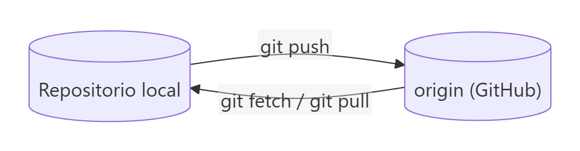
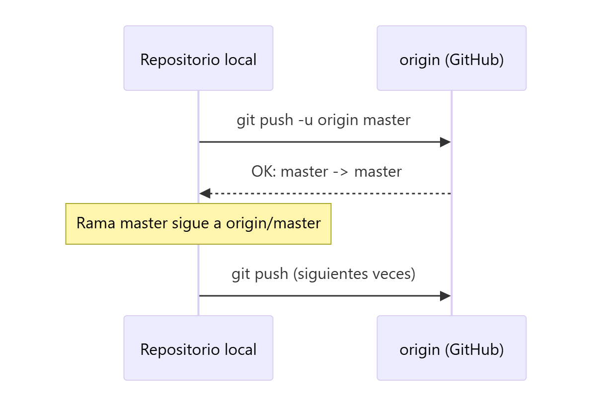
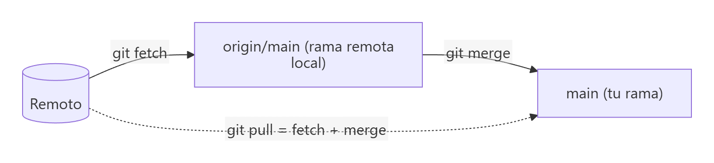
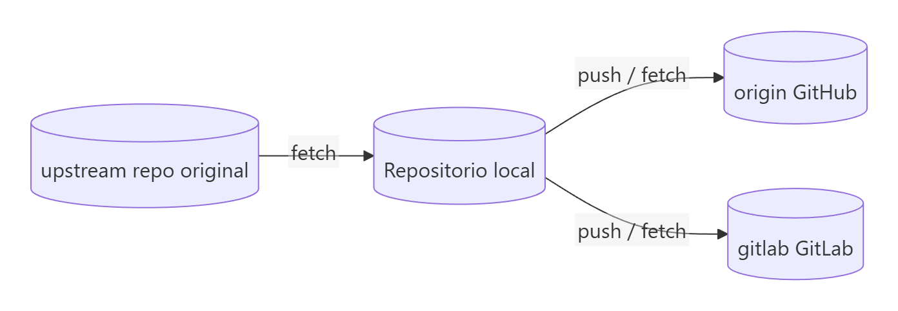
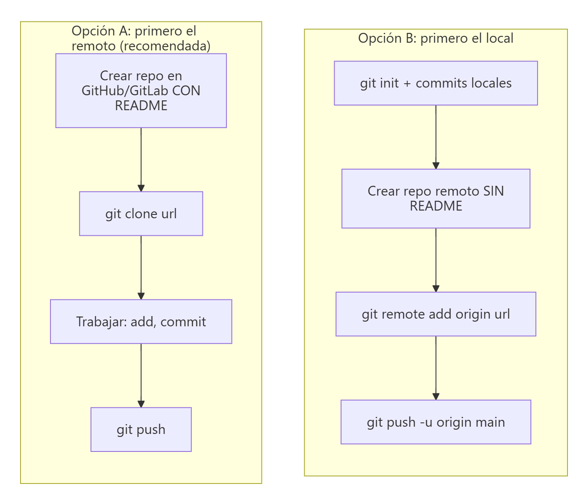

# Repositorios remotos: crear, conectar y subir commits

> **Autor:** Martín Gil Blanco  
> **Curso:** Control de versiones con Git en contextos académicos y profesionales  
> **Tema 5** · Última revisión: octubre de 2026

---

## Índice

- [1. ¿Qué es un repositorio remoto?](#1-qué-es-un-repositorio-remoto)
- [2. Crear un repositorio remoto vacío en GitHub](#2-crear-un-repositorio-remoto-vacío-en-github)
- [3. Crear un repositorio remoto en GitLab](#3-crear-un-repositorio-remoto-en-gitlab)
- [4. Asociar el repositorio local con el remoto](#4-asociar-el-repositorio-local-con-el-remoto)
- [5. Subir los commits: `git push`](#5-subir-los-commits-git-push)
- [6. Subir las etiquetas y ver las *releases*](#6-subir-las-etiquetas-y-ver-las-releases)
- [7. Traer cambios: `git fetch` y `git pull`](#7-traer-cambios-git-fetch-y-git-pull)
- [8. Gestionar remotos](#8-gestionar-remotos)
- [9. Varios remotos en un mismo repositorio](#9-varios-remotos-en-un-mismo-repositorio)
- [10. Las dos formas de empezar](#10-las-dos-formas-de-empezar-un-proyecto-con-remoto)
- [11. Resumen](#11-resumen)
- [Actividad práctica](#actividad-práctica)

---

## 1. ¿Qué es un repositorio remoto?

Un **repositorio remoto** es una versión del proyecto alojada en Internet o en otra red (GitHub, GitLab, Bitbucket, un servidor propio…). Permite:

- Tener una **copia de seguridad** fuera de tu equipo.
- **Colaborar**: cada persona envía (*push*) y trae (*fetch/pull*) cambios.
- Publicar el proyecto.

Un repositorio local puede estar conectado a **uno o varios** remotos, cada uno con un **nombre corto** (por convención, el principal se llama `origin`).



---

## 2. Crear un repositorio remoto vacío en GitHub

Vamos a crear un repositorio **totalmente vacío** en GitHub y subir el contenido de nuestro repositorio local.

1. Entra en tu cuenta de GitHub. En la **esquina superior derecha**, pulsa el signo **+** y luego **New repository**.

   

2. Escoge el nombre del repositorio. No tiene por qué coincidir con el de la carpeta local, aunque es aconsejable para no liarse. Añade una descripción y elige la visibilidad (**Public** o **Private**).

   

3. ⚠️ **NO INICIALICES EL REPOSITORIO** (no marques *Add a README*, *.gitignore* ni *license*). Si el remoto no estuviera vacío, tendría commits que tu repositorio local no tiene y el primer `push` sería rechazado.

4. Pulsa **Create repository**. Aparecerá una página como esta:

   

Ahí se ve la URL del repositorio, con dos formas de acceso:

| Protocolo | Formato de URL | Autenticación |
|---|---|---|
| **HTTPS** | `https://github.com/usuario/repo.git` | Usuario + **token de acceso personal** (o Git Credential Manager) |
| **SSH** | `git@github.com:usuario/repo.git` | Par de claves SSH ([Tema 8](08-claves-ssh.md)) |

De momento usaremos **HTTPS**. Debajo, GitHub indica los comandos a ejecutar en el repositorio local: los vemos en los siguientes apartados.

> 💡 Si el repositorio es para clase, puedes añadir al profesorado como colaborador: **Settings → Collaborators → Add people**.

---

## 3. Crear un repositorio remoto en GitLab

GitLab funciona de forma muy parecida:

1. Crea una cuenta (puedes iniciar sesión con Google). Si te registras así, establece una **contraseña** en *Editar perfil → Contraseña* para poder usar la línea de comandos por HTTPS, o mejor configura SSH.
2. Opcionalmente, cambia el idioma en *Editar perfil → Preferencias → Localización*.
3. Pulsa **Nuevo proyecto → Crear proyecto en blanco**.
4. Indica nombre, descripción y nivel de visibilidad.
5. Para **subir un repositorio local existente**, desmarca *Inicializar repositorio con un README*. Si vas a **clonarlo** directamente, márcalo.

> 📌 En GitLab los repositorios se llaman **proyectos** y las Pull Requests se llaman **Merge Requests**.

---

## 4. Asociar el repositorio local con el remoto

En el repositorio local:

```bash
git remote add origin https://github.com/tu_usuario/pruebas-martin.git
```

- `origin` es el **nombre** con el que identificaremos al remoto. Podríamos poner otro, pero es una convención ampliamente aceptada.

Para comprobar que se ha añadido bien:

```bash
git remote -v
```


Deben aparecer **2 entradas**: una para bajada (**fetch**) y otra para subida (**push**).

> 📝 Si te equivocas al escribir el nombre o la URL, puedes borrar la asociación y volver a crearla, o corregir solo la URL:
>
> ```bash
> git remote remove origin
> git remote set-url origin <nueva-url>
> ```

---

## 5. Subir los commits: `git push`

```bash
git push -u origin master      # o main, según cómo se llame tu rama
```

- `origin`: el remoto al que enviamos.
- `master`/`main`: la rama que enviamos.
- `-u` (`--set-upstream`): establece la rama remota como **rama de seguimiento** (*upstream*). A partir de entonces bastará con escribir `git push` o `git pull` sin más argumentos.

Si usas HTTPS, se pedirán las credenciales. Si todo va bien, se realiza la subida.



> ⚠️ `git push` solo funciona si tienes **permisos de escritura** y **nadie ha subido commits** que tú no tengas. Si no, el envío se rechaza y primero hay que traer e integrar esos cambios (ver [Tema 9](09-resolucion-de-conflictos.md)).

---

## 6. Subir las etiquetas y ver las *releases*

Al actualizar la página de GitHub veremos algo así:


Teníamos 2 versiones etiquetadas (`v1` y `v2`), pero no aparece ninguna *release*: **las etiquetas se suben por separado**.

```bash
git push --tags
```

Refrescamos la página y… *et voilà!*


Pulsa en **commits** para examinar cada commit y en **releases/tags** para ver las versiones. GitHub genera automáticamente archivos comprimidos (`.zip` y `.tar.gz`) con el código fuente de cada etiqueta.

---

## 7. Traer cambios: `git fetch` y `git pull`

| Comando | Qué hace | ¿Modifica tu trabajo? |
|---|---|---|
| `git fetch [remoto]` | Descarga los commits nuevos del remoto y actualiza las **ramas remotas** (`origin/main`…) | **No**: solo actualiza referencias |
| `git pull [remoto] [rama]` | `git fetch` + `git merge` de la rama remota en la rama actual | **Sí**: integra los cambios |



> 💡 Buena práctica: haz **`git pull` antes de empezar a trabajar** y antes de hacer `git push`, para asegurarte de que tienes las últimas modificaciones.

Esto se estudia en profundidad en el [Tema 12](12-ramas-remotas.md).

---

## 8. Gestionar remotos

| Comando | Descripción |
|---|---|
| `git remote` | Lista los nombres de los remotos |
| `git remote -v` | Lista los remotos con sus URL (fetch y push) |
| `git remote add <nombre> <url>` | Añade un remoto |
| `git remote show <nombre>` | Información detallada: URL, ramas remotas, ramas seguidas, qué hace `push`/`pull` |
| `git remote rename <viejo> <nuevo>` | Renombra un remoto (también sus ramas remotas: `pb/main` → `paul/main`) |
| `git remote remove <nombre>` (o `rm`) | Elimina un remoto |
| `git remote set-url <nombre> <url>` | Cambia la URL (por ejemplo, de HTTPS a SSH) |

Ejemplo de `git remote show origin`:

```text
* remote origin
  Fetch URL: https://github.com/tu_usuario/pruebas-martin.git
  Push  URL: https://github.com/tu_usuario/pruebas-martin.git
  HEAD branch: master
  Remote branch:
    master tracked
  Local branch configured for 'git pull':
    master merges with remote master
  Local ref configured for 'git push':
    master pushes to master (up to date)
```

---

## 9. Varios remotos en un mismo repositorio

Un repositorio local puede estar conectado a **varios remotos**, por ejemplo una copia en GitHub y otra en GitLab, o el repositorio original de un proyecto y tu *fork*:

```bash
git remote add origin  git@github.com:tu_usuario/proyecto.git
git remote add gitlab  git@gitlab.com:tu_usuario/proyecto.git
git remote add upstream https://github.com/autor-original/proyecto.git

git push origin main
git push gitlab main
git fetch upstream
```



> 🧪 La [Tarea 1](Apuntes/Tarea%201/Tarea%20de%20Git%20y%20GitHub.md) practica exactamente esto: un repositorio local conectado a dos remotos (`repoA` y `repoB`).

---

## 10. Las dos formas de empezar un proyecto con remoto



Con **`git clone`**, el remoto `origin` y la rama de seguimiento se configuran automáticamente.

---

## 11. Resumen

| Comando | Descripción |
|---|---|
| `git remote add origin <url>` | Conecta el repositorio local con un remoto |
| `git remote -v` | Lista los remotos |
| `git push -u origin main` | Primera subida y configuración de *upstream* |
| `git push` | Subidas posteriores |
| `git push --tags` | Sube las etiquetas |
| `git fetch` | Descarga cambios sin integrarlos |
| `git pull` | Descarga e integra cambios |
| `git clone <url>` | Copia un remoto con todo configurado |

---

## Actividad práctica

1. Crea un repositorio vacío en GitHub, asócialo a tu repositorio local y sube los commits y las etiquetas.
2. En GitHub, haz una captura de la lista de **commits** y otra de las **releases/tags**.

Entrega un documento PDF con las capturas de pantalla y las explicaciones pertinentes. No borres los repositorios: los usaremos en el siguiente tema.

---

[⬅ Anterior: Etiquetas y diferencias](04-etiquetas-y-diferencias.md) · [Índice](README.md) · [Siguiente: Deshacer cambios ➡](06-deshacer-cambios.md)
