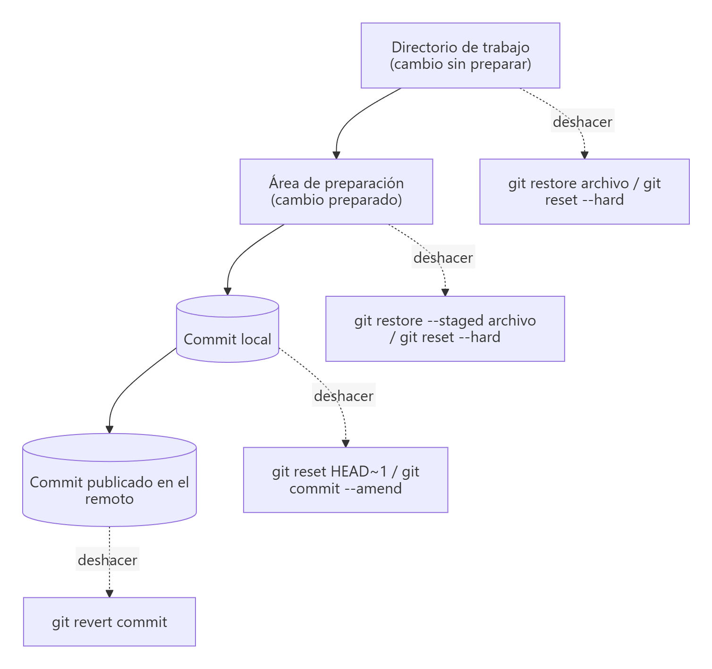
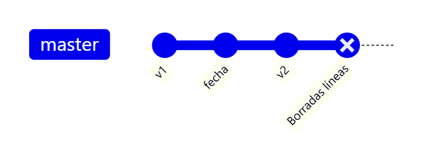
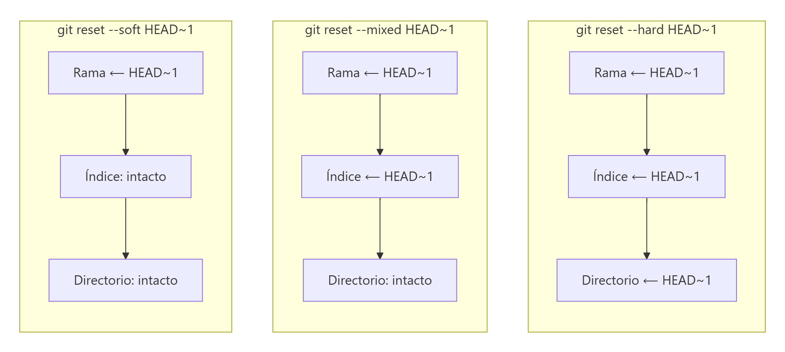
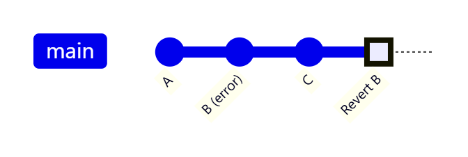

# Deshacer cambios en el repositorio local

> **Autor:** Martín Gil Blanco  
> **Curso:** Control de versiones con Git en contextos académicos y profesionales  
> **Tema 6** · Última revisión: octubre de 2026

---

## Índice

- [1. ¿Qué se puede deshacer?](#1-qué-se-puede-deshacer)
- [2. Deshacer cambios en el directorio de trabajo](#2-deshacer-cambios-en-el-directorio-de-trabajo)
- [3. Deshacer cambios del área de preparación](#3-deshacer-cambios-del-área-de-preparación)
- [4. Deshacer un commit ya realizado](#4-deshacer-un-commit-ya-realizado)
- [5. Los tres modos de `git reset`](#5-los-tres-modos-de-git-reset)
- [6. Corregir el último commit: `--amend`](#6-corregir-el-último-commit---amend)
- [7. Deshacer commits ya publicados: `git revert`](#7-deshacer-commits-ya-publicados-git-revert)
- [8. Recuperar lo "perdido": `git reflog`](#8-recuperar-lo-perdido-git-reflog)
- [9. Eliminar archivos sin seguimiento: `git clean`](#9-eliminar-archivos-sin-seguimiento-git-clean)
- [10. Tabla resumen: ¿qué comando uso?](#10-tabla-resumen-qué-comando-uso)
- [Actividad práctica](#actividad-práctica)

---

## 1. ¿Qué se puede deshacer?

Si hemos "metido la pata", Git ofrece herramientas para deshacer el entuerto según **hasta dónde haya llegado** el error:



> ⚠️ Esta es una de las pocas áreas en las que Git **puede hacerte perder trabajo**. Lo que nunca se ha confirmado (*commit*) y se descarta, normalmente **no se puede recuperar**.

---

## 2. Deshacer cambios en el directorio de trabajo

Estando en el último commit de la rama, modificamos `README.md` y **eliminamos las 2 últimas líneas**:

```bash
nano README.md
```

Debe quedar una sola línea con nuestro nombre. Para ver los cambios:

```bash
git diff HEAD
```

Es decir, las diferencias entre el directorio de trabajo y `HEAD` (el último commit confirmado).

> 📝 Para ver las diferencias respecto a la versión 1 haríamos `git diff v1`. Fíjate en que aquí miramos las diferencias **hacia el pasado** (del directorio de trabajo a un commit antiguo), al contrario que en el tema anterior, donde mirábamos **hacia el futuro** (`git diff v1..v2`).


Se ve claramente que hemos eliminado las 2 últimas líneas. Para restaurar **todos** los archivos modificados del directorio de trabajo:

```bash
git reset --hard
```


Para restaurar **solo un archivo**, sin tocar los demás:

```bash
git restore README.md            # Git 2.23+
git checkout -- README.md        # forma clásica, equivalente
```

> ⚠️ `git restore archivo` y `git checkout -- archivo` **sobrescriben** el archivo con la última versión confirmada. Los cambios que tenías desaparecen para siempre. Úsalo solo si estás seguro.

---

## 3. Deshacer cambios del área de preparación

Imaginemos que, además de modificar el archivo, lo hemos **preparado**:

```bash
nano README.md          # borramos las 2 últimas líneas
git add README.md
```

Tenemos dos opciones:

**a) Sacarlo del área de preparación pero conservar los cambios** en el directorio de trabajo:

```bash
git restore --staged README.md   # Git 2.23+
git reset HEAD README.md         # forma clásica, equivalente
```

El archivo vuelve a estar *modificado* (no preparado). Es una operación **segura**: no toca el directorio de trabajo.

**b) Descartarlo todo** (área de preparación y directorio de trabajo):

```bash
git reset --hard
```

Este comando toma el contenido del último commit y **restaura ambas áreas**.

---

## 4. Deshacer un commit ya realizado

Vamos todavía más lejos: hemos modificado, preparado **y confirmado**:

```bash
nano README.md          # borramos las 2 últimas líneas
git add README.md
git commit -m "Borradas líneas de README.md"
```


También podemos usar `git reset --hard`, indicando a qué commit queremos volver:

```bash
git reset --hard HEAD~1
```


- **`HEAD~1`**: el commit anterior al actual (**un commit hacia atrás**).
- **`HEAD~2`**: **2 commits hacia atrás**.
- **`HEAD~n`**: **n commits hacia atrás**.
- También se puede indicar un hash o una etiqueta: `git reset --hard v2`.



Tras `git reset --hard HEAD~1`, la rama `master` vuelve a apuntar a `v2` y el commit *"Borradas líneas"* deja de formar parte de la rama.

> ⚠️ **Usar `git reset --hard` de esta forma es peligroso**: se pierden el último o los últimos commits **y** los cambios del directorio de trabajo. Asegúrate muy bien de que es lo que quieres. **Nunca** lo hagas sobre commits que ya hayas subido a un remoto compartido: usa [`git revert`](#7-deshacer-commits-ya-publicados-git-revert).

---

## 5. Los tres modos de `git reset`

`git reset <commit>` **mueve la rama actual** (y `HEAD`) al commit indicado. Lo que pasa con el área de preparación y el directorio de trabajo depende del modo:

| Modo | Mueve la rama | Área de preparación | Directorio de trabajo | Uso típico |
|---|---|---|---|---|
| `--soft` | ✅ | Se **conserva** (los cambios de los commits deshechos quedan preparados) | Se conserva | Rehacer los últimos commits en uno solo |
| `--mixed` (por defecto) | ✅ | Se **restaura** al commit (los cambios quedan sin preparar) | Se conserva | Deshacer commits y volver a decidir qué preparar |
| `--hard` | ✅ | Se restaura | Se **restaura** (¡se pierden los cambios!) | Descartarlo todo |



Ejemplos:

```bash
git reset --soft HEAD~3    # junta los 3 últimos commits: quedan preparados para un único commit
git reset HEAD~1           # deshace el último commit; los cambios quedan sin preparar
git reset --hard origin/main   # deja la rama exactamente igual que la remota
```

---

## 6. Corregir el último commit: `--amend`

Uno de los errores más comunes es confirmar demasiado pronto: olvidar un archivo o equivocarse en el mensaje.

```bash
git commit -m "Commit inicial"
git add archivo_olvidado
git commit --amend
```

- Usa el área de preparación actual para **rehacer** el último commit.
- Si no has preparado nada nuevo, solo cambia el **mensaje**: `git commit --amend -m "Mensaje corregido"`.
- El commit corregido **sustituye** al anterior (tiene un hash distinto).

> ⚠️ No uses `--amend` sobre un commit que ya hayas subido a un remoto compartido: estarías reescribiendo historia que otras personas pueden tener.

---

## 7. Deshacer commits ya publicados: `git revert`

Si el commit ya está en el remoto, **no se debe reescribir la historia**. En su lugar, `git revert` crea un **commit nuevo que aplica los cambios inversos**:

```bash
git revert HEAD          # revierte el último commit
git revert a1b2c3d       # revierte un commit concreto
```



| `git reset` | `git revert` |
|---|---|
| Mueve la rama hacia atrás; los commits "desaparecen" de la rama | Añade un commit nuevo que deshace otro |
| Reescribe la historia | No reescribe la historia |
| Solo para commits **locales** no compartidos | Seguro para commits **publicados** |

---

## 8. Recuperar lo "perdido": `git reflog`

Git guarda durante un tiempo (por defecto ~90 días) un registro de **todos los movimientos de `HEAD`**, incluidos los commits que ya no están en ninguna rama:

```bash
git reflog
```

```text
fedb39f HEAD@{0}: reset: moving to HEAD~1
9a8b7c6 HEAD@{1}: commit: Borradas líneas de README.md
fedb39f HEAD@{2}: checkout: moving from v1 to master
```

Para recuperar el commit "perdido" tras un `reset --hard`:

```bash
git reset --hard 9a8b7c6        # volver a él
# o bien, crear una rama que lo conserve:
git branch rescate 9a8b7c6
```

> 💡 Recuerda: **todo lo que ha sido confirmado en Git se puede recuperar** casi siempre, incluso commits de ramas borradas o sustituidos con `--amend`. Lo que nunca se confirmó, no.

---

## 9. Eliminar archivos sin seguimiento: `git clean`

`git reset --hard` no toca los archivos **sin seguimiento**. Para borrarlos:

```bash
git clean -n     # simulación: muestra qué se borraría
git clean -f     # borra los archivos sin seguimiento
git clean -fd    # también las carpetas
```

> ⚠️ `git clean` borra archivos que Git **no tiene guardados**: no se pueden recuperar. Ejecuta siempre antes `git clean -n`.

---

## 10. Tabla resumen: ¿qué comando uso?

| Situación | Comando |
|---|---|
| He modificado un archivo y quiero descartar los cambios | `git restore archivo` |
| He preparado un archivo y quiero sacarlo del índice (sin perder cambios) | `git restore --staged archivo` |
| Quiero descartar **todos** los cambios no confirmados | `git reset --hard` |
| Me he olvidado un archivo o me he equivocado en el mensaje del último commit (no publicado) | `git commit --amend` |
| Quiero deshacer el último commit pero conservar los cambios | `git reset HEAD~1` (o `--soft`) |
| Quiero eliminar el último commit y sus cambios (no publicado) | `git reset --hard HEAD~1` |
| Quiero deshacer un commit **ya publicado** | `git revert <commit>` |
| He perdido un commit tras un reset | `git reflog` + `git reset --hard <hash>` |
| Quiero borrar archivos sin seguimiento | `git clean -n` y después `git clean -f` |

---

## Actividad práctica

Reproduce los tres escenarios de los apartados 2, 3 y 4 (cambio sin preparar, cambio preparado y cambio confirmado) y deshazlos. Después, recupera el commit eliminado con `git reflog`. Entrega un documento PDF con las capturas de pantalla y las explicaciones pertinentes.

---

[⬅ Anterior: Repositorios remotos](05-repositorios-remotos.md) · [Índice](README.md) · [Siguiente: Archivo .gitignore ➡](07-gitignore.md)
