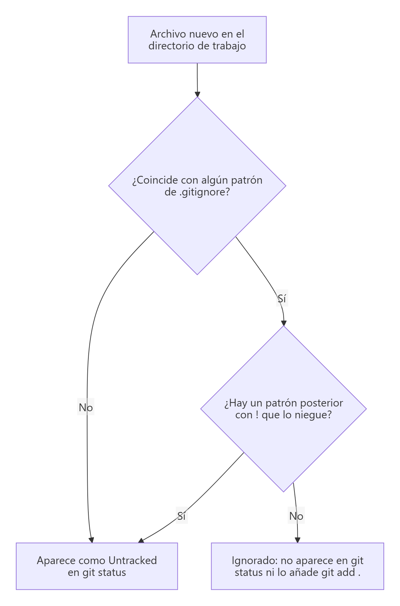

# El archivo `.gitignore`

> **Autor:** Martín Gil Blanco  
> **Curso:** Control de versiones con Git en contextos académicos y profesionales  
> **Tema 7** · Última revisión: octubre de 2026

---

## Índice

- [1. Punto de partida](#1-punto-de-partida)
- [2. Crear una aplicación Java con Gradle](#2-crear-una-aplicación-holamundo-en-java-con-gradle)
- [3. Archivos sin seguimiento y `git diff`](#3-archivos-sin-seguimiento-y-git-diff)
- [4. ¿Qué archivos no deben subirse?](#4-qué-archivos-no-deben-subirse-al-repositorio)
- [5. Sintaxis de `.gitignore`](#5-sintaxis-de-gitignore)
- [6. Crear el `.gitignore` y confirmar](#6-crear-el-gitignore-del-proyecto-y-confirmar)
- [7. Subir los cambios al remoto](#7-subir-los-cambios-al-repositorio-remoto)
- [8. Situaciones habituales](#8-situaciones-habituales)
- [Actividad práctica](#actividad-práctica)

---

## 1. Punto de partida

En este tema trabajaremos con algo más real: una sencilla aplicación Java. Seguimos usando el repositorio de los temas anteriores:

```bash
git log --oneline --all
```


---

## 2. Crear una aplicación HolaMundo en Java con Gradle

```bash
gradle init --type java-application
```


Gradle crea un proyecto con varios archivos.

> 📝 El archivo `README.md` no lo crea Gradle: ya existía en la carpeta.

Para probar la ejecución:

```bash
gradle run
```


Si volvemos a listar, veremos que se ha creado la carpeta `build` con el *bytecode* resultante de la compilación:

```bash
ls -a
tree build
```


---

## 3. Archivos sin seguimiento y `git diff`

Si ahora ejecutamos `git diff HEAD`, esperaríamos ver los cambios del directorio de trabajo respecto al último commit. Sin embargo, **no se muestra nada**. ¿Por qué?

Porque `git diff` solo tiene en cuenta los archivos **con seguimiento** (los que ya estaban en el repositorio). **Los archivos nuevos son archivos sin seguimiento**, y para verlos hay que usar **`git status`**:


Ahora deberíamos añadir los archivos al área de preparación y hacer un commit… **pero espera un momento**.

---

## 4. ¿Qué archivos no deben subirse al repositorio?

Cuando se trabaja con código fuente, hay archivos que **no interesa** añadir al repositorio porque no aportan nada y se pueden regenerar:

| Tipo | Ejemplos |
|---|---|
| Resultados de compilación | `build/`, `target/`, `dist/`, `*.class`, `*.o`, `*.exe` |
| Dependencias descargadas | `node_modules/`, `vendor/`, `.gradle/` |
| Empaquetados | `*.jar`, `*.war`, `*.zip`, `*.rar` |
| Configuración del IDE/sistema | `.idea/`, `.vscode/` (según el caso), `.DS_Store`, `Thumbs.db` |
| Registros y temporales | `*.log`, `*.tmp`, `*~` |
| **Secretos** | `.env`, claves, contraseñas, tokens 🔐 |

Estos archivos **inflan el repositorio**, ralentizan las subidas y bajadas y, en el caso de los secretos, suponen un **riesgo de seguridad**.

Los archivos y carpetas a ignorar se indican en un archivo llamado **`.gitignore`**, situado normalmente en la raíz del repositorio. Cada programador puede añadir o quitar entradas según su proyecto.

En el repositorio <https://github.com/github/gitignore> hay plantillas para muchos lenguajes, herramientas y entornos:

- Java: <https://github.com/github/gitignore/blob/main/Java.gitignore>
- Gradle: <https://github.com/github/gitignore/blob/main/Gradle.gitignore>
- NetBeans: <https://github.com/github/gitignore/blob/main/Global/NetBeans.gitignore>
- VS Code: <https://github.com/github/gitignore/blob/main/Global/VisualStudioCode.gitignore>

> 💡 Al crear un repositorio en GitHub puedes elegir una plantilla de `.gitignore` directamente. También existe <https://www.toptal.com/developers/gitignore> para combinar varias.

---

## 5. Sintaxis de `.gitignore`

Reglas básicas:

- Las **líneas en blanco** y las que empiezan por **`#`** se ignoran (comentarios).
- Se aceptan **patrones *glob*** estándar.
- Un patrón que **termina en `/`** se refiere a un **directorio**.
- Un patrón que **empieza por `/`** solo se aplica en la **raíz** del repositorio (no en subcarpetas).
- Un patrón que **empieza por `!`** **niega** (vuelve a incluir) algo ignorado por una regla anterior.

Patrones *glob*:

| Patrón | Coincide con |
|---|---|
| `*` | Cero o más caracteres (`*.log`) |
| `?` | Exactamente un carácter (`archivo?.txt`) |
| `[abc]` | Uno de los caracteres indicados (`*.[oa]` → `.o` o `.a`) |
| `[0-9]` | Un carácter del rango |
| `**` | Directorios anidados a cualquier profundidad (`a/**/z` → `a/z`, `a/b/z`, `a/b/c/z`) |

Ejemplo comentado:

```gitignore
# Ignora los archivos terminados en .a
*.a

# …pero NO lib.a, aunque se ignoren los .a en la línea anterior
!lib.a

# Ignora únicamente el archivo TODO de la raíz, no subdir/TODO
/TODO

# Ignora todos los archivos del directorio build/
build/

# Ignora doc/notas.txt, pero no doc/servidor/arq.txt
doc/*.txt

# Ignora todos los .txt dentro de doc/ y sus subcarpetas
doc/**/*.txt

# Ignora las clases compiladas de Java
*.class
```



> ⚠️ `.gitignore` solo afecta a archivos **sin seguimiento**. Si un archivo **ya estaba confirmado**, añadirlo a `.gitignore` no hace que Git deje de rastrearlo (ver [apartado 8](#8-situaciones-habituales)).

---

## 6. Crear el `.gitignore` del proyecto y confirmar

Simplificando, vamos a ignorar las carpetas `build` y `.gradle`. El archivo `.gitignore` tendrá este contenido:

```gitignore
build/
.gradle/
```

La barra final es opcional, pero es útil ponerla para distinguir de un vistazo carpetas y archivos.

Si ahora ejecutamos:

```bash
git status
```

ya no aparecen las carpetas `build` ni `.gradle`, y aparece un archivo nuevo: `.gitignore`.


Ahora sí podemos preparar y confirmar:

```bash
git add .
git commit -m "Código fuente inicial"
```

`git add .` añade al área de preparación **todos los archivos del directorio actual** (y subdirectorios), **salvo** los indicados en `.gitignore`. Es la forma habitual cuando no queremos añadir los archivos uno a uno.

> 💡 El propio `.gitignore` **sí se confirma**: así todas las personas del equipo ignoran los mismos archivos.

---

## 7. Subir los cambios al repositorio remoto

```bash
git push
```


Para hacerlo más interesante, creamos una etiqueta en el commit actual y la subimos para que GitHub cree una nueva *release*:

```bash
git tag v3
git push --tags
```


Las etiquetas `v1` y `v2` no se vuelven a subir porque ya estaban en el remoto. También podríamos haber ejecutado:

```bash
git push origin v3
```

Y la historia del repositorio local queda así de bonita:


En GitHub **no** deben aparecer las carpetas `build` ni `.gradle`, y **sí** el archivo `.gitignore`.

> 📝 La carpeta `.git` nunca se muestra en GitHub.

---

## 8. Situaciones habituales

### Dejar de rastrear un archivo que ya estaba confirmado

```bash
echo "config.local" >> .gitignore
git rm --cached config.local        # lo quita del índice, pero lo deja en el disco
git commit -m "Deja de rastrear config.local"
```

Para una carpeta entera: `git rm -r --cached build/`.

> 🔐 Si el archivo contenía **secretos** (contraseñas, tokens…), seguirán en el **historial** aunque lo dejes de rastrear. Considera esas credenciales comprometidas y **cámbialas**.

### Comprobar por qué se ignora un archivo

```bash
git check-ignore -v build/app.class
```

```text
.gitignore:1:build/    build/app.class
```

### Ver los archivos ignorados

```bash
git status --ignored
```

### Ignorar archivos solo en tu equipo

| Mecanismo | Alcance | ¿Se comparte? |
|---|---|---|
| `.gitignore` (en el repositorio) | Ese repositorio | ✅ Sí (se confirma) |
| `.git/info/exclude` | Ese repositorio, solo en tu copia | ❌ No |
| `core.excludesFile` (global) | Todos tus repositorios | ❌ No |

```bash
git config --global core.excludesFile ~/.gitignore_global
```

Útil para archivos del sistema operativo o de tu editor (`.DS_Store`, `Thumbs.db`…).

### Mantener una carpeta vacía en el repositorio

Git no rastrea carpetas vacías. La convención es crear dentro un archivo vacío llamado `.gitkeep`.

---

## Actividad práctica

1. Crea el proyecto Gradle, el archivo `.gitignore` y haz el commit *"Código fuente inicial"*.
2. Crea la etiqueta `v3` y súbela.
3. Haz una captura de las *releases* en GitHub y otra de los archivos subidos (no deben aparecer `build` ni `.gradle`).

Entrega un documento PDF con las capturas de pantalla y las explicaciones pertinentes.

---

[⬅ Anterior: Deshacer cambios](06-deshacer-cambios.md) · [Índice](README.md) · [Siguiente: Claves SSH ➡](08-claves-ssh.md)
