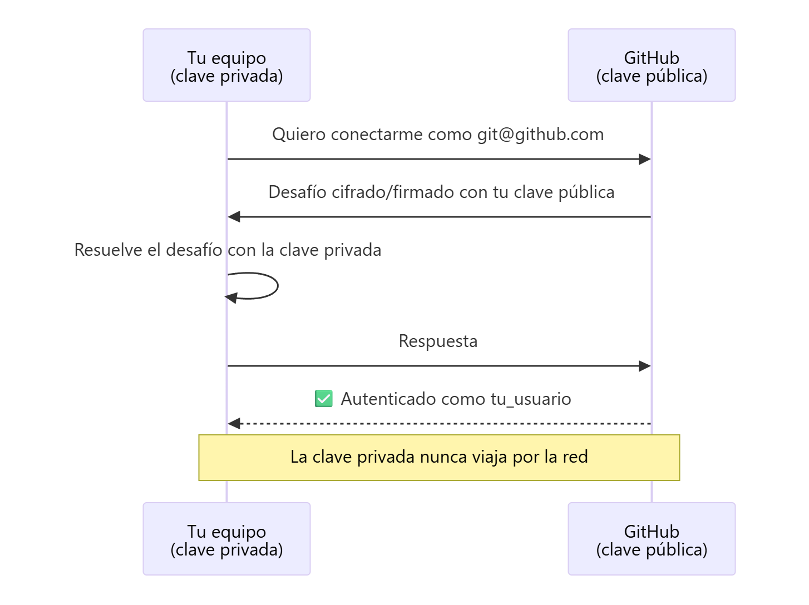
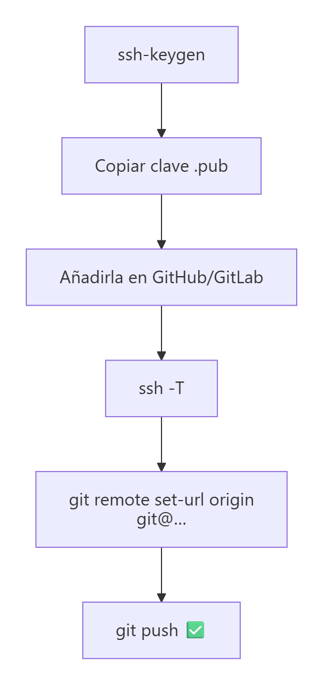

# Autenticación con un par de claves SSH

> **Autor:** Martín Gil Blanco  
> **Curso:** Control de versiones con Git en contextos académicos y profesionales  
> **Tema 8** · Última revisión: octubre de 2026

---

## Índice

- [1. ¿Por qué SSH?](#1-por-qué-ssh)
- [2. Cómo funciona un par de claves](#2-cómo-funciona-un-par-de-claves)
- [3. Comprobar si ya existen claves](#3-comprobar-si-ya-existen-claves)
- [4. Generar un par de claves](#4-generar-un-par-de-claves)
- [5. Añadir la clave pública a GitHub](#5-añadir-la-clave-pública-a-github)
- [6. Añadir la clave pública a GitLab](#6-añadir-la-clave-pública-a-gitlab)
- [7. Comprobar la conexión](#7-comprobar-la-conexión)
- [8. Usar SSH en un repositorio](#8-usar-ssh-en-un-repositorio)
- [9. El agente SSH](#9-el-agente-ssh-opcional)
- [10. Problemas frecuentes](#10-problemas-frecuentes)
- [11. Resumen](#11-resumen)
- [Actividad práctica](#actividad-práctica)

---

## 1. ¿Por qué SSH?

Git permite dos tipos de acceso a un repositorio remoto: **HTTPS** y **SSH**.

| | HTTPS | SSH |
|---|---|---|
| URL | `https://github.com/usuario/repo.git` | `git@github.com:usuario/repo.git` |
| Autenticación | Usuario + **token de acceso personal** | **Par de claves** pública/privada |
| ¿Pide credenciales en cada `push`? | Sí, salvo que se usen cachés o gestores de credenciales | **No** |
| Seguridad | Buena (el token puede revocarse) | Muy buena (la clave privada nunca sale del equipo) |

Con HTTPS, cada operación de escritura en un repositorio privado pide autenticarse, lo que resulta molesto. Además, **desde agosto de 2021 GitHub no admite la contraseña de la cuenta** para operaciones Git.

Con **SSH**, la autenticación se hace automáticamente con la clave privada guardada en el equipo. Si alguien accediera a tu PC y robara la clave, bastaría con **eliminar la clave pública de GitHub**: tu usuario y contraseña nunca se verían comprometidos.

---

## 2. Cómo funciona un par de claves

Un par de claves SSH está formado por dos archivos que **se complementan**; uno sin el otro no sirve de nada:

| Archivo | Clave | ¿Se comparte? |
|---|---|---|
| `id_ed25519` | **Privada** | ❌ **Nunca** debe salir de tu equipo |
| `id_ed25519.pub` | **Pública** | ✅ Se sube a GitHub/GitLab |



Tipos de clave:

| Tipo | Comentario |
|---|---|
| **ED25519** | Recomendada: más moderna, segura y con claves cortas |
| **RSA** | Muy compatible; si se usa, con al menos 4096 bits |

---

## 3. Comprobar si ya existen claves

```bash
ls -al ~/.ssh
```

Por defecto, las claves públicas se llaman `id_ed25519.pub`, `id_rsa.pub` o `id_ecdsa.pub`. Puedes usar una existente o generar una nueva.

---

## 4. Generar un par de claves

Como usuario normal (sin ser *root*):

```bash
ssh-keygen -t ed25519 -C "tu_correo@ejemplo.com"
```

- `-t ed25519`: tipo de clave.
- `-C`: comentario para identificar la clave (opcional; suele ponerse el correo).

Si tu sistema no admite ED25519:

```bash
ssh-keygen -t rsa -b 4096 -C "tu_correo@ejemplo.com"
```

Durante la generación:

1. **Ruta del archivo**: pulsa Intro para aceptar la ruta por defecto (`~/.ssh/id_ed25519`). Si ya existe un par de claves, preguntará si quieres sobrescribirlo (*Overwrite (y/n)?*).
2. ***Passphrase***: puedes dejarla vacía (Intro) o, mejor, poner una frase de contraseña que protege la clave privada si alguien la roba.

Captura de ejemplo (con clave RSA):


Se crea la carpeta **`~/.ssh`** con, al menos, 2 archivos: la clave privada y la pública. Copia el **contenido de la clave pública**, que necesitarás después:

```bash
cat ~/.ssh/id_ed25519.pub
```


Debe copiarse completa: `ssh-ed25519 AAAA… tu_correo@ejemplo.com` (o `ssh-rsa AAAA… usuario@equipo` si es RSA).

> 💡 En Windows (Git Bash) puedes copiarla directamente al portapapeles con `clip < ~/.ssh/id_ed25519.pub`.

---

## 5. Añadir la clave pública a GitHub

1. Inicia sesión en GitHub. En el menú del avatar (esquina superior derecha), selecciona **Settings**.

   

2. En el menú de la izquierda, elige **SSH and GPG keys**.

   

3. Pulsa el botón **New SSH key**.

   

4. Rellena los campos:
   - **Title**: un nombre descriptivo (por ejemplo, `portatil-casa`).
   - **Key type**: *Authentication Key*.
   - **Key**: pega el contenido de la clave pública.
5. Pulsa **Add SSH key**.

   

La clave sirve para **todos tus repositorios**. Puedes ver la lista de claves y **eliminar** cualquiera si sospechas que se ha comprometido:


---

## 6. Añadir la clave pública a GitLab

1. Copia el contenido de la clave pública.
2. Inicia sesión en GitLab → avatar → **Editar perfil** (*Preferences*).
3. Pulsa **Claves SSH** (*SSH Keys*) → **Añadir nueva clave**.
4. Pega la clave, asígnale un **título descriptivo** y, opcionalmente, una **fecha de caducidad**.
5. Pulsa **Añadir clave**.

---

## 7. Comprobar la conexión

```bash
ssh -T git@github.com
ssh -T git@gitlab.com
```

La **primera vez** que te conectas a un servidor, SSH pide verificar su autenticidad:


```text
The authenticity of host 'github.com (140.82.121.4)' can't be established.
ED25519 key fingerprint is SHA256:+DiY3wvvV6TuJJhbpZisF/zLDA0zPMSvHdkr4UvCOqU.
Are you sure you want to continue connecting (yes/no/[fingerprint])? yes
```

Escribe **`yes`**. El servidor queda registrado en el archivo **`~/.ssh/known_hosts`** y las siguientes veces no se vuelve a preguntar.

> 🔐 Puedes comprobar que la huella coincide con la publicada oficialmente por GitHub en su documentación (*GitHub's SSH key fingerprints*).

Si todo va bien:

```text
Hi tu_usuario! You've successfully authenticated, but GitHub does not provide shell access.
```

---

## 8. Usar SSH en un repositorio

### 8.1. Obtener la URL SSH

En la página del repositorio, pulsa **Code → SSH** y copia la URL.


Su formato es fácil de recordar: siempre **`git@github.com:`** seguido de **`usuario/repositorio.git`**.

### 8.2. Clonar por SSH

```bash
git clone git@github.com:tu_usuario/tu_repositorio.git
```

### 8.3. Cambiar un repositorio existente de HTTPS a SSH

Nuestro repositorio local estaba asociado a `origin` mediante HTTPS. Podemos borrar el enlace y crear uno nuevo:

```bash
git remote remove origin
git remote add origin git@github.com:tu_usuario/tu_repositorio.git
```


O, en un solo paso:

```bash
git remote set-url origin git@github.com:tu_usuario/tu_repositorio.git
```

### 8.4. Probar con un commit

Modificamos `README.md` poniendo al principio de cada línea el símbolo `>` y un espacio (formato de cita en Markdown):

```markdown
> Martín Gil Blanco
> 13 de octubre de 2026
> Mi centro educativo
```

```bash
git add README.md
git commit -m "Añadida cita"
git push -u origin master
```

Esta vez **no se piden usuario ni contraseña**: la conexión se autentica con la clave SSH.



---

## 9. El agente SSH (opcional)

Si has puesto *passphrase* a tu clave, el **agente SSH** la recuerda durante la sesión para no tener que escribirla en cada operación:

```bash
eval "$(ssh-agent -s)"          # inicia el agente
ssh-add ~/.ssh/id_ed25519       # añade la clave (pide la passphrase una vez)
ssh-add -l                      # lista las claves cargadas
```

---

## 10. Problemas frecuentes

| Error | Causa probable | Solución |
|---|---|---|
| `Permission denied (publickey)` | La clave pública no está en la cuenta o se usa otra clave | Revisa que la `.pub` esté añadida; prueba `ssh -vT git@github.com` para ver qué clave se ofrece |
| `Host key verification failed` | No se aceptó la huella o cambió | Vuelve a conectar con `ssh -T` y acepta; si cambió, revisa `~/.ssh/known_hosts` |
| `Could not open a connection to your authentication agent` | El agente no está iniciado | `eval "$(ssh-agent -s)"` |
| Sigue pidiendo usuario/contraseña | El remoto sigue en HTTPS | `git remote -v` y `git remote set-url origin git@…` |

---

## 11. Resumen

| Comando | Descripción |
|---|---|
| `ls -al ~/.ssh` | Ver claves existentes |
| `ssh-keygen -t ed25519 -C "correo"` | Generar par de claves |
| `cat ~/.ssh/id_ed25519.pub` | Ver la clave pública |
| `ssh -T git@github.com` | Probar la conexión |
| `git remote set-url origin git@github.com:usuario/repo.git` | Cambiar el remoto a SSH |
| `ssh-add ~/.ssh/id_ed25519` | Cargar la clave en el agente |

---

## Actividad práctica

1. Genera un par de claves, añade la pública a GitHub y comprueba la conexión con `ssh -T`.
2. Cambia el remoto de tu repositorio a SSH, haz el commit *"Añadida cita"* y súbelo sin introducir credenciales.

Entrega un documento PDF con las capturas de pantalla y las explicaciones pertinentes.

---

[⬅ Anterior: Archivo .gitignore](07-gitignore.md) · [Índice](README.md) · [Siguiente: Resolviendo conflictos ➡](09-resolucion-de-conflictos.md)
