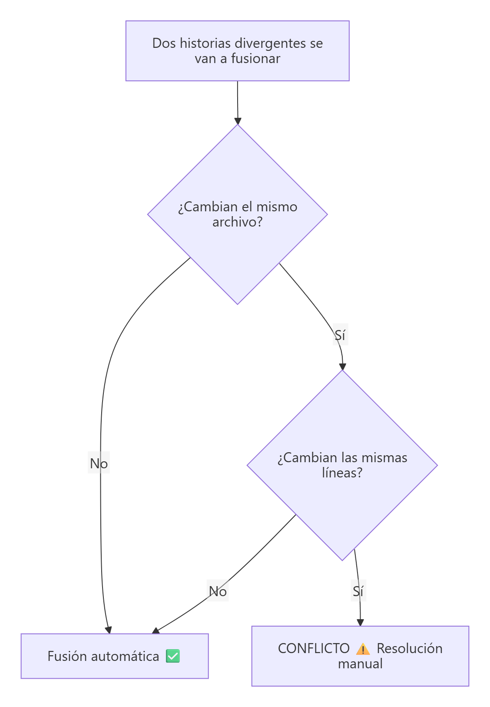
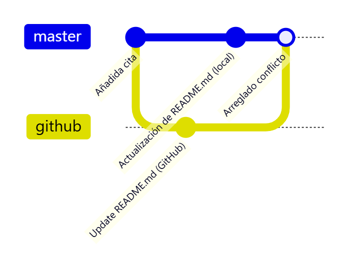
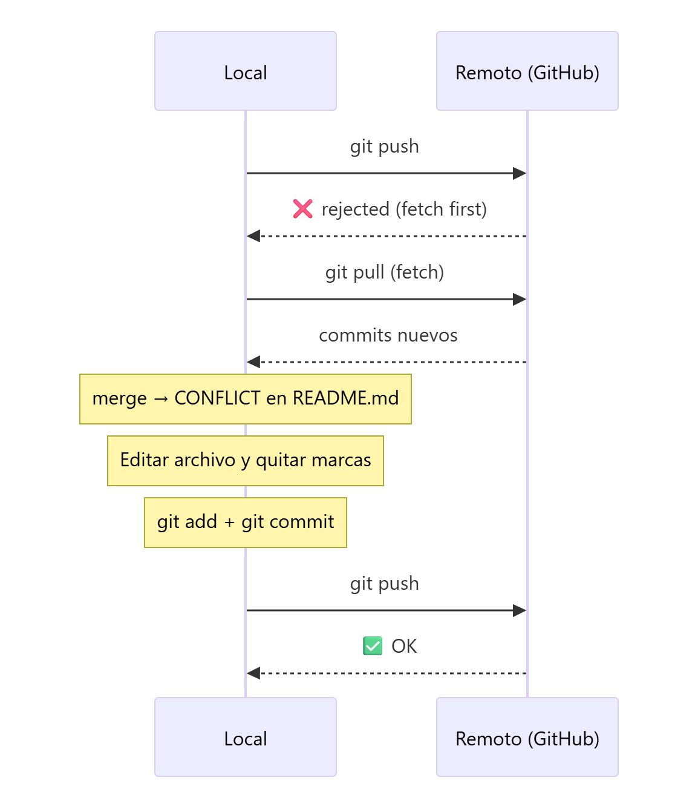

# Resolución de conflictos

> **Autor:** Martín Gil Blanco  
> **Curso:** Control de versiones con Git en contextos académicos y profesionales  
> **Tema 9** · Última revisión: octubre de 2026

---

## Índice

- [1. ¿Qué es un conflicto?](#1-qué-es-un-conflicto)
- [2. Práctica: provocar un conflicto entre local y remoto](#2-práctica-provocar-un-conflicto-entre-local-y-remoto)
  - [2.1. Modificar `README.md` en GitHub](#21-modificar-readmemd-en-el-repositorio-remoto)
  - [2.2. Modificar `README.md` en local](#22-modificar-readmemd-en-el-repositorio-local)
  - [2.3. Intentar subir el commit](#23-intentar-subir-el-commit-local)
  - [2.4. `git pull` y aparición del conflicto](#24-git-pull-y-aparición-del-conflicto)
  - [2.5. Resolver el conflicto](#25-resolver-el-conflicto)
- [3. Marcadores de conflicto](#3-marcadores-de-conflicto)
- [4. Herramientas para resolver conflictos](#4-herramientas-para-resolver-conflictos)
- [5. Abortar una fusión](#5-abortar-una-fusión)
- [6. Cómo evitar conflictos](#6-cómo-evitar-conflictos)
- [7. Resumen](#7-resumen)
- [Actividad práctica](#actividad-práctica)

---

## 1. ¿Qué es un conflicto?

Un mismo repositorio puede tener copias en distintos sitios: en GitHub, en tu PC, en el PC de un compañero… Git sabe **fusionar automáticamente** cambios hechos en paralelo siempre que afecten a **archivos distintos** o a **zonas distintas** de un mismo archivo.

Se produce un **conflicto** cuando se hacen commits que modifican **las mismas líneas del mismo archivo** en copias (o ramas) distintas y Git **no puede decidir** con qué versión quedarse.



Los conflictos pueden aparecer en:

- `git pull` (que incluye un `git merge`), al integrar cambios del remoto — **este tema**.
- `git merge` entre ramas locales ([Tema 11](11-fusion-de-ramas.md)).
- `git rebase` ([Tema 13](13-rebase.md)) y `git stash pop` ([Tema 14](14-stash.md)).

---

## 2. Práctica: provocar un conflicto entre local y remoto

Vamos a hacer un commit en el repositorio de GitHub y otro en el repositorio local, ambos sobre `README.md` y en la misma línea.



> 📝 En el diagrama, la línea `github` representa el commit hecho en el remoto (`origin/master`).

### 2.1. Modificar `README.md` en el repositorio remoto

En GitHub, entra en el repositorio, pulsa sobre `README.md` y después en el **lápiz** para editar.


**Inserta una primera línea con un título (`#`) y modifica la línea de la fecha**.


Registra el commit pulsando **Commit changes**. Puedes escribir un mensaje y una descripción, aunque no es obligatorio: GitHub propone uno por defecto.


### 2.2. Modificar `README.md` en el repositorio local

En local, **añade una línea al final** y **modifica también la línea de la fecha**:

```bash
nano README.md
```


```bash
git add README.md
git commit -m "Actualización de README.md"
```


### 2.3. Intentar subir el commit local

```bash
git push
```


El envío se **rechaza** (*rejected — fetch first*).

> 📌 **Esto todavía no es un conflicto**. Git simplemente indica que el remoto tiene commits que tú no tienes y que debes **integrarlos antes** de poder subir los tuyos.

### 2.4. `git pull` y aparición del conflicto

```bash
git pull
```

`git pull` = `git fetch` (descarga los commits del remoto) + `git merge` (los fusiona con tu rama).

Esto **no tendría por qué** provocar un conflicto. Pero en este caso **sí**, porque se ha modificado **el mismo archivo y la misma línea** (la de la fecha) en ambos lados. Git realiza la fusión de lo que puede y avisa del conflicto:


```text
Auto-merging README.md
CONFLICT (content): Merge conflict in README.md
Automatic merge failed; fix conflicts and then commit the result.
```

En este momento, `git status` muestra el archivo en la sección **`Unmerged paths`** (*both modified*).

> 💡 Desde Git 2.27, si es la primera vez que haces `git pull` con historias divergentes, Git puede pedirte que elijas estrategia. Para el comportamiento clásico (fusión) configura: `git config --global pull.rebase false`.

### 2.5. Resolver el conflicto

Abre el archivo. En la zona en conflicto verás unas **marcas** especiales:


**Resolver el conflicto consiste en dejar el contenido correcto y eliminar las marcas**. Puedes:

- Quedarte con tu versión.
- Quedarte con la versión del remoto.
- Combinar ambas o escribir algo distinto (aquí he puesto otra fecha).


Guarda el archivo y **marca el conflicto como resuelto** añadiéndolo al área de preparación; después confirma:

```bash
git add README.md
git commit -m "Arreglado conflicto en README.md"
```


Ahora sí podemos subir el commit:

```bash
git push
```




---

## 3. Marcadores de conflicto

```text
<<<<<<< HEAD
Línea o líneas de TU versión (rama actual / commit local)
=======
Línea o líneas de la versión que se está fusionando (remoto / otra rama)
>>>>>>> a1b2c3d (o nombre de la rama)
```

| Marcador | Significado |
|---|---|
| `<<<<<<< HEAD` | Comienzo de la versión de la **rama actual** |
| `=======` | Separador entre ambas versiones |
| `>>>>>>> …` | Fin de la versión **entrante** (la que se fusiona) |

> ⚠️ Antes de hacer `git add`, comprueba que **no queda ningún marcador** en el archivo. Puedes buscarlos con `git diff --check` o `grep -n "<<<<<<<" archivo`.

Opciones rápidas para quedarse entera con una de las dos versiones de un archivo:

```bash
git checkout --ours   README.md   # tu versión
git checkout --theirs README.md   # la versión entrante
git add README.md
```

---

## 4. Herramientas para resolver conflictos

| Herramienta | Uso |
|---|---|
| **Cualquier editor de texto** | Editar a mano y borrar los marcadores |
| **VS Code** | Resalta los conflictos y ofrece botones: *Accept Current Change*, *Accept Incoming Change*, *Accept Both Changes*, *Compare Changes* |
| **`git mergetool`** | Abre la herramienta de fusión configurada ([Tema 0](00-introduccion-y-configuracion.md#64-herramienta-de-diferencias-y-fusión-vs-code)) para cada archivo en conflicto |
| **GitHub** | En una Pull Request con conflictos sencillos, botón *Resolve conflicts* |

```bash
git mergetool
```

---

## 5. Abortar una fusión

Si el conflicto es complicado y prefieres volver al estado anterior al `pull`/`merge`:

```bash
git merge --abort
```

---

## 6. Cómo evitar conflictos

- **Evita editar directamente en GitHub** si trabajas también en local.
- Empieza el día con **`git pull`** y termínalo con **`git push`**: cuanto más tiempo pase sin sincronizar, más probabilidad de conflicto.
- Haz **commits pequeños y frecuentes**.
- Trabaja en **ramas** ([Tema 10](10-creacion-de-ramas.md)) e intégralas a menudo.
- Coordínate con el equipo para no editar las mismas zonas de los mismos archivos a la vez.

---

## 7. Resumen

| Paso | Comando |
|---|---|
| Push rechazado | `git pull` |
| Ver archivos en conflicto | `git status` |
| Editar y quitar marcadores | Editor / `git mergetool` |
| Marcar como resuelto | `git add <archivo>` |
| Cerrar la fusión | `git commit` |
| Subir | `git push` |
| Cancelar la fusión | `git merge --abort` |

---

## Actividad práctica

Reproduce el conflicto del [apartado 2](#2-práctica-provocar-un-conflicto-entre-local-y-remoto), resuélvelo y súbelo. Entrega un documento PDF con las capturas de pantalla y las explicaciones pertinentes.

---

[⬅ Anterior: Claves SSH](08-claves-ssh.md) · [Índice](README.md) · [Siguiente: Creación de ramas ➡](10-creacion-de-ramas.md)
