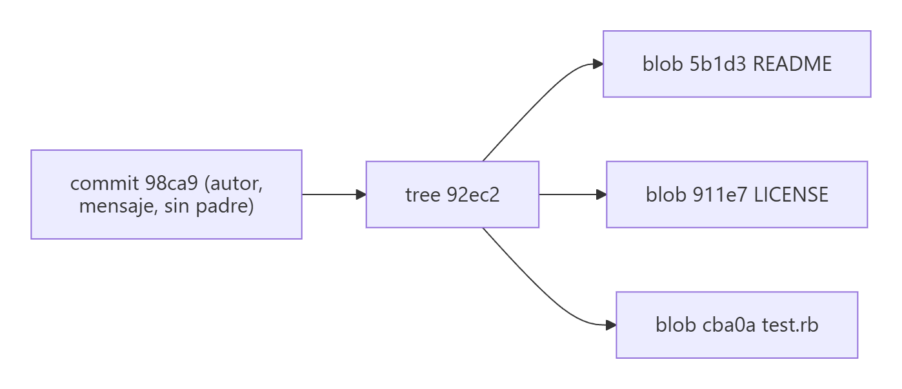
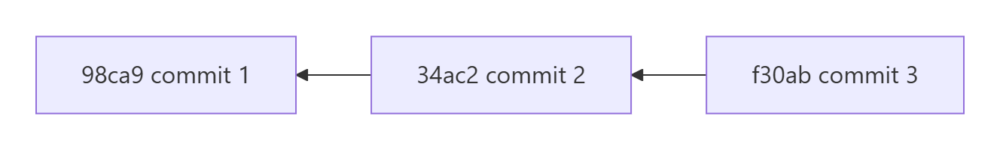
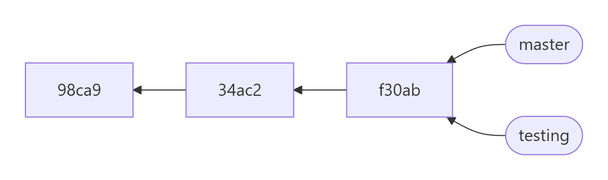
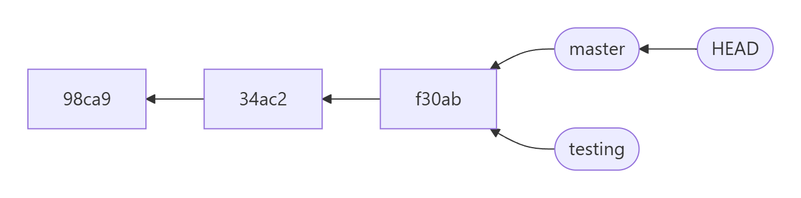
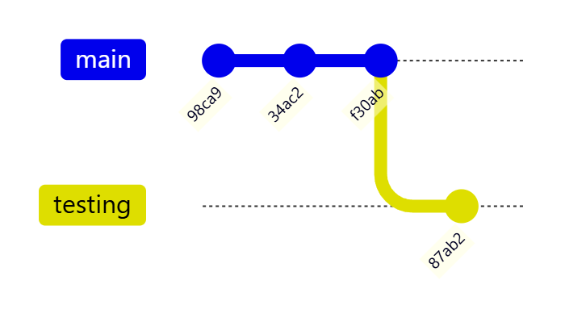
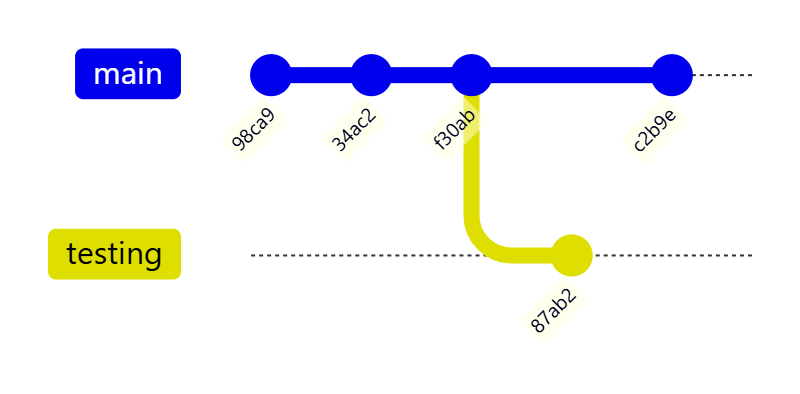
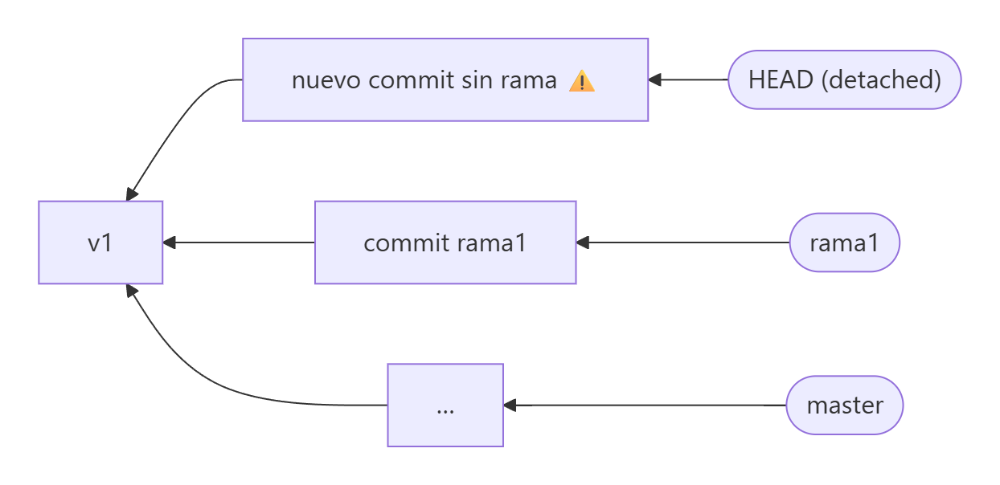
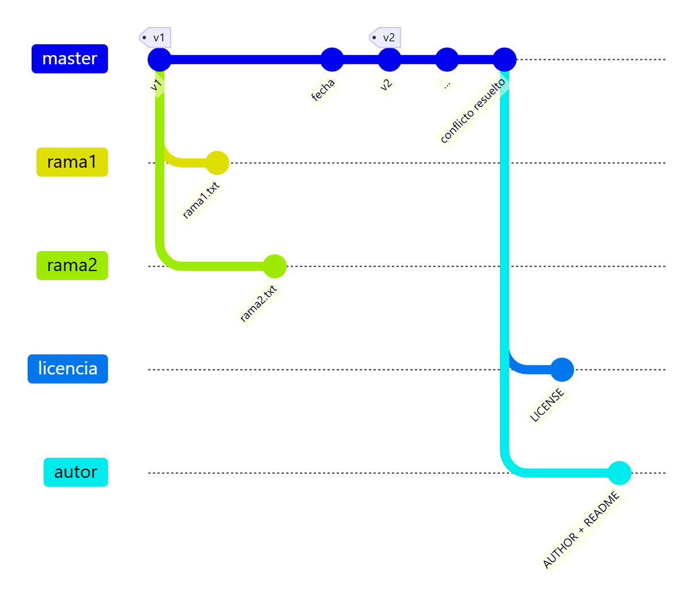

# Ramas: concepto y creación

> **Autor:** Martín Gil Blanco  
> **Curso:** Control de versiones con Git en contextos académicos y profesionales  
> **Tema 10** · Última revisión: octubre de 2026

---

## Índice

- [1. ¿Qué es una rama?](#1-qué-es-una-rama)
  - [1.1. Cómo guarda Git un commit](#11-cómo-guarda-git-un-commit)
  - [1.2. Una rama es un puntero móvil](#12-una-rama-es-un-puntero-móvil)
  - [1.3. HEAD: ¿en qué rama estoy?](#13-head-en-qué-rama-estoy)
  - [1.4. Cambiar de rama](#14-cambiar-de-rama)
  - [1.5. Historias divergentes](#15-historias-divergentes)
- [2. ¿Para qué sirven las ramas?](#2-para-qué-sirven-las-ramas)
- [3. Estado inicial del repositorio](#3-estado-inicial-del-repositorio)
- [4. Crear ramas con `git checkout -b`](#4-crear-ramas-con-git-checkout--b-o-git-switch--c)
- [5. Crear ramas con `git branch`](#5-crear-ramas-con-git-branch)
- [6. Subir ramas al repositorio remoto](#6-subir-ramas-al-repositorio-remoto)
- [7. Otros comandos de gestión de ramas](#7-otros-comandos-de-gestión-de-ramas)
- [8. Resumen](#8-resumen)
- [Actividad práctica](#actividad-práctica)

---

## 1. ¿Qué es una rama?

Una rama es un **desarrollo paralelo dentro del mismo repositorio**, que puede empezar en cualquier commit. El modelo de ramas es la característica más potente de Git: crear una rama o cambiar de rama es **casi instantáneo**, porque internamente una rama es solo un **archivo de 41 bytes** con el hash de un commit.

### 1.1. Cómo guarda Git un commit

Cuando confirmas, Git guarda varios **objetos**:

| Objeto | Contenido |
|---|---|
| **blob** | El contenido de cada archivo |
| **tree** (árbol) | La estructura del directorio: qué nombre tiene cada blob y en qué carpeta está |
| **commit** | Puntero al árbol raíz + autor, confirmador, mensaje + puntero(s) al **commit padre** |



Cada commit apunta a su **padre** (el anterior). Un commit normal tiene un padre; el primero no tiene ninguno y un commit de **fusión** tiene dos o más.



### 1.2. Una rama es un puntero móvil

Una rama es simplemente un **apuntador móvil** a uno de esos commits. La rama por defecto se llama `master` o `main`. Cada vez que confirmas, **la rama avanza automáticamente** al nuevo commit.

Crear una rama nueva solo crea **un puntero nuevo**:

```bash
git branch testing
```



### 1.3. HEAD: ¿en qué rama estoy?

Git usa un puntero especial llamado **`HEAD`** que apunta a la **rama local en la que estás**. `git branch` crea la rama, pero **no te cambia a ella**:



### 1.4. Cambiar de rama

```bash
git checkout testing     # o: git switch testing
```

Este comando hace **dos cosas**:

1. Mueve `HEAD` para que apunte a la rama `testing`.
2. **Actualiza el directorio de trabajo** con los archivos de esa rama.

> ⚠️ Si tienes cambios sin confirmar que entrarían en conflicto con la rama de destino, Git **no te dejará cambiar**. Confírmalos o guárdalos con `git stash` ([Tema 14](14-stash.md)).

Si ahora confirmas en `testing`, solo avanza `testing`; `master` se queda donde estaba:



### 1.5. Historias divergentes

Si vuelves a `master` y haces otro commit, las dos ramas **divergen**: cada una tiene trabajo que la otra no tiene. Más adelante podrás **fusionarlas** ([Tema 11](11-fusion-de-ramas.md)).



```bash
git log --oneline --decorate --graph --all
```

---

## 2. ¿Para qué sirven las ramas?

Las dos finalidades principales son:

- **Hacer cambios sin afectar a la rama principal** (o a cualquier otra): experimentos, pruebas, nuevas funcionalidades.
- **Hacer cambios e integrarlos después** en la rama principal cuando estén listos.

Por seguridad, es habitual trabajar en otras ramas e integrar después en `master`/`main`. Es común tener, por ejemplo, una rama de **producción** y otra de **desarrollo**. Existen **flujos de trabajo** en los que casi no se crean commits directamente en la rama principal: solo se integran commits de otras ramas ([Tema 15](15-flujos-de-trabajo.md)).

---

## 3. Estado inicial del repositorio

En este tema usaremos dos métodos para crear ramas:

- **`git checkout -b nueva-rama`** (o `git switch -c nueva-rama`)
- **`git branch nueva-rama`** y después **`git checkout nueva-rama`** (o `git switch nueva-rama`)

Primero comprobamos el estado del repositorio:

```bash
git log --oneline --all --graph
```

La opción **`--graph`** dibuja las ramas de forma "gráfica".


Aparece también "otra rama" sin nombre con el commit `b0ef` *Update README.md*. En realidad es el commit que editamos en GitHub en el [Tema 9](09-resolucion-de-conflictos.md) y que fusionamos en `master` antes de volver a subirlo.

---

## 4. Crear ramas con `git checkout -b` (o `git switch -c`)

Este comando tiene esencialmente dos formas:

| Comando | Efecto |
|---|---|
| `git checkout -b nueva-rama` | Crea la rama **en el commit actual** y se cambia a ella |
| `git checkout -b nueva-rama commit-de-partida` | Crea la rama **en el commit indicado** y se cambia a ella |

Equivalentes modernos (Git 2.23+): `git switch -c nueva-rama [commit-de-partida]`.

Vamos a crear dos ramas, `rama1` y `rama2`, a partir del **primer commit** (etiquetado como `v1`).

### 4.1. `rama1`: forma directa

```bash
git checkout -b rama1 v1
```

En `rama1` creamos un nuevo commit:


El resultado es:


### 4.2. `rama2`: el despiste del *detached HEAD*

Imaginemos que, por despiste, nos movemos al commit `v1` con:

```bash
git checkout v1
```


Como indica el mensaje, estamos en modo **despegado** (*detached HEAD*). Podemos hacer commits sin afectar a `master`, **pero ninguna rama los apunta**.

Lo aconsejable sería ejecutar ahora `git checkout -b rama2`, porque después se nos podría olvidar y, al cambiar de rama, **perderíamos** los commits realizados. Vamos a simular que se nos olvida y hacemos un commit:


```bash
git log --oneline --all --graph
```


No hay ningún puntero de rama en ese commit. Si ahora ejecutáramos `git checkout master`, el commit quedaría **huérfano** (solo recuperable con `git reflog`).



Para no perderlo, creamos la rama **en ese momento**:

```bash
git checkout -b rama2
```


Ahora ya podemos cambiar de rama sin miedo a perder el commit.

> ⚠️ Asegúrate de haber ejecutado el comando anterior antes de continuar.

---

## 5. Crear ramas con `git branch`

| Comando | Efecto |
|---|---|
| `git branch nueva-rama` | Crea la rama en el commit actual, pero **NO** se cambia a ella |
| `git branch nueva-rama commit-de-partida` | Crea la rama en el commit indicado, pero **NO** se cambia a ella |

Después siempre hay que hacer `git checkout` (o `git switch`) para trabajar en la nueva rama.

Desde la rama actual (`rama2`), creamos dos ramas, `licencia` y `autor`, a partir de `master`:

```bash
git branch licencia master
git branch autor    master
```


Para trabajar en `licencia`:

```bash
git checkout licencia
```

Con `git log --oneline --all --graph` vemos que **`HEAD`** apunta ahora a `licencia`:


### 5.1. Trabajo en la rama `licencia`

Creamos un archivo `LICENSE` con la línea **GPL v3** y confirmamos:

```bash
nano LICENSE
git add LICENSE
git commit -m "Nuevo archivo LICENSE"
```

### 5.2. Trabajo en la rama `autor`

```bash
git checkout autor
```

Creamos un archivo `AUTHOR` con la línea **MARTÍN GIL BLANCO**:

```bash
nano AUTHOR
```

Además, en `README.md`, cambiamos la línea de nuestro nombre para ponerla **toda en mayúsculas**. La finalidad es preparar una fusión de 3 vías que veremos en el siguiente tema.

```bash
git add AUTHOR README.md
git commit -m "Nuevo archivo AUTHOR y editado README.md"
```

El resultado de `git log --oneline --all --graph` es:


Esquema de las ramas tras este tema:



---

## 6. Subir ramas al repositorio remoto

Para subir **una** rama concreta:

```bash
git push origin licencia
git push -u origin licencia     # y además establecer el seguimiento
```

Para subir los cambios de **todas** las ramas:

```bash
git push origin --all
```


Todos los apuntadores a **ramas remotas** se actualizan (aparecen en rojo en la captura):


En **GitHub**, dentro del repositorio, se puede ver un gráfico de las ramas en **Insights → Network**:


---

## 7. Otros comandos de gestión de ramas

| Comando | Descripción |
|---|---|
| `git branch` | Lista las ramas locales (`*` marca la actual) |
| `git branch -v` | Ramas locales con el último commit de cada una |
| `git branch -vv` | Además, la rama remota que sigue cada una y si va por delante/detrás |
| `git branch -a` | Ramas locales **y remotas** |
| `git branch -r` | Solo ramas remotas |
| `git branch -m viejo nuevo` | **Renombra** una rama |
| `git branch -M main` | Renombra la rama actual a `main` (forzando) |
| `git branch -d rama` | Borra una rama fusionada ([Tema 11](11-fusion-de-ramas.md)) |
| `git branch --merged` / `--no-merged` | Ramas fusionadas / sin fusionar en la actual |
| `git switch -` | Vuelve a la rama anterior |

> ⚠️ No se puede borrar la rama en la que estás: primero cámbiate a otra.

---

## 8. Resumen

| Comando | Crea la rama | Se cambia a ella |
|---|---|---|
| `git branch rama [inicio]` | ✅ | ❌ |
| `git checkout rama` / `git switch rama` | ❌ | ✅ |
| `git checkout -b rama [inicio]` / `git switch -c rama [inicio]` | ✅ | ✅ |

- Una rama es un **puntero móvil** a un commit; `HEAD` indica la rama actual.
- Cambiar de rama **cambia el directorio de trabajo**.
- Si haces commits en *detached HEAD*, crea una rama antes de salir para no perderlos.

---

## Actividad práctica

Crea las ramas `rama1`, `rama2`, `licencia` y `autor` tal como se describe y súbelas con `git push origin --all`. Haz una captura del gráfico **Insights → Network** de GitHub. Entrega un documento PDF con las capturas de pantalla y las explicaciones pertinentes. No borres los repositorios: los usaremos en el siguiente tema.

---

[⬅ Anterior: Resolviendo conflictos](09-resolucion-de-conflictos.md) · [Índice](README.md) · [Siguiente: Fusión y eliminación de ramas ➡](11-fusion-de-ramas.md)
