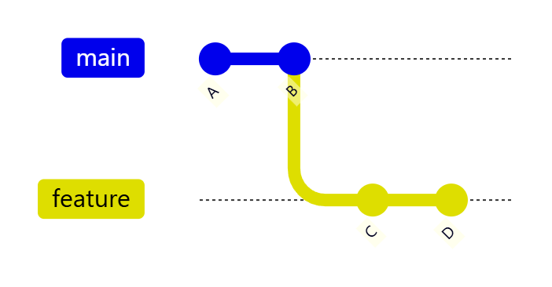
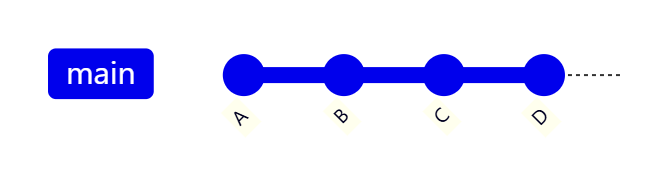
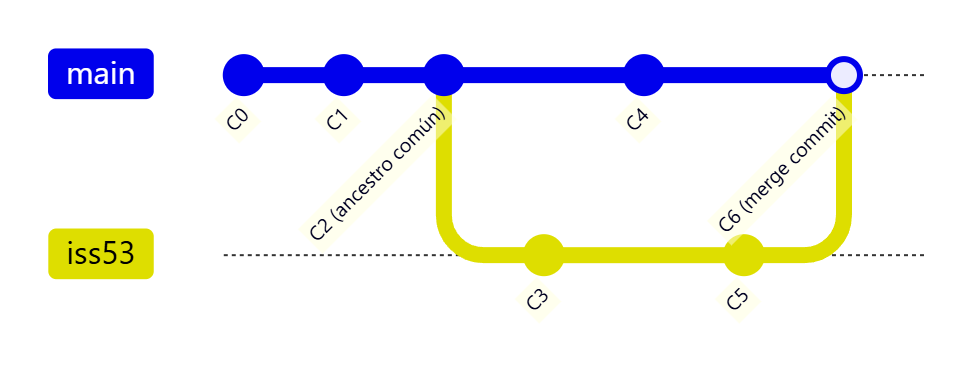
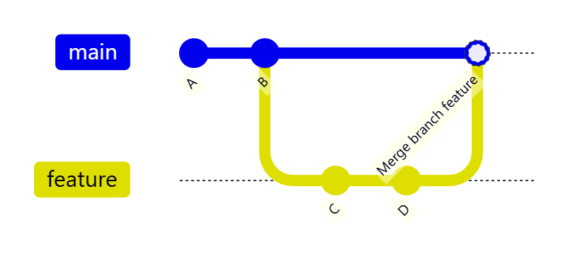
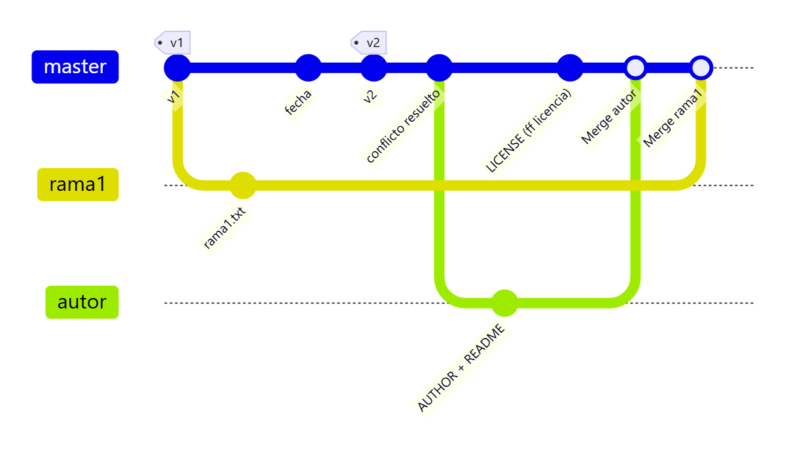
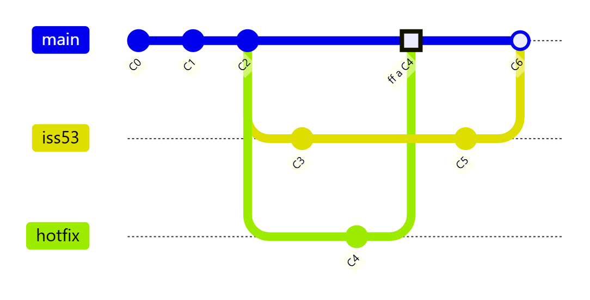

# Fusión y eliminación de ramas

> **Autor:** Martín Gil Blanco  
> **Curso:** Control de versiones con Git en contextos académicos y profesionales  
> **Tema 11** · Última revisión: octubre de 2026

---

## Índice

- [1. Introducción](#1-introducción)
- [2. Tipos de fusión](#2-tipos-de-fusión)
  - [2.1. Avance rápido (*fast-forward*)](#21-fusión-con-avance-rápido-fast-forward)
  - [2.2. Fusión de 3 vías (*3-way merge*)](#22-fusión-de-3-vías-3-way-merge)
  - [2.3. Fusión deshabilitando el *fast-forward*](#23-fusión-deshabilitando-el-fast-forward---no-ff)
- [3. Eliminar una rama local](#3-eliminar-una-rama-local)
- [4. Práctica: fusionar ramas locales](#4-práctica-fusionar-ramas-locales)
- [5. Subir los cambios al remoto](#5-subir-los-cambios-al-repositorio-remoto)
- [6. Eliminar apuntadores a ramas locales](#6-eliminar-apuntadores-a-ramas-locales)
- [7. Eliminar ramas remotas](#7-eliminar-ramas-remotas)
- [8. Comprobar los cambios en GitHub](#8-comprobar-los-cambios-en-github)
- [9. Ejemplo completo: hotfix e iss53](#9-ejemplo-completo-hotfix-e-iss53)
- [10. Resumen](#10-resumen)
- [Actividad práctica](#actividad-práctica)

---

## 1. Introducción

Este tema continúa el anterior. Veremos cómo **fusionar ramas** (*merge*) y cómo **eliminar** apuntadores a ramas que ya no necesitamos.

Supondremos que hemos trabajado en las ramas `rama1`, `rama2`, `licencia` y `autor` y que llega el momento de:

- **Desechar** el trabajo de `rama2`.
- **Integrar** en `master` las ramas `rama1`, `licencia` y `autor`.

Para fusionar se usa:

```bash
git merge <rama-a-integrar>
```

> ⚠️ **Regla de oro**: primero te sitúas en la rama que **recibe** los cambios y después ejecutas `git merge` con la rama que quieres **traer**.

---

## 2. Tipos de fusión

### 2.1. Fusión con avance rápido (*fast-forward*)

Se produce cuando la rama actual **no ha avanzado** desde que se creó la otra rama, es decir, hay un camino **lineal** desde la rama actual hasta la rama a fusionar. Git no necesita crear un commit nuevo: **solo mueve el puntero** hacia delante.



Tras `git checkout main && git merge feature`, `main` simplemente avanza hasta `D`:



- Es la fusión más sencilla y **nunca produce conflictos**.
- **No queda rastro** en el historial de que existió una rama.

### 2.2. Fusión de 3 vías (*3-way merge*)

Se produce cuando **ambas ramas han avanzado** en paralelo. Git usa **tres instantáneas**:

1. El extremo de la rama actual.
2. El extremo de la rama a fusionar.
3. El **ancestro común** de ambas (*merge base*), que Git localiza automáticamente.

Con ellas crea un **nuevo commit de fusión** (*merge commit*) que tiene **dos padres**.



- **Puede producir conflictos** si ambas ramas modifican las mismas líneas de los mismos archivos ([Tema 9](09-resolucion-de-conflictos.md)).
- Git abre el editor para el mensaje del commit de fusión (puedes aceptarlo o pasarlo con `-m`).

### 2.3. Fusión deshabilitando el *fast-forward* (`--no-ff`)

A veces interesa **conservar en el historial** que existió una rama y cuándo se integró, aunque fuera posible un avance rápido. Para ello:

```bash
git merge --no-ff feature
```

Git crea siempre un commit de fusión con dos padres.



| `git merge` (fast-forward) | `git merge --no-ff` |
|---|---|
| Historial lineal | Historial con "burbuja" de la rama |
| No queda constancia de la rama | Queda constancia de la rama y de la fusión |
| No crea commit | Crea un commit de fusión |

> 💡 Otras opciones: `git merge --ff-only` (solo fusiona si es posible el avance rápido; si no, falla) y `git merge --squash` (junta todos los cambios de la rama en un único commit nuevo, sin commit de fusión).

---

## 3. Eliminar una rama local

```bash
git branch -d rama
```

Vamos a borrar `rama2`:

```bash
git branch -d rama2
```

**No se ejecuta** la eliminación: los cambios de `rama2` no se han integrado en `master` ni en ninguna otra rama, y Git nos protege de perderlos. Para **forzar** el borrado:

```bash
git branch -D rama2
```

Así se pierden todas las modificaciones de esa rama (salvo recuperación con `git reflog`).


| Comando | Comportamiento |
|---|---|
| `git branch -d rama` | Borra **solo si está fusionada** (seguro) |
| `git branch -D rama` | Borra **siempre** (equivale a `--delete --force`) |
| `git branch --merged` | Lista las ramas ya fusionadas en la actual (se pueden borrar con `-d`) |
| `git branch --no-merged` | Lista las ramas con trabajo sin fusionar |

---

## 4. Práctica: fusionar ramas locales

Orden de trabajo:

1. Cambiar a la rama `master`.
2. Fusionar `licencia`.
3. Fusionar `autor`.
4. Fusionar `rama1`.

### 4.1. Cambiar a la rama `master`

Es **MUY IMPORTANTE** cambiar a `master`. Si no, las fusiones se harían sobre `autor` (la rama en la que estamos).

```bash
git checkout master
```

### 4.2. Fusionar `licencia` (*fast-forward*)

```bash
git log --oneline --all --graph
```


Fusionar `licencia` en `master` equivale a **mover los apuntadores `HEAD` y `master` hacia arriba** hasta `licencia`: es un **fast-forward**.

```bash
git merge licencia
```


Tras la fusión, solo se han movido `HEAD` y `master`:


> 📝 No te preocupes por los apuntadores remotos (en rojo): los sincronizaremos más adelante.

### 4.3. Fusionar `autor` (3 vías)

Ahora la rama a fusionar está **en paralelo** con `master` (ambas han avanzado desde su ancestro común), así que se hace una **fusión de 3 vías**.

En `README.md`, la línea del nombre es distinta en `master` y en `autor` (en mayúsculas).

```bash
git merge autor
```

Cuando aparezca el editor con el mensaje, lo aceptamos o lo editamos.


En este caso **no hubo conflicto**: Git lo resolvió automáticamente a favor de `autor`, porque desde el ancestro común **solo `autor` había modificado esa línea**. El nombre aparecerá en mayúsculas.

Se ha creado un **nuevo commit** resultado de unir `autor` y `master`. Esto **siempre** ocurre en la fusión de 3 vías.


> 💡 Git compara cada rama con el **ancestro común**: si solo una de las dos cambió una línea, se queda con ese cambio. Solo hay conflicto cuando **ambas** cambian la misma zona de forma distinta.

### 4.4. Fusionar `rama1` (3 vías)

También es una fusión de 3 vías. No habrá conflicto, porque en `rama1` solo se modificó `rama1.txt`, que no existe en `master`.

```bash
git merge rama1
```


Historial resultante:



---

## 5. Subir los cambios al repositorio remoto

```bash
git push origin --all
```


---

## 6. Eliminar apuntadores a ramas locales

```bash
git branch -d rama1
```

Como `rama1` ya está fusionada en `master`, se borra sin problema. Mantenemos `licencia` y `autor` por si queremos seguir trabajando en ellas.


> 💡 Borrar una rama fusionada **no borra ningún commit**: solo elimina la etiqueta/puntero. Los commits siguen en el historial de `master`.

---

## 7. Eliminar ramas remotas

```bash
git push origin --delete rama1
git push origin --delete rama2
```


Mantenemos `origin/licencia` y `origin/autor`.

```bash
git log --oneline --all --graph
```

Las ramas están actualizadas y sincronizadas con el remoto:


> 💡 Si un compañero borró ramas en el remoto, tus referencias `origin/…` seguirán apareciendo hasta que hagas `git fetch --prune` (ver [Tema 12](12-ramas-remotas.md)).

---

## 8. Comprobar los cambios en GitHub

En **Insights → Network**:


---

## 9. Ejemplo completo: hotfix e iss53

Este escenario, clásico del libro *Pro Git*, resume todo lo visto. Trabajas en una incidencia (`iss53`) y llega un error urgente en producción:

```bash
git checkout -b iss53          # 1. empiezas a trabajar en la incidencia 53
# … editas y confirmas C3 …
git checkout main              # 2. ¡error urgente! vuelves a main (directorio limpio)
git checkout -b hotfix         # 3. rama para el arreglo
# … editas y confirmas C4 …
git checkout main
git merge hotfix               # 4. fast-forward: main avanza a C4
git branch -d hotfix           # 5. hotfix ya no hace falta
git checkout iss53             # 6. vuelves a la incidencia
# … confirmas C5 …
git checkout main
git merge iss53                # 7. fusión de 3 vías → C6
git branch -d iss53
```



> 📝 Mermaid dibuja la fusión de `hotfix` como un commit; en realidad, al ser *fast-forward*, `main` simplemente pasa a apuntar a `C4`.

---

## 10. Resumen

| Comando | Descripción |
|---|---|
| `git merge rama` | Fusiona `rama` en la rama actual (ff o 3 vías) |
| `git merge --no-ff rama` | Fuerza un commit de fusión |
| `git merge --ff-only rama` | Solo fusiona si es posible el avance rápido |
| `git merge --squash rama` | Junta los cambios en un único commit |
| `git merge --abort` | Cancela una fusión con conflictos |
| `git branch -d rama` / `-D rama` | Borra una rama local (segura / forzada) |
| `git branch --merged` / `--no-merged` | Ramas fusionadas / sin fusionar |
| `git push origin --delete rama` | Borra una rama remota |
| `git push origin --all` | Sube todas las ramas |

---

## Actividad práctica

1. Realiza las fusiones del [apartado 4](#4-práctica-fusionar-ramas-locales) y elimina las ramas indicadas (local y remotamente).
2. **Tarea propuesta**:
   - Vuelve a la rama `licencia`, añade contenido a `LICENSE` y haz commit.
   - Vuelve a la rama `autor`, añade contenido a `AUTHOR` y haz commit.
   - Integra los cambios de ambas ramas en `master`.

Entrega un documento PDF con las capturas de pantalla y las explicaciones pertinentes.

---

[⬅ Anterior: Creación de ramas](10-creacion-de-ramas.md) · [Índice](README.md) · [Siguiente: Ramas remotas ➡](12-ramas-remotas.md)
