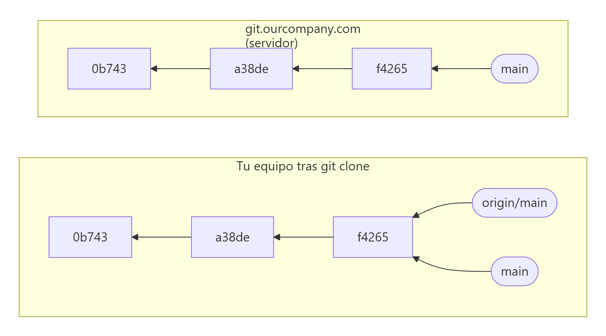
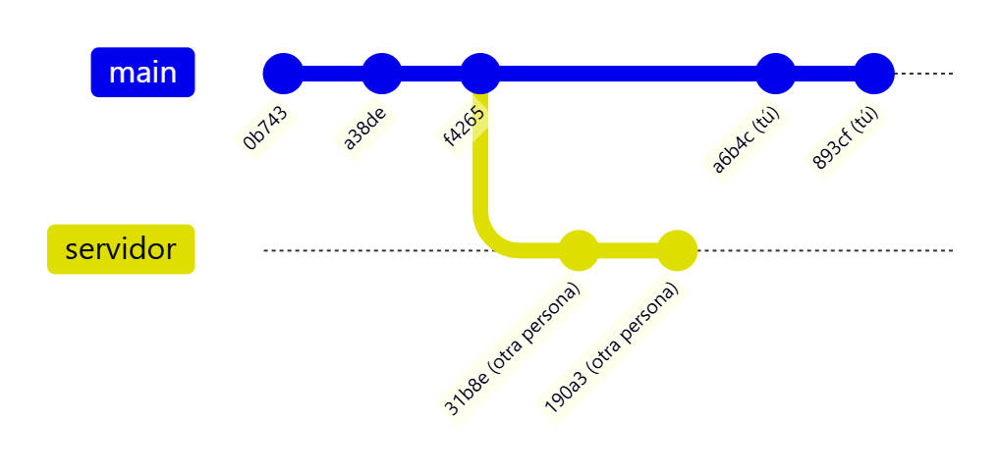
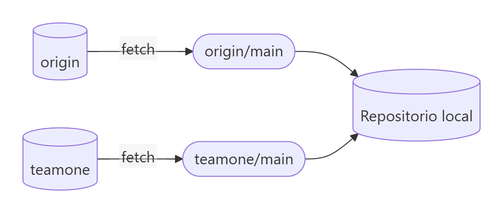
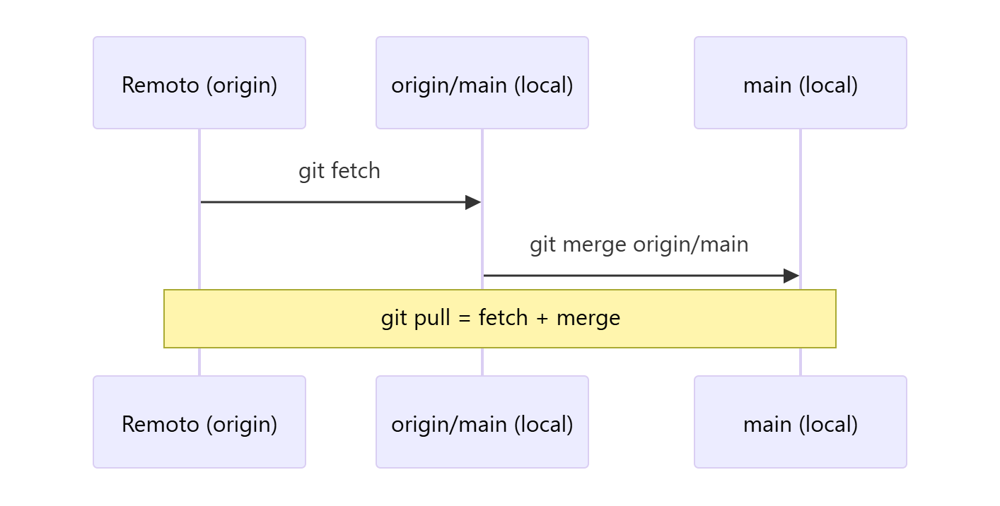

# Ramas remotas y ramas de seguimiento

> **Autor:** Martín Gil Blanco  
> **Curso:** Control de versiones con Git en contextos académicos y profesionales  
> **Tema 12** · Última revisión: octubre de 2026

---

## Índice

- [1. ¿Qué es una rama remota?](#1-qué-es-una-rama-remota)
- [2. Clonar: qué se crea](#2-clonar-qué-se-crea)
- [3. Cuando el trabajo diverge](#3-cuando-el-trabajo-local-y-el-remoto-divergen)
- [4. `git fetch`: sincronizar referencias](#4-git-fetch-sincronizar-referencias)
- [5. Varios remotos](#5-varios-remotos)
- [6. Publicar una rama: `git push`](#6-publicar-una-rama-git-push)
- [7. Ramas de seguimiento (*tracking branches*)](#7-ramas-de-seguimiento-tracking-branches)
- [8. `git pull`: traer y fusionar](#8-git-pull-traer-y-fusionar)
- [9. Eliminar ramas remotas y limpiar referencias](#9-eliminar-ramas-remotas-y-limpiar-referencias)
- [10. Resumen](#10-resumen)
- [Actividad práctica](#actividad-práctica)

---

## 1. ¿Qué es una rama remota?

Las **ramas remotas** (*remote-tracking branches*) son **referencias locales al estado de las ramas en un repositorio remoto**. Tienen la forma:

```text
<remoto>/<rama>        por ejemplo: origin/main, origin/iss53, gitlab/dev
```

- **No puedes moverlas tú directamente**: Git las actualiza automáticamente cada vez que te comunicas con el remoto (`fetch`, `pull`, `push`).
- Son como **marcadores** que te recuerdan dónde estaban las ramas del remoto **la última vez que te conectaste**.

```bash
git branch -r          # lista las ramas remotas
git branch -a          # locales + remotas
git ls-remote origin   # consulta al servidor las referencias actuales
```

---

## 2. Clonar: qué se crea

Al clonar, Git:

1. Nombra al servidor **`origin`**.
2. Descarga todos sus datos y crea la referencia **`origin/main`** apuntando donde está `main` en el servidor.
3. Crea tu rama local **`main`** en el mismo punto, configurada para **seguir** a `origin/main`.



> 📝 `origin` no tiene ningún significado especial: es solo el nombre por defecto. Si clonas con `git clone -o booyah`, la rama remota será `booyah/main`.

---

## 3. Cuando el trabajo local y el remoto divergen

Si tú haces commits en local y otra persona sube commits al servidor, las historias **divergen**. Mientras no te conectes, **`origin/main` no se mueve** en tu equipo.



> 📝 En el diagrama, la línea `servidor` representa los commits que existen en `main` **del servidor**. En tu equipo, `origin/main` sigue apuntando a `f4265` hasta que hagas `git fetch`.

---

## 4. `git fetch`: sincronizar referencias

```bash
git fetch origin
```

- Busca el servidor del remoto.
- **Descarga** los commits que no tienes.
- **Actualiza** `origin/main` (y el resto de ramas remotas) a su nueva posición.
- **No toca** tus ramas locales ni tu directorio de trabajo.

Después puedes **inspeccionar** antes de integrar:

```bash
git log --oneline main..origin/main     # commits del remoto que no tengo
git log --oneline origin/main..main     # commits míos que el remoto no tiene
git diff main origin/main
git merge origin/main                   # integrarlos cuando quieras
```

| Opción | Descripción |
|---|---|
| `git fetch` | Trae del remoto de seguimiento (normalmente `origin`) |
| `git fetch <remoto>` | Trae de un remoto concreto |
| `git fetch --all` | Trae de **todos** los remotos |
| `git fetch --prune` (`-p`) | Además elimina referencias a ramas borradas en el servidor |

---

## 5. Varios remotos

Si añades otro remoto (por ejemplo, el servidor de un equipo):

```bash
git remote add teamone git://git.team1.ourcompany.com
git fetch teamone
```

Se crea la rama remota `teamone/main`. Cada remoto tiene **sus propias** ramas remotas.



---

## 6. Publicar una rama: `git push`

Tus ramas locales **no se sincronizan automáticamente** con los remotos: tienes que enviarlas explícitamente. Así puedes tener ramas privadas y publicar solo las que quieras compartir.

```bash
git push origin serverfix
```

Es una abreviatura de `git push origin refs/heads/serverfix:refs/heads/serverfix`: *"toma mi rama `serverfix` y actualiza con ella la rama `serverfix` del remoto"*. Para publicarla con otro nombre:

```bash
git push origin serverfix:awesomebranch
```

Cuando un compañero haga `git fetch`, obtendrá la referencia `origin/serverfix`, **pero no una rama local editable**. Para trabajar en ella:

```bash
git checkout -b serverfix origin/serverfix   # rama local basada en la remota
# o fusionarla en su rama actual:
git merge origin/serverfix
```

> 🔐 **Credenciales**: si usas HTTPS y no quieres escribirlas en cada `push`, configura un *credential helper* ([Tema 0](00-introduccion-y-configuracion.md#66-caché-de-credenciales-https)) o, mejor, usa SSH ([Tema 8](08-claves-ssh.md)).

---

## 7. Ramas de seguimiento (*tracking branches*)

Una **rama de seguimiento** es una rama local que tiene una relación directa con una rama remota, llamada su ***upstream***. Gracias a ella:

- `git pull` sabe **de dónde traer** y qué fusionar.
- `git push` sabe **adónde enviar**.
- `git status` te dice si vas **por delante** (*ahead*) o **por detrás** (*behind*).

```text
On branch main
Your branch is ahead of 'origin/main' by 2 commits.
  (use "git push" to publish your local commits)
```

### Crear ramas de seguimiento

| Comando | Efecto |
|---|---|
| `git clone` | `main` sigue automáticamente a `origin/main` |
| `git checkout -b serverfix origin/serverfix` | Crea `serverfix` siguiendo a `origin/serverfix` |
| `git checkout --track origin/serverfix` | Atajo del anterior (mismo nombre) |
| `git checkout serverfix` / `git switch serverfix` | Si no existe en local pero sí `origin/serverfix` (en un único remoto), la crea con seguimiento |
| `git checkout -b sf origin/serverfix` | Rama local con **otro nombre** (`sf`) |
| `git branch -u origin/serverfix` | Asigna o cambia el *upstream* de la rama actual |
| `git push -u origin rama` | Publica la rama y la configura para seguir a la remota |

### El atajo `@{u}`

Cuando una rama tiene *upstream*, puedes referirte a él como `@{upstream}` o `@{u}`:

```bash
git merge @{u}        # en lugar de git merge origin/main
git log @{u}..HEAD    # commits pendientes de subir
```

### Ver el seguimiento: `git branch -vv`

```bash
git fetch --all; git branch -vv
```

```text
  iss53     7e424c3 [origin/iss53: ahead 2] forgot the brackets
  main      1ae2a45 [origin/main] deploying index fix
* serverfix f8674d9 [teamone/server-fix-good: ahead 3, behind 1] this should do it
  testing   5ea463a trying something new
```

| Rama | Interpretación |
|---|---|
| `iss53` | Sigue a `origin/iss53` y va **2 commits por delante** (2 commits locales sin subir) |
| `main` | Sigue a `origin/main` y está **al día** |
| `serverfix` | Sigue a `teamone/server-fix-good`: **3 por delante y 1 por detrás** |
| `testing` | **No sigue** a ninguna rama remota |

> ⚠️ Estos números se calculan con la información de la **última vez que hiciste `fetch`**. `git branch -vv` no se conecta al servidor; por eso conviene ejecutar antes `git fetch --all`.

---

## 8. `git pull`: traer y fusionar

`git pull` es, en la mayoría de los casos, **`git fetch` seguido de `git merge`** con el *upstream* de la rama actual.



| Comando | Comportamiento |
|---|---|
| `git pull` | `fetch` + `merge` (por defecto) |
| `git pull --rebase` | `fetch` + `rebase` de tus commits sobre los del remoto ([Tema 13](13-rebase.md)) |
| `git pull --ff-only` | Solo actualiza si es posible un avance rápido |
| `git config --global pull.rebase false` | Fija `merge` como estrategia por defecto |
| `git config --global pull.rebase true` | Fija `rebase` como estrategia por defecto |

> 💡 Muchas veces es más claro usar **`git fetch` y `git merge` por separado**: así ves qué llega antes de integrarlo. La "magia" de `git pull` puede resultar confusa al principio.

---

## 9. Eliminar ramas remotas y limpiar referencias

Cuando una funcionalidad ya está fusionada en la rama estable del remoto, puedes borrar su rama del servidor:

```bash
git push origin --delete serverfix
```

```text
To https://github.com/schacon/simplegit
 - [deleted]         serverfix
```

Esto elimina el **puntero** en el servidor; los datos suelen conservarse un tiempo hasta que se ejecuta el recolector de basura, así que un borrado accidental suele poder recuperarse.

Si otras personas borran ramas en el servidor, en tu equipo seguirán apareciendo las referencias `origin/…` hasta que las limpies:

```bash
git fetch --prune
git remote prune origin     # equivalente
```

Para que se haga siempre al hacer `fetch`:

```bash
git config --global fetch.prune true
```

---

## 10. Resumen

| Comando | Descripción |
|---|---|
| `git branch -r` / `-a` | Ver ramas remotas / todas |
| `git fetch [--all] [--prune]` | Actualizar ramas remotas sin tocar tu trabajo |
| `git push origin rama` | Publicar una rama |
| `git push -u origin rama` | Publicar y establecer seguimiento |
| `git checkout --track origin/rama` | Crear rama local que sigue a la remota |
| `git branch -u origin/rama` | Cambiar el *upstream* |
| `git branch -vv` | Ver seguimiento, *ahead* y *behind* |
| `git pull [--rebase]` | Traer e integrar |
| `git push origin --delete rama` | Borrar rama remota |

---

## Actividad práctica

1. Desde otro directorio, clona tu repositorio (simulando ser otra persona), crea una rama `feature-x`, haz un commit y publícala con `git push -u`.
2. En tu repositorio original ejecuta `git fetch`, observa `git branch -a` y `git branch -vv`, crea una rama local que siga a `origin/feature-x` y fusiónala en `main`.
3. Borra la rama remota y limpia las referencias con `git fetch --prune`.

Entrega un documento PDF con las capturas de pantalla y las explicaciones pertinentes.

---

[⬅ Anterior: Fusión y eliminación de ramas](11-fusion-de-ramas.md) · [Índice](README.md) · [Siguiente: Rebase ➡](13-rebase.md)
