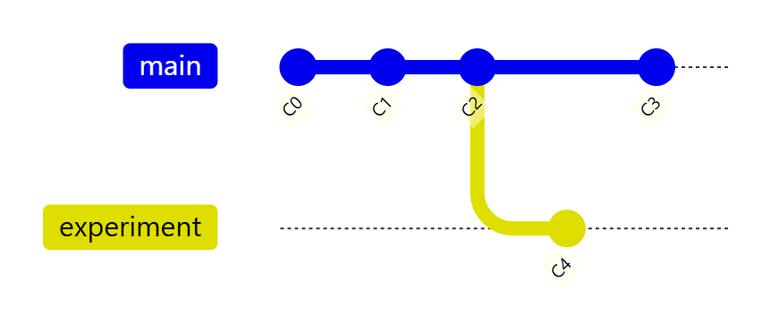
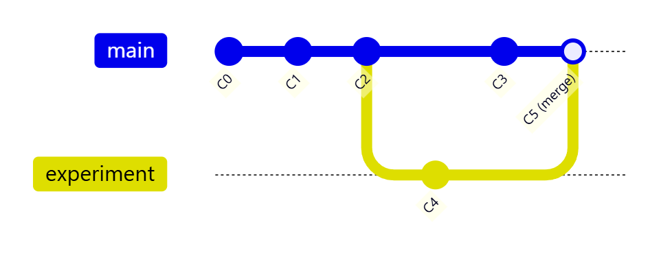
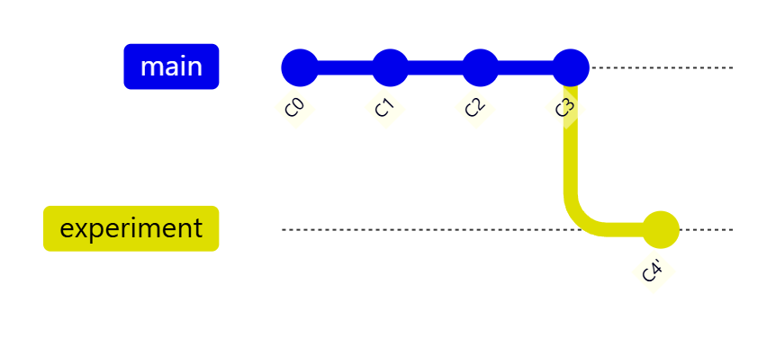
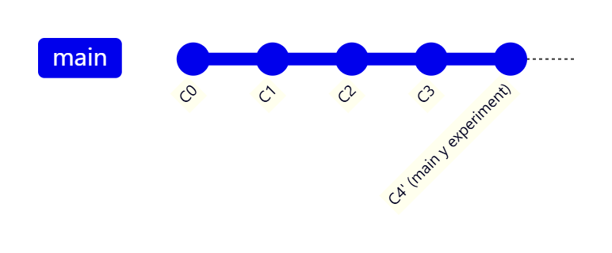
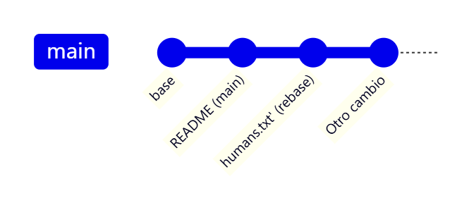
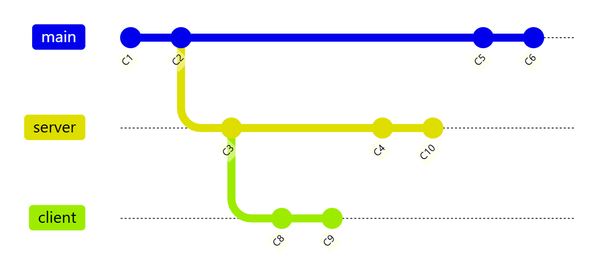
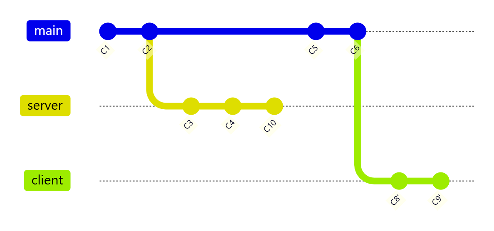
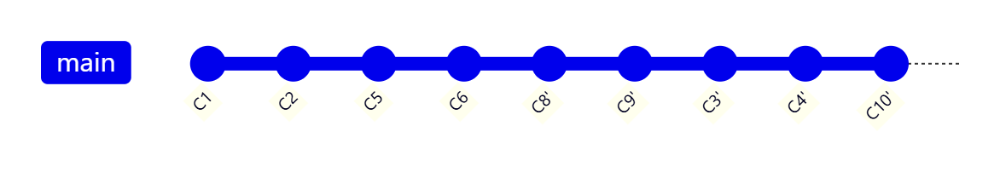
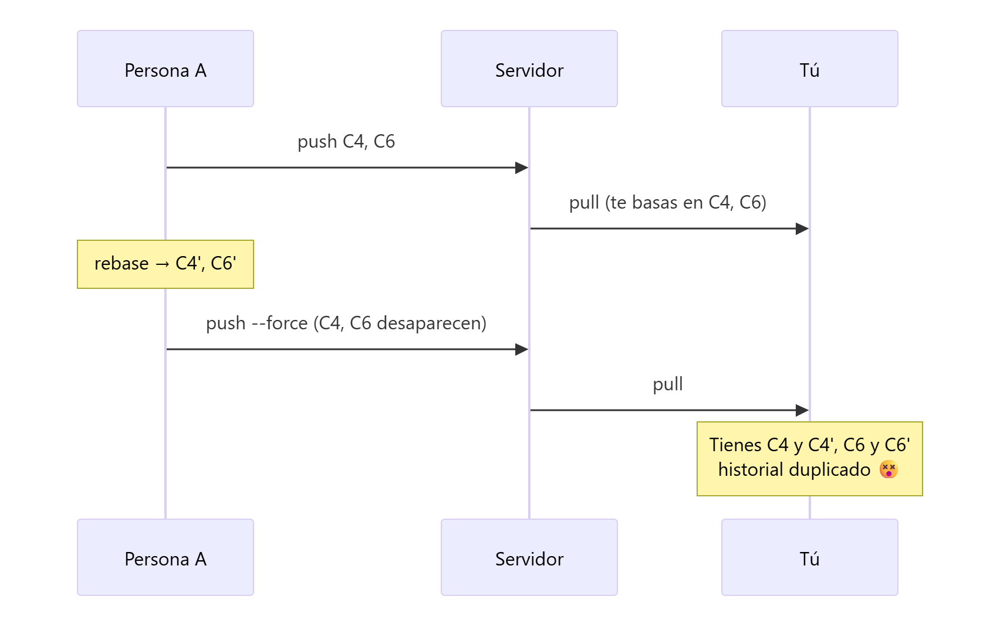
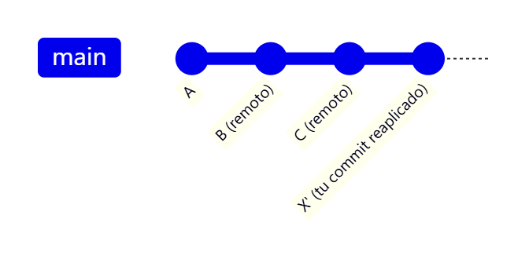

# Reorganizar el trabajo: `git rebase`

> **Autor:** Martín Gil Blanco  
> **Curso:** Control de versiones con Git en contextos académicos y profesionales  
> **Tema 13** · Última revisión: octubre de 2026

---

## Índice

- [1. Dos formas de integrar cambios](#1-dos-formas-de-integrar-cambios)
- [2. Rebase básico](#2-rebase-básico)
- [3. Práctica: rebase paso a paso](#3-práctica-rebase-paso-a-paso)
- [4. Conflictos durante un rebase](#4-conflictos-durante-un-rebase)
- [5. Rebase avanzado: `--onto`](#5-rebase-avanzado---onto)
- [6. Los peligros de reorganizar](#6-los-peligros-de-reorganizar)
- [7. `git pull --rebase`](#7-git-pull---rebase)
- [8. Rebase interactivo](#8-rebase-interactivo)
- [9. ¿Merge o rebase?](#9-merge-o-rebase)
- [10. Resumen](#10-resumen)
- [Actividad práctica](#actividad-práctica)

---

## 1. Dos formas de integrar cambios

`git rebase` resuelve el **mismo problema** que `git merge`: integrar cambios de una rama en otra. Pero lo hace de forma **distinta**.

Imagina que empiezas una funcionalidad en una rama y, mientras tanto, otra persona añade commits a `main`. El resultado es un **historial bifurcado**:



**Opción 1 — `merge`**: crea un commit de fusión que une ambas historias.



**Opción 2 — `rebase`**: "trasplanta" los commits de `experiment` para que empiecen en el extremo de `main`, como si se hubieran hecho después.



El **resultado final** (los archivos) es el mismo; lo que cambia es **la forma del historial**.

---

## 2. Rebase básico

```bash
git checkout experiment
git rebase main
```

```text
First, rewinding head to replay your work on top of it...
Applying: added staged command
```

Qué hace Git internamente:

1. Busca el **ancestro común** de ambas ramas (`C2`).
2. Obtiene las diferencias introducidas por cada commit de la rama actual (`C4`) y las guarda temporalmente.
3. Mueve la rama actual al extremo de la rama base (`C3`).
4. **Reaplica** los cambios uno a uno, creando **commits nuevos** (`C4'`, con hash distinto).

Después, `main` puede integrar la rama con un simple **avance rápido**:

```bash
git checkout main
git merge experiment     # fast-forward
```



> 💡 Ventaja: el historial queda **lineal y limpio**, como si todo se hubiera hecho en serie. Es muy usado para que, al enviar una contribución a un proyecto ajeno, la persona responsable solo tenga que hacer un *fast-forward*.

---

## 3. Práctica: rebase paso a paso

```bash
# 1. Crear una rama y hacer un cambio
git checkout -b myfeature
code humans.txt
git add .
git commit -m "Agradecimientos al alumnado"

# 2. Mientras tanto, main avanza
git checkout main
code README.md
git add .
git commit -m "Añade una línea a README para el ejemplo de rebase"

git log --oneline --graph --decorate --all
# → historial bifurcado entre main y myfeature
```

No hemos terminado `myfeature`, pero queremos incorporar los cambios de `main`:

```bash
# 3. Rebase de myfeature sobre main
git checkout myfeature
git rebase main
git log --oneline --graph --decorate --all
# → myfeature empieza ahora en el extremo de main

# 4. Seguimos trabajando en la rama
code README.md
git add .
git commit -m "Otro cambio después del rebase"

# 5. Integramos en main: será un fast-forward
git checkout main
git diff main myfeature
git merge myfeature
git log --oneline --graph --decorate --all

# 6. Borramos la rama
git branch -d myfeature
```



---

## 4. Conflictos durante un rebase

Como el rebase **reaplica commit a commit**, puede detenerse en cada uno si hay conflicto:

```text
CONFLICT (content): Merge conflict in README.md
error: could not apply 1a2b3c4... Otro cambio
```

| Comando | Cuándo usarlo |
|---|---|
| Editar archivos + `git add <archivo>` | Para resolver el conflicto del commit actual |
| `git rebase --continue` | Tras resolver: sigue con el siguiente commit |
| `git rebase --skip` | Descarta el commit que está dando conflicto |
| `git rebase --abort` | Cancela todo y vuelve al estado anterior al rebase |

> ⚠️ Durante un rebase **no hagas `git commit`** tras resolver; usa `git rebase --continue`.

---

## 5. Rebase avanzado: `--onto`

Supón una rama `server` creada desde `main` y una rama `client` creada desde `server`:



Quieres publicar ya los cambios de `client` sin los de `server` (que aún no están listos):

```bash
git rebase --onto main server client
```

*"Toma los commits de `client` que no están en `server` y reaplícalos sobre `main`"*.



Después:

```bash
git checkout main
git merge client                 # fast-forward
git rebase main server           # reaplica server sobre main sin cambiar de rama antes
git checkout main
git merge server                 # fast-forward
git branch -d client
git branch -d server
```

Historial final, completamente lineal:



> 💡 `git rebase <base> <rama>` primero se cambia a `<rama>` y después la reorganiza sobre `<base>`.

---

## 6. Los peligros de reorganizar

El rebase **reescribe la historia**: abandona commits existentes y crea otros nuevos, parecidos pero **con hashes distintos**.

> ### 🚨 Regla de oro
> **Nunca reorganices (rebase) commits que ya existan fuera de tu repositorio** y sobre los que otras personas puedan haber basado su trabajo.

¿Qué pasa si la incumples?

1. Clonas un repositorio y trabajas sobre él.
2. Otra persona sube commits, incluido un *merge*; tú los traes y los fusionas.
3. Esa persona **hace rebase** de su trabajo y lo sube con `git push --force`, eliminando los commits originales del servidor.
4. Tú haces `git pull` y acabas con **los mismos cambios duplicados** (los commits originales y los reescritos), un historial confuso y probables conflictos.



Si te ocurre, a veces se puede arreglar haciendo tú también rebase sobre la rama reescrita (`git pull --rebase`): Git es capaz de detectar los commits que ya están aplicados comparando sus parches.

> 💡 Si necesitas forzar un *push* de tu propia rama (por ejemplo, tras un rebase de una rama de feature que solo usas tú), usa `git push --force-with-lease`: falla si alguien ha subido algo que tú no tienes.

---

## 7. `git pull --rebase`

En lugar de `fetch` + `merge`, hace `fetch` + **`rebase`** de tus commits locales sobre los del remoto. Evita los commits de fusión "Merge branch 'main' of github.com:…" que ensucian el historial cuando dos personas trabajan sobre la misma rama.

```bash
git pull --rebase
git config --global pull.rebase true    # usarlo por defecto
```



---

## 8. Rebase interactivo

`git rebase -i` permite **editar** una serie de commits locales antes de compartirlos: reordenarlos, unirlos, cambiar mensajes o eliminarlos.

```bash
git rebase -i HEAD~3
```

Se abre el editor con una lista:

```text
pick 1a2b3c4 Añade formulario
pick 5d6e7f8 Corrige errata
pick 9a0b1c2 Añade validación
```

| Orden | Efecto |
|---|---|
| `pick` | Mantener el commit |
| `reword` (`r`) | Mantener, pero cambiar el mensaje |
| `edit` (`e`) | Detenerse para modificar el commit |
| `squash` (`s`) | Unir con el commit anterior (combinando mensajes) |
| `fixup` (`f`) | Unir con el anterior descartando este mensaje |
| `drop` (`d`) | Eliminar el commit |

Cambiar el orden de las líneas cambia el orden de los commits. La regla de oro se aplica igual: **solo con commits que no hayas publicado**.

---

## 9. ¿Merge o rebase?

Hay dos visiones del historial:

- **Registro de lo que realmente pasó**: el historial es un documento histórico y no debería alterarse → **merge**.
- **Historia de cómo se hizo el proyecto**: igual que un libro no publica su primer borrador, el historial se puede pulir antes de publicarlo → **rebase**.

| | `git merge` | `git rebase` |
|---|---|---|
| Historial | Fiel a lo ocurrido; con bifurcaciones y commits de fusión | Lineal y limpio |
| Reescribe historia | ❌ No | ✅ Sí (commits nuevos) |
| Seguro con commits publicados | ✅ Sí | ❌ No |
| Conflictos | Se resuelven una vez | Pueden aparecer en cada commit reaplicado |
| Uso típico | Integrar ramas en `main`, Pull Requests | Actualizar tu rama local con `main` antes de publicarla; limpiar commits |

> ✅ **Recomendación general**: haz **rebase** sobre los cambios **locales** que aún no has compartido para limpiar tu trabajo, y **nunca** sobre algo que ya esté publicado. Así obtienes lo mejor de los dos mundos.

---

## 10. Resumen

| Comando | Descripción |
|---|---|
| `git rebase main` | Reaplica la rama actual sobre `main` |
| `git rebase main rama` | Igual, cambiando antes a `rama` |
| `git rebase --onto A B C` | Reaplica los commits de `C` que no están en `B` sobre `A` |
| `git rebase --continue` / `--skip` / `--abort` | Gestionar conflictos |
| `git rebase -i HEAD~n` | Rebase interactivo de los últimos *n* commits |
| `git pull --rebase` | Traer cambios reorganizando tus commits encima |
| `git push --force-with-lease` | Forzar subida de forma más segura |

---

## Actividad práctica

1. Reproduce el ejemplo del [apartado 3](#3-práctica-rebase-paso-a-paso) y haz capturas de `git log --oneline --graph --all` antes y después del rebase.
2. Repite el mismo escenario usando `git merge` en lugar de `git rebase` y compara ambos historiales.
3. Usa `git rebase -i HEAD~3` para unir (*squash*) dos commits locales.

Entrega un documento PDF con las capturas de pantalla y las explicaciones pertinentes.

---

[⬅ Anterior: Ramas remotas](12-ramas-remotas.md) · [Índice](README.md) · [Siguiente: Stash ➡](14-stash.md)
