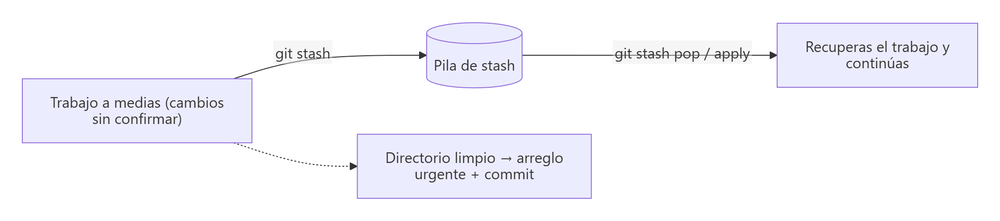
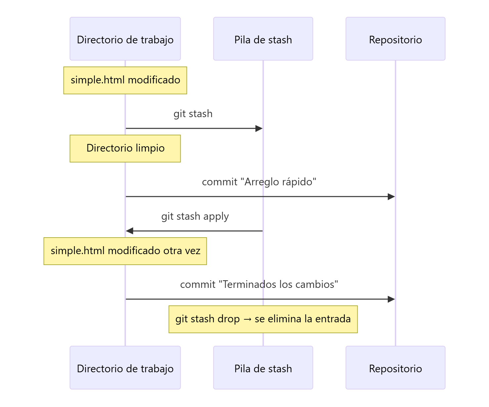

# Guardar cambios temporalmente: `git stash`

> **Autor:** Martín Gil Blanco  
> **Curso:** Control de versiones con Git en contextos académicos y profesionales  
> **Tema 14** · Última revisión: octubre de 2026

---

## Índice

- [1. ¿Para qué sirve `git stash`?](#1-para-qué-sirve-git-stash)
- [2. Cómo funciona: una pila](#2-cómo-funciona-una-pila)
- [3. Práctica: arreglo urgente con stash](#3-práctica-arreglo-urgente-con-stash)
- [4. Comandos de stash](#4-comandos-de-stash)
- [5. `apply` frente a `pop`](#5-apply-frente-a-pop)
- [6. Archivos sin seguimiento e ignorados](#6-archivos-sin-seguimiento-e-ignorados)
- [7. Situaciones habituales](#7-situaciones-habituales)
- [8. Resumen](#8-resumen)
- [Actividad práctica](#actividad-práctica)

---

## 1. ¿Para qué sirve `git stash`?

`git stash` **guarda temporalmente** los cambios en los que estás trabajando (sin hacer commit) y deja el directorio de trabajo **limpio**, igual que el último commit. Más tarde puedes **recuperarlos** y seguir donde lo dejaste.

Es muy práctico cuando:

- Tienes que **cambiar rápidamente de contexto** (por ejemplo, arreglar un error urgente en producción) y tu trabajo actual aún no está listo para un commit.
- Git **no te deja cambiar de rama** porque tienes cambios sin confirmar.
- Has empezado a trabajar en la **rama equivocada** y quieres llevarte los cambios a otra.



---

## 2. Cómo funciona: una pila

Los *stashes* se guardan en una **pila** (LIFO: el último en entrar es el primero en salir). Cada entrada se identifica como `stash@{n}`, siendo `stash@{0}` la más reciente.

```text
stash@{0}: WIP on main: 049d078 Añade formulario      ← el más reciente (cima)
stash@{1}: WIP on main: c264051 Revert "Añade nombre"
stash@{2}: On main: estilos sin terminar
```

Por defecto, `git stash` guarda:

- Los cambios **preparados** (área de preparación).
- Los cambios **no preparados** de archivos **rastreados**.

Y **no** guarda los archivos sin seguimiento ni los ignorados (ver [apartado 6](#6-archivos-sin-seguimiento-e-ignorados)).

---

## 3. Práctica: arreglo urgente con stash

```bash
# 1. Con el árbol de trabajo limpio, empezamos a modificar un archivo
code simple.html
git status
# → modified: simple.html

# 2. ¡Hay que arreglar algo urgente! Guardamos los cambios en el stash
git stash

# 3. El directorio de trabajo vuelve a estar limpio
git status
# → nothing to commit, working tree clean

# 4. Hacemos el arreglo urgente y lo confirmamos
code README.md
git add .
git commit -m "Arreglo rápido en producción del aviso de copyright"

# 5. Recuperamos los cambios guardados para seguir trabajando
git stash apply
git status
# → modified: simple.html

# 6. Terminamos el trabajo y lo confirmamos
git add .
git commit -m "Terminados los cambios de simple.html"

# 7. Con apply, el stash sigue en la pila
git stash list

# 8. Lo eliminamos
git stash drop
```



---

## 4. Comandos de stash

| Comando | Descripción |
|---|---|
| `git stash` | Guarda los cambios (equivale a `git stash push`) |
| `git stash push -m "mensaje"` | Guarda con una descripción (muy recomendable si tienes varios) |
| `git stash push archivo.txt` | Guarda solo los cambios de ese archivo |
| `git stash list` | Lista las entradas de la pila |
| `git stash show [-p] [stash@{n}]` | Resumen (o *diff* completo con `-p`) de una entrada |
| `git stash apply [stash@{n}]` | Aplica una entrada **sin eliminarla** de la pila |
| `git stash pop [stash@{n}]` | Aplica una entrada **y la elimina** de la pila |
| `git stash drop [stash@{n}]` | Elimina una entrada |
| `git stash clear` | Vacía la pila completa ⚠️ |
| `git stash branch nueva-rama [stash@{n}]` | Crea una rama en el commit donde se hizo el stash, aplica los cambios y elimina la entrada |

Si no se indica `stash@{n}`, se usa el más reciente (`stash@{0}`).

---

## 5. `apply` frente a `pop`

| `git stash apply` | `git stash pop` |
|---|---|
| Aplica los cambios | Aplica los cambios |
| **Mantiene** la entrada en la pila | **Elimina** la entrada de la pila (si no hay conflictos) |
| Útil para aplicar el mismo stash en varias ramas | Uso más habitual |

> 📌 `git stash pop` equivale a `git stash apply` seguido de `git stash drop`. "*Pop*" hace referencia a sacar el elemento de la cima de la pila.

> ⚠️ Si al aplicar un stash hay **conflictos**, se resuelven igual que en una fusión ([Tema 9](09-resolucion-de-conflictos.md)). En ese caso, `pop` **no** elimina la entrada: tendrás que hacer `git stash drop` cuando termines.

---

## 6. Archivos sin seguimiento e ignorados

| Comando | Guarda rastreados | Guarda sin seguimiento | Guarda ignorados |
|---|---|---|---|
| `git stash` | ✅ | ❌ | ❌ |
| `git stash -u` (`--include-untracked`) | ✅ | ✅ | ❌ |
| `git stash -a` (`--all`) | ✅ | ✅ | ✅ |

```bash
git stash -u
```

---

## 7. Situaciones habituales

### He empezado a trabajar en la rama equivocada

```bash
git stash
git switch rama-correcta
git stash pop
```

### No puedo cambiar de rama por tener cambios sin confirmar

```text
error: Your local changes to the following files would be overwritten by checkout:
        index.html
Please commit your changes or stash them before you switch branches.
```

```bash
git stash
git switch otra-rama
# … trabajo …
git switch -
git stash pop
```

### Quiero convertir un stash en una rama

Si la rama ha avanzado mucho y aplicar el stash da conflictos:

```bash
git stash branch prueba-estilos
```

---

## 8. Resumen

- `git stash` guarda los cambios sin confirmar y limpia el directorio de trabajo.
- Las entradas se guardan en una **pila** (`stash@{0}` es la más reciente).
- `apply` recupera sin borrar; `pop` recupera y borra.
- Usa `-u` para incluir archivos sin seguimiento y `-m` para describir cada entrada.

---

## Actividad práctica

1. Modifica un archivo, guárdalo con `git stash push -m "trabajo a medias"`, haz un commit en otro archivo y recupera los cambios con `git stash pop`.
2. Repite usando `git stash -u` con un archivo nuevo sin seguimiento.
3. Muestra la salida de `git stash list` en cada paso.

Entrega un documento PDF con las capturas de pantalla y las explicaciones pertinentes.

---

[⬅ Anterior: Rebase](13-rebase.md) · [Índice](README.md) · [Siguiente: Flujos de trabajo y colaboración ➡](15-flujos-de-trabajo.md)
