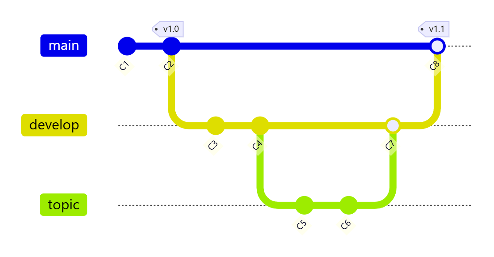
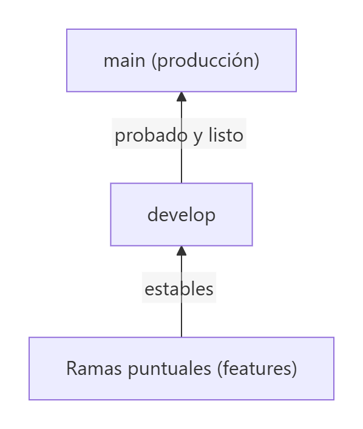
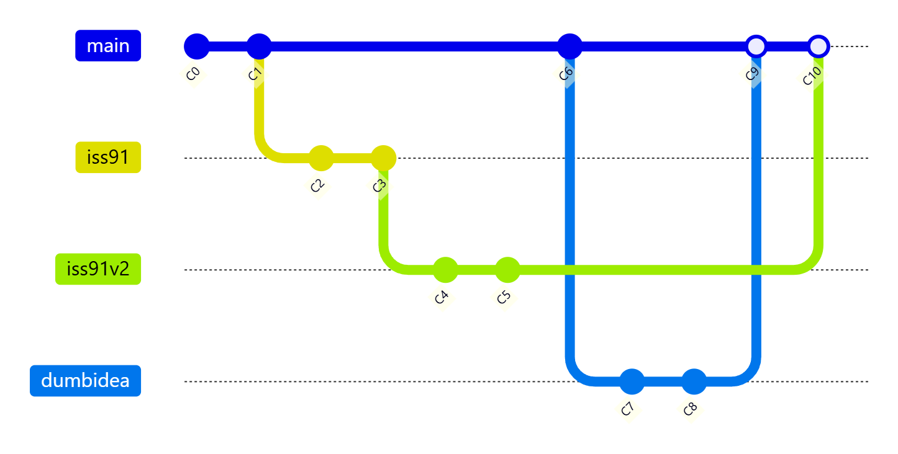
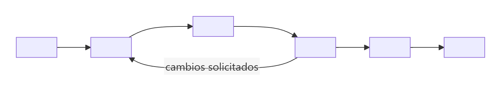
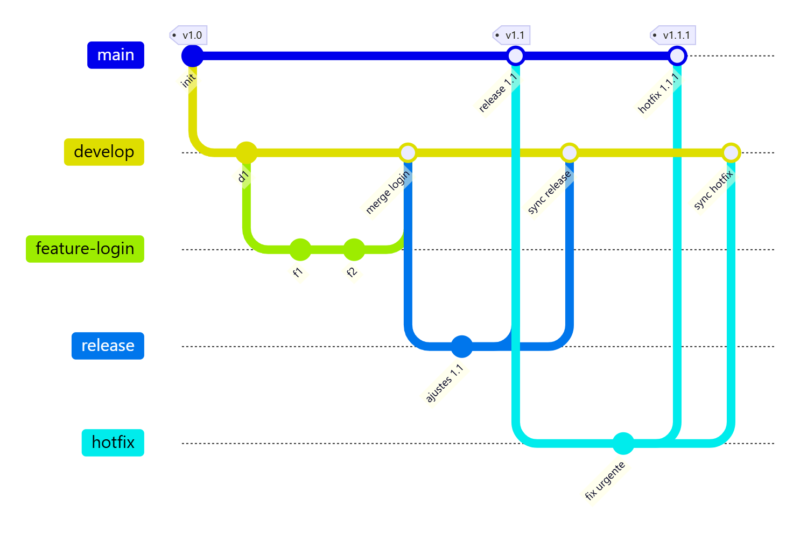
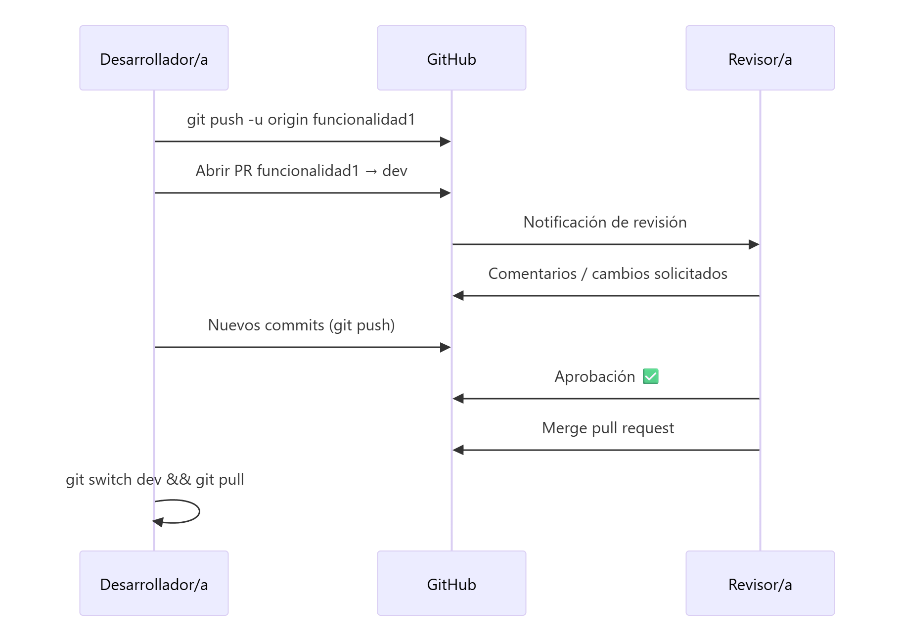
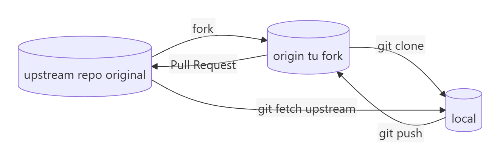
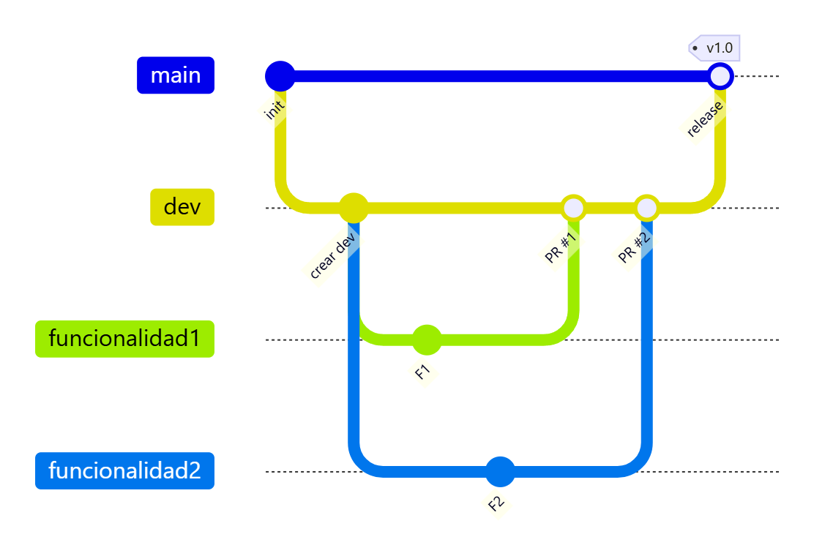

# Flujos de trabajo con ramas y colaboración

> **Autor:** Martín Gil Blanco  
> **Curso:** Control de versiones con Git en contextos académicos y profesionales  
> **Tema 15** · Última revisión: octubre de 2026

---

## Índice

- [1. Introducción](#1-introducción)
- [2. Ramas de largo recorrido](#2-ramas-de-largo-recorrido)
- [3. Ramas puntuales (*topic branches*)](#3-ramas-puntuales-topic-branches)
- [4. GitHub Flow](#4-github-flow)
- [5. Git Flow](#5-git-flow)
- [6. Pull Requests (Merge Requests)](#6-pull-requests-merge-requests)
- [7. Colaborar en un proyecto ajeno: *fork*](#7-colaborar-en-un-proyecto-ajeno-fork)
- [8. Práctica: trabajo en equipo con rama `dev`](#8-práctica-trabajo-en-equipo-con-rama-dev)
- [9. Buenas prácticas de colaboración](#9-buenas-prácticas-de-colaboración)
- [10. Resumen](#10-resumen)

---

## 1. Introducción

Como crear y fusionar ramas en Git es tan **rápido y barato**, se pueden diseñar **flujos de trabajo** (*workflows*) basados en ramas. Un flujo de trabajo es un **acuerdo del equipo** sobre:

- Qué ramas existen y para qué sirve cada una.
- Desde dónde se crean las ramas nuevas y dónde se integran.
- Cómo se revisan y aprueban los cambios.

No hay un flujo "correcto": depende del tamaño del equipo, del tipo de proyecto y de la frecuencia de publicación.

---

## 2. Ramas de largo recorrido

Consiste en tener **varias ramas abiertas permanentemente**, cada una con un **nivel de estabilidad** distinto:

| Rama | Contenido |
|---|---|
| `main` / `master` | Solo código **estable**, ya publicado o listo para publicar |
| `develop` / `next` | Rama paralela de **desarrollo**; cuando es estable, se fusiona en `main` |
| `proposed` / `pu` | Cambios propuestos que aún no están listos para `next` |

Las ramas más estables van **por detrás** en el historial y las más experimentales **por delante**. Cuando una rama de nivel inferior se estabiliza, se fusiona en la superior.



Se suele representar como **silos**: el trabajo "madura" y va subiendo de rama.



---

## 3. Ramas puntuales (*topic branches*)

Una **rama puntual** es una rama de **vida corta** creada para una tarea concreta: una funcionalidad, un error (`iss91`), un experimento (`dumbidea`)… Se fusiona cuando está lista y después se **borra**.

Ventajas:

- Cambios **aislados**: cada tarea en su rama.
- Facilita la **revisión** del trabajo.
- Permite **descartar** una idea sin afectar a lo demás.
- Puedes cambiar de contexto rápidamente.



En este ejemplo, `iss91v2` (segunda versión del arreglo) y `dumbidea` se fusionan, mientras que la primera versión `iss91` se **descarta**.

> 📌 Todo esto ocurre **en local** hasta que decides publicar las ramas: puedes experimentar libremente.

---

## 4. GitHub Flow

Flujo **sencillo**, ideal para equipos pequeños, proyectos web y despliegue continuo. Solo hay una rama de larga duración: `main`, que **siempre es desplegable**.



```bash
git switch main
git pull
git switch -c feature/login
# … commits …
git push -u origin feature/login
# → abrir Pull Request en GitHub, revisar, fusionar
git switch main
git pull
git branch -d feature/login
```

---

## 5. Git Flow

Flujo más **estructurado**, pensado para proyectos con **versiones planificadas**. Usa dos ramas permanentes y tres tipos de ramas de apoyo:

| Rama | Se crea desde | Se fusiona en | Propósito |
|---|---|---|---|
| `main` | — | — | Código en producción; cada fusión se etiqueta (`v1.0`, `v1.1`…) |
| `develop` | `main` | — | Integración del desarrollo |
| `feature/*` | `develop` | `develop` | Nuevas funcionalidades |
| `release/*` | `develop` | `main` y `develop` | Preparar una versión (pruebas, ajustes finales) |
| `hotfix/*` | `main` | `main` y `develop` | Corregir errores urgentes en producción |



> 📝 En el diagrama, `feature-login`, `release` y `hotfix` representan las ramas `feature/login`, `release/1.1` y `hotfix/1.1.1`.

| | GitHub Flow | Git Flow |
|---|---|---|
| Ramas permanentes | `main` | `main` y `develop` |
| Complejidad | Baja | Alta |
| Ideal para | Despliegue continuo, equipos pequeños | Versiones planificadas, varios entornos |

> 💡 Otra alternativa muy usada es ***trunk-based development***: todo el equipo integra en `main` (el "tronco") varias veces al día mediante ramas muy cortas.

---

## 6. Pull Requests (Merge Requests)

Una **Pull Request** (PR) —en GitLab, **Merge Request** (MR)— es una **petición para fusionar** una rama en otra, hecha desde la plataforma web. Permite:

- **Revisar el código** (*code review*): comentar líneas concretas, sugerir cambios, aprobar o pedir modificaciones.
- **Discutir** la implementación con el equipo.
- Ejecutar **pruebas automáticas** (CI) antes de fusionar.
- Dejar **registro** de por qué se hizo cada cambio.



Opciones de fusión que ofrece GitHub al aceptar una PR:

| Opción | Resultado |
|---|---|
| **Create a merge commit** | Commit de fusión (`--no-ff`); conserva todos los commits de la rama |
| **Squash and merge** | Todos los commits de la rama se juntan en **uno solo** |
| **Rebase and merge** | Los commits se reaplican sobre la rama destino; historial lineal |

> 💡 Puedes proteger ramas (**Settings → Branches → Branch protection rules**) para exigir que todo cambio en `main` llegue mediante una PR aprobada.

---

## 7. Colaborar en un proyecto ajeno: *fork*

Si **no tienes permisos de escritura** en un repositorio (por ejemplo, un proyecto de código abierto):

1. Haz un ***fork***: una copia del repositorio en **tu** cuenta.
2. Clona tu fork y añade el original como remoto `upstream`.
3. Crea una rama, haz tus cambios y súbelos **a tu fork**.
4. Abre una **Pull Request** desde tu fork hacia el repositorio original.

```bash
git clone git@github.com:tu_usuario/proyecto.git
cd proyecto
git remote add upstream https://github.com/autor-original/proyecto.git
git switch -c mejora-docs
# … commits …
git push -u origin mejora-docs
# → abrir PR desde tu_usuario:mejora-docs hacia autor-original:main

# Mantener tu fork actualizado
git fetch upstream
git switch main
git merge upstream/main
git push origin main
```



---

## 8. Práctica: trabajo en equipo con rama `dev`

Este flujo es el que se practica en la [Tarea 2](Apuntes/Tarea%202/Tarea%20de%20Git%20y%20GitHub%202.md):




1. **Formar el equipo** y designar a un responsable.
2. El responsable **crea el repositorio** en GitHub y añade al resto como **colaboradores** (*Settings → Collaborators*).
3. Se **clona** el repositorio y se crea la rama **`dev`** desde `main`:

   ```bash
   git clone git@github.com:responsable/proyecto.git
   cd proyecto
   git switch -c dev
   git push -u origin dev
   ```

4. Cada miembro trabaja en **su propia rama** creada desde `dev`:

   ```bash
   git switch dev
   git pull
   git switch -c funcionalidad1
   # … cambios …
   git add .
   git commit -m "Implementa funcionalidad 1"
   git push -u origin funcionalidad1
   ```

5. En GitHub se abre una **Pull Request** de `funcionalidad1` hacia **`dev`** (¡no hacia `main`!).
6. Si hay **conflictos**, se resuelven actualizando la rama con `dev`:

   ```bash
   git switch funcionalidad1
   git pull origin dev        # o: git fetch && git merge origin/dev
   # resolver conflictos, git add, git commit
   git push
   ```

7. Tras la revisión, el responsable **fusiona** la PR. Todos actualizan su copia:

   ```bash
   git switch dev
   git pull origin dev
   ```

8. Cuando `dev` es estable, se fusiona en **`main`** (directamente o mediante otra PR) y se etiqueta la versión:

   ```bash
   git switch main
   git pull
   git merge dev
   git tag -a v1.0 -m "Primera versión"
   git push origin main --tags
   ```

---

## 9. Buenas prácticas de colaboración

- **Nunca trabajes directamente en `main`** en un proyecto compartido.
- Nombra las ramas de forma descriptiva: `feature/login`, `fix/calculo-edad`, `docs/readme`.
- **Actualiza tu rama** con la rama base a menudo (`git pull`, `git fetch` + `git merge`/`git rebase`).
- Haz **PR pequeñas** y centradas en una sola cosa: se revisan mejor y antes.
- Escribe **mensajes de commit y descripciones de PR claros** (qué y por qué).
- **No reescribas** historia publicada (`rebase`, `--amend`, `push --force`) en ramas compartidas.
- Borra las ramas una vez fusionadas.
- Usa *issues* para planificar el trabajo y enlázalas desde las PR (`Closes #12`).

---

## 10. Resumen

| Concepto | Idea clave |
|---|---|
| Ramas de largo recorrido | Distintos niveles de estabilidad (`main`, `develop`…) |
| Ramas puntuales | Una rama por tarea; vida corta |
| GitHub Flow | `main` siempre desplegable + ramas + PR |
| Git Flow | `main` + `develop` + `feature/*`, `release/*`, `hotfix/*` |
| Pull/Merge Request | Revisión y discusión antes de fusionar |
| Fork | Copia propia para contribuir sin permisos de escritura |

---

[⬅ Anterior: Stash](14-stash.md) · [Índice](README.md) · [Siguiente: Referencia rápida de comandos ➡](16-referencia-rapida.md)
