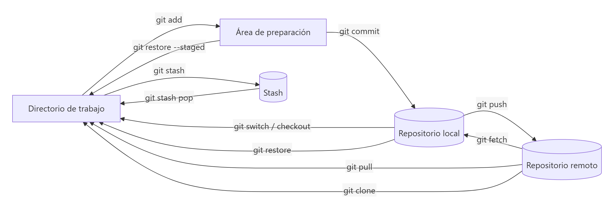

# Referencia rápida de comandos Git

> **Autor:** Martín Gil Blanco  
> **Curso:** Control de versiones con Git en contextos académicos y profesionales  
> **Tema 16** · Última revisión: octubre de 2026

---

## Índice

- [Mapa general](#mapa-general)
- [Configuración](#configuración)
- [Crear y clonar](#crear-y-clonar)
- [Cambios locales](#cambios-locales)
- [Historial y diferencias](#historial-y-diferencias)
- [Etiquetas](#etiquetas)
- [Ramas](#ramas)
- [Fusión y rebase](#fusión-y-rebase)
- [Remotos](#remotos)
- [Deshacer](#deshacer)
- [Stash](#stash)
- [GitHub CLI](#github-cli)
- [Finales de línea](#finales-de-línea)
- [SSH](#ssh)
- [Glosario](#glosario)

---

## Mapa general

---

## Configuración

| Comando | Descripción |
|---|---|
| `git config --global user.name "Nombre"` | Nombre del autor |
| `git config --global user.email "correo"` | Correo del autor |
| `git config --global core.editor "code --wait"` | Editor por defecto |
| `git config --global init.defaultBranch main` | Rama inicial `main` |
| `git config --global pull.rebase false` | `git pull` usa merge |
| `git config --global alias.lg "log --oneline --graph --all"` | Crear un alias |
| `git config --list --show-origin` | Ver configuración y su origen |
| `git help <comando>` / `git <comando> -h` | Ayuda |

## Crear y clonar

| Comando | Descripción |
|---|---|
| `git init [-b main]` | Crear un repositorio |
| `git clone <url> [carpeta]` | Clonar un repositorio |

## Cambios locales

| Comando | Descripción |
|---|---|
| `git status` / `git status -s` | Estado de los archivos |
| `git add <archivo>` / `git add .` | Preparar cambios |
| `git add -p` | Preparar por fragmentos |
| `git commit -m "mensaje"` | Confirmar |
| `git commit -am "mensaje"` | Preparar rastreados y confirmar |
| `git commit --amend` | Rehacer el último commit |
| `git rm [--cached] <archivo>` | Eliminar / dejar de rastrear |
| `git mv <origen> <destino>` | Renombrar o mover |

## Historial y diferencias

| Comando | Descripción |
|---|---|
| `git log --oneline --graph --decorate --all` | Grafo del historial |
| `git log -p -2` | Últimos 2 commits con su diff |
| `git log --stat` | Archivos cambiados por commit |
| `git log --author="x" --since=2.weeks` | Filtrar historial |
| `git log -S "texto"` | Commits que añaden/quitan un texto |
| `git show <commit>` | Detalle de un commit |
| `git diff` | Trabajo ↔ preparación |
| `git diff --staged` | Preparación ↔ último commit |
| `git diff HEAD` | Trabajo ↔ último commit |
| `git diff a..b` | Entre dos commits o ramas |
| `git difftool` | Diferencias en herramienta gráfica |
| `git blame <archivo>` | Quién modificó cada línea |

## Etiquetas

| Comando | Descripción |
|---|---|
| `git tag` / `git tag -l "v1.*"` | Listar |
| `git tag -a v1.0 -m "msg" [commit]` | Etiqueta anotada |
| `git tag v1.0 [commit]` | Etiqueta ligera |
| `git tag -d v1.0` | Borrar local |
| `git push origin v1.0` / `--tags` | Subir una / todas |
| `git push origin --delete v1.0` | Borrar remota |

## Ramas

| Comando | Descripción |
|---|---|
| `git branch` / `-v` / `-vv` / `-a` | Listar ramas |
| `git branch <rama> [inicio]` | Crear (sin cambiar) |
| `git switch <rama>` / `git checkout <rama>` | Cambiar |
| `git switch -c <rama> [inicio]` / `git checkout -b <rama> [inicio]` | Crear y cambiar |
| `git switch -` | Volver a la rama anterior |
| `git branch -m <viejo> <nuevo>` | Renombrar |
| `git branch -d <rama>` / `-D` | Borrar (segura / forzada) |
| `git branch --merged` / `--no-merged` | Fusionadas / sin fusionar |

## Fusión y rebase

| Comando | Descripción |
|---|---|
| `git merge <rama>` | Fusionar en la rama actual |
| `git merge --no-ff <rama>` | Forzar commit de fusión |
| `git merge --squash <rama>` | Juntar cambios en un commit |
| `git merge --abort` | Cancelar fusión |
| `git mergetool` | Resolver conflictos gráficamente |
| `git rebase <base>` | Reaplicar la rama sobre `base` |
| `git rebase --onto A B C` | Rebase avanzado |
| `git rebase -i HEAD~n` | Rebase interactivo |
| `git rebase --continue` / `--skip` / `--abort` | Gestionar conflictos de rebase |
| `git cherry-pick [-x] <commit>` | Aplicar un commit concreto en la rama actual ([Tema 17](17-cherry-pick.md)) |

## Remotos

| Comando | Descripción |
|---|---|
| `git remote -v` | Listar remotos |
| `git remote add <nombre> <url>` | Añadir |
| `git remote set-url <nombre> <url>` | Cambiar URL |
| `git remote rename <viejo> <nuevo>` | Renombrar |
| `git remote remove <nombre>` | Eliminar |
| `git remote show <nombre>` | Información detallada |
| `git fetch [--all] [--prune]` | Traer sin integrar |
| `git pull [--rebase]` | Traer e integrar |
| `git push -u origin <rama>` | Publicar con seguimiento |
| `git push origin --all` | Subir todas las ramas |
| `git push origin --delete <rama>` | Borrar rama remota |
| `git push --force-with-lease` | Forzar de forma segura |
| `git branch -u origin/<rama>` | Establecer *upstream* |

## Deshacer

| Comando | Descripción |
|---|---|
| `git restore <archivo>` | Descartar cambios no preparados |
| `git restore --staged <archivo>` | Sacar del área de preparación |
| `git reset --soft HEAD~1` | Deshacer commit, cambios preparados |
| `git reset HEAD~1` | Deshacer commit, cambios sin preparar |
| `git reset --hard [commit]` | Descartarlo todo ⚠️ |
| `git revert <commit>` | Commit inverso (seguro si está publicado) |
| `git reflog` | Historial de movimientos de `HEAD` |
| `git clean -n` / `-fd` | Ver / borrar archivos sin seguimiento ⚠️ |

## Stash

| Comando | Descripción |
|---|---|
| `git stash [-u] [-m "msg"]` | Guardar cambios |
| `git stash list` | Listar |
| `git stash show -p [stash@{n}]` | Ver contenido |
| `git stash apply` / `pop` | Recuperar (sin borrar / borrando) |
| `git stash drop` / `clear` | Borrar uno / todos |
| `git stash branch <rama>` | Crear rama desde un stash |

## GitHub CLI

| Comando | Descripción |
|---|---|
| `gh auth login` | Iniciar sesión |
| `gh issue create` / `list` / `close <n>` | Gestionar issues |
| `gh pr create --fill` / `checkout <n>` / `merge <n>` | Gestionar Pull Requests |
| `gh release create <tag> --generate-notes` | Publicar una release |

## Finales de línea

| Comando | Descripción |
|---|---|
| `git config --global core.autocrlf true` / `input` | Conversión en Windows / Linux-macOS |
| `git ls-files --eol` | Ver el final de línea de cada archivo |
| `git add --renormalize .` | Reaplicar `.gitattributes` a todo el repositorio |

## SSH

| Comando | Descripción |
|---|---|
| `ssh-keygen -t ed25519 -C "correo"` | Generar claves |
| `cat ~/.ssh/id_ed25519.pub` | Ver clave pública |
| `ssh -T git@github.com` | Probar conexión |
| `eval "$(ssh-agent -s)"` + `ssh-add` | Cargar clave en el agente |

---

## Glosario

| Término | Definición |
|---|---|
| **Repositorio** | Conjunto de archivos de un proyecto junto con todo su historial de cambios |
| **Directorio de trabajo** | Carpeta con la versión de los archivos con la que trabajas |
| **Área de preparación (index)** | Zona intermedia con los cambios del próximo commit |
| **Commit** | Instantánea confirmada del proyecto, identificada por un hash SHA‑1 |
| **Hash** | Identificador único de 40 caracteres hexadecimales calculado a partir del contenido |
| **Rama (branch)** | Puntero móvil a un commit; línea independiente de desarrollo |
| **HEAD** | Puntero a la rama (o commit) en que estás |
| **Detached HEAD** | Estado en el que `HEAD` apunta a un commit y no a una rama |
| **Etiqueta (tag)** | Puntero fijo a un commit, usado para marcar versiones |
| **Remoto (remote)** | Repositorio alojado en otro sitio, con un nombre corto (`origin`) |
| **Rama remota** | Referencia local al estado de una rama del remoto (`origin/main`) |
| **Upstream** | Rama remota que sigue una rama local |
| **Clone** | Copia completa de un repositorio remoto |
| **Fetch** | Descargar datos del remoto sin integrarlos |
| **Pull** | Fetch + merge (o rebase) |
| **Push** | Enviar commits locales al remoto |
| **Merge** | Integrar los cambios de una rama en otra |
| **Fast-forward** | Fusión en la que solo avanza el puntero de la rama |
| **3-way merge** | Fusión que usa el ancestro común y crea un commit de fusión |
| **Conflicto** | Cambios incompatibles en la misma zona de un archivo que Git no puede fusionar solo |
| **Rebase** | Reaplicar commits sobre otra base, reescribiendo la historia |
| **Stash** | Almacén temporal de cambios sin confirmar |
| **Fork** | Copia de un repositorio ajeno en tu cuenta |
| **Pull Request / Merge Request** | Petición de fusión con revisión en la plataforma web |
| **.gitignore** | Archivo con los patrones de archivos que Git debe ignorar |

---

[⬅ Anterior: Flujos de trabajo y colaboración](15-flujos-de-trabajo.md) · [Índice](README.md) · [Siguiente: Cherry-pick ➡](17-cherry-pick.md)
