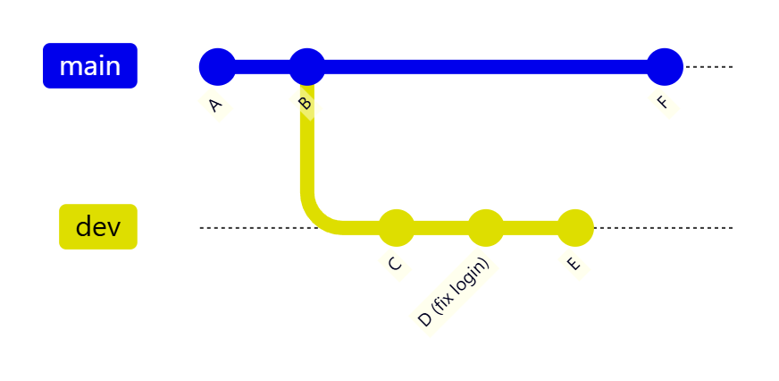
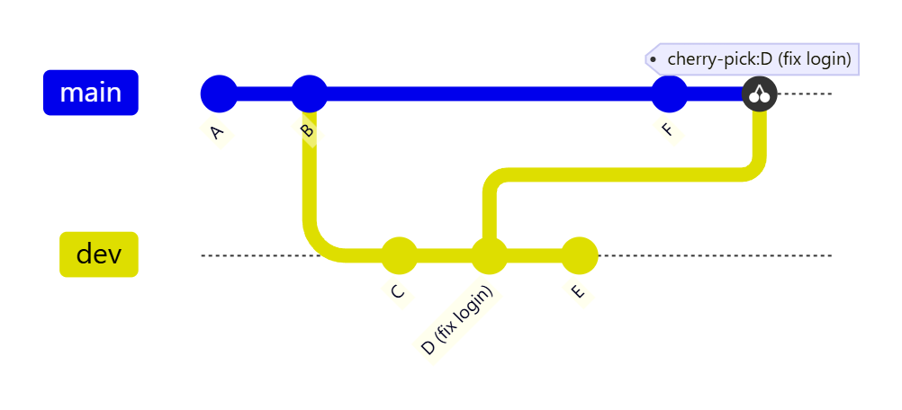
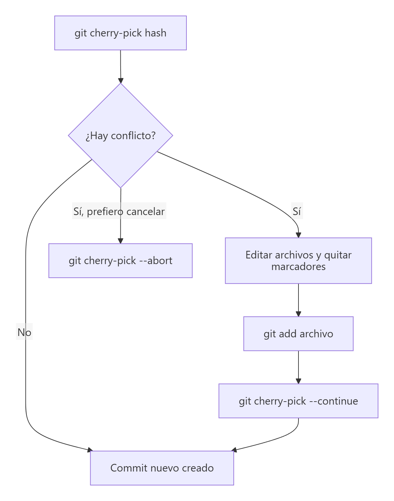

# Aplicar commits concretos: `git cherry-pick`

> **Autor:** Martín Gil Blanco  
> **Curso:** Control de versiones con Git en contextos académicos y profesionales  
> **Tema 17** · Última revisión: octubre de 2026

---

## Índice

- [1. ¿Qué es `git cherry-pick`?](#1-qué-es-git-cherry-pick)
- [2. ¿Cuándo usarlo?](#2-cuándo-usarlo)
- [3. Sintaxis básica](#3-sintaxis-básica)
- [4. Práctica: llevar un arreglo de `dev` a `main`](#4-práctica-llevar-un-arreglo-de-dev-a-main)
- [5. Aplicar varios commits](#5-aplicar-varios-commits)
- [6. Opciones útiles](#6-opciones-útiles)
- [7. Conflictos durante un cherry-pick](#7-conflictos-durante-un-cherry-pick)
- [8. Cherry-pick, merge y rebase](#8-cherry-pick-merge-y-rebase)
- [9. Buenas prácticas y precauciones](#9-buenas-prácticas-y-precauciones)
- [10. Resumen](#10-resumen)
- [Actividad práctica](#actividad-práctica)

---

## 1. ¿Qué es `git cherry-pick`?

`git cherry-pick` toma **los cambios introducidos por un commit concreto** de otra rama y los **aplica en la rama actual**, creando un **commit nuevo** con el mismo contenido y el mismo mensaje.

El nombre viene de *"coger la cereza"*: en lugar de traer **toda** una rama (como hace `git merge`), eliges **solo los commits que te interesan**.

Partimos de esta situación: en `dev` hay un commit `D` que corrige un error de inicio de sesión y lo necesitamos ya en `main`, pero **sin** traer `C` ni `E`, que aún no están listos.



Tras ejecutar `git cherry-pick` sobre `D` estando en `main`:



> 💡 El commit nuevo tiene **otro hash**, porque su padre es distinto (`F` en lugar de `C`). Para Git son dos commits diferentes con los mismos cambios.

---

## 2. ¿Cuándo usarlo?

| Situación | Ejemplo |
|---|---|
| **Llevar un arreglo urgente** a otra rama | Un *bugfix* hecho en `dev` que hay que publicar ya en `main` |
| **Portar un arreglo a versiones antiguas** | Aplicar la corrección de seguridad también en la rama `release/1.x` |
| **Rescatar un commit** de una rama que se va a descartar | De una rama experimental solo vale la pena un commit |
| **Corregir un commit hecho en la rama equivocada** | Hiciste el commit en `main` y debía ir en `feature/login` (ver [Tema 20](20-errores-frecuentes.md)) |

> ⚠️ No es la herramienta para integrar ramas completas: para eso están `git merge` ([Tema 11](11-fusion-de-ramas.md)) y `git rebase` ([Tema 13](13-rebase.md)).

---

## 3. Sintaxis básica

```bash
git switch rama-destino        # 1. Sitúate en la rama que RECIBE el commit
git cherry-pick <hash>         # 2. Indica el commit que quieres copiar
```

Para localizar el hash del commit:

```bash
git log --oneline dev          # commits de la rama dev
git log --oneline --all --graph
```

> 📌 El commit tiene que existir en tu repositorio local. Si está en una rama remota que aún no tienes, haz antes `git fetch`.

---

## 4. Práctica: llevar un arreglo de `dev` a `main`

```bash
# 1. Preparamos el escenario
git switch -c dev
echo "Nueva pantalla" > pantalla.txt
git add . && git commit -m "Añade pantalla nueva (sin terminar)"

echo "Corrección del login" > login.txt
git add . && git commit -m "Corrige error en el login"

echo "Más trabajo" >> pantalla.txt
git add . && git commit -m "Continúa la pantalla nueva"

# 2. Localizamos el commit del arreglo
git log --oneline
# 9f3c2a1 Continúa la pantalla nueva
# 4b7e8d0 Corrige error en el login     ← este es el que queremos
# 1a2b3c4 Añade pantalla nueva (sin terminar)

# 3. Lo aplicamos en main
git switch main
git cherry-pick 4b7e8d0
```

```text
[main 7c1d2e3] Corrige error en el login
 Date: Tue Oct 13 18:20:11 2026 +0200
 1 file changed, 1 insertion(+)
 create mode 100644 login.txt
```

```bash
# 4. Comprobamos
ls                      # login.txt está en main; pantalla.txt NO
git log --oneline --all --graph
```

---

## 5. Aplicar varios commits

| Comando | Commits que aplica |
|---|---|
| `git cherry-pick A B C` | Los commits `A`, `B` y `C` (en ese orden) |
| `git cherry-pick A..C` | Los posteriores a `A` hasta `C` (**sin incluir `A`**) |
| `git cherry-pick A^..C` | De `A` a `C`, **incluido `A`** |

> 💡 Si aplicas varios commits, hazlo **en orden cronológico** (del más antiguo al más reciente) para evitar conflictos innecesarios.

---

## 6. Opciones útiles

| Opción | Efecto |
|---|---|
| `-x` | Añade al mensaje la línea `(cherry picked from commit <hash>)`. Muy recomendable cuando el commit original es público: deja constancia de su origen |
| `-e` (`--edit`) | Permite editar el mensaje antes de confirmar |
| `-n` (`--no-commit`) | Aplica los cambios al directorio de trabajo y al índice **sin hacer commit** (útil para juntar varios cherry-picks en un solo commit) |
| `-s` (`--signoff`) | Añade una línea `Signed-off-by` con tu nombre |
| `-m 1` | Necesario para hacer cherry-pick de un **commit de fusión**: indica qué padre se toma como base (`1` = la rama en la que se fusionó) |

```bash
git cherry-pick -x 4b7e8d0
git cherry-pick -n 4b7e8d0 9f3c2a1 && git commit -m "Trae dos arreglos de dev"
```

---

## 7. Conflictos durante un cherry-pick

Si el commit modifica líneas que en la rama destino son distintas, aparece un **conflicto**, igual que en una fusión ([Tema 9](09-resolucion-de-conflictos.md)):

```text
error: could not apply 4b7e8d0... Corrige error en el login
hint: After resolving the conflicts, mark them with
hint: "git add/rm <pathspec>", then run
hint: "git cherry-pick --continue".
```



| Comando | Cuándo usarlo |
|---|---|
| Editar + `git add <archivo>` | Para resolver el conflicto |
| `git cherry-pick --continue` | Tras resolver: crea el commit y sigue con el siguiente (si hay varios) |
| `git cherry-pick --skip` | Descarta el commit actual y sigue con el siguiente |
| `git cherry-pick --abort` | Cancela todo y vuelve al estado anterior |
| `git cherry-pick --quit` | Sale de la operación conservando los commits ya aplicados |

---

## 8. Cherry-pick, merge y rebase

| | `git merge` | `git rebase` | `git cherry-pick` |
|---|---|---|---|
| ¿Qué integra? | **Toda** la rama | **Toda** la rama, reaplicada sobre otra base | **Solo los commits elegidos** |
| ¿Crea commits nuevos? | Un commit de fusión (si no es *fast-forward*) | Copias de todos los commits | Copias de los commits elegidos |
| ¿Reescribe historia? | No | Sí (la rama reorganizada) | No (solo añade commits) |
| Uso típico | Integrar una funcionalidad terminada | Actualizar una rama local con `main` | Llevar un arreglo puntual a otra rama |

---

## 9. Buenas prácticas y precauciones

- **No lo uses como sustituto de `merge`**: si copias muchos commits entre ramas, el historial se llena de **duplicados** (mismos cambios con distintos hashes) y las fusiones posteriores pueden dar conflictos confusos.
- Usa **`-x`** al copiar commits que ya están publicados, para saber de dónde vienen.
- Si el arreglo debe llegar a varias ramas, una buena estrategia es **hacerlo primero en la rama más antigua/estable** y después fusionar hacia las más nuevas.
- En **GitLab** hay un botón *Cherry-pick* en la página de cada commit y de cada Merge Request. En **GitHub** no existe ese botón: se hace desde la línea de comandos o desde VS Code (paleta de comandos → *Git: Cherry Pick…*).

---

## 10. Resumen

| Comando | Descripción |
|---|---|
| `git cherry-pick <hash>` | Aplica un commit en la rama actual |
| `git cherry-pick A B C` | Aplica varios commits |
| `git cherry-pick A^..C` | Aplica un rango (incluido `A`) |
| `git cherry-pick -x <hash>` | Deja constancia del commit original |
| `git cherry-pick -n <hash>` | Aplica sin confirmar |
| `git cherry-pick --continue` / `--skip` / `--abort` | Gestionar conflictos |

---

## Actividad práctica

1. Reproduce la práctica del [apartado 4](#4-práctica-llevar-un-arreglo-de-dev-a-main) y muestra con `git log --oneline --all --graph` que el arreglo está en ambas ramas con **hashes distintos**.
2. Repite el cherry-pick con la opción `-x` en otra rama y muestra el mensaje resultante con `git show`.
3. Provoca un conflicto haciendo cherry-pick de un commit que modifique una línea cambiada también en la rama destino, y resuélvelo con `git cherry-pick --continue`.

Entrega un documento PDF con las capturas de pantalla y las explicaciones pertinentes.

---

[⬅ Anterior: Referencia rápida de comandos](16-referencia-rapida.md) · [Índice](README.md) · [Siguiente: Issues, Projects y Releases ➡](18-issues-y-releases.md)
