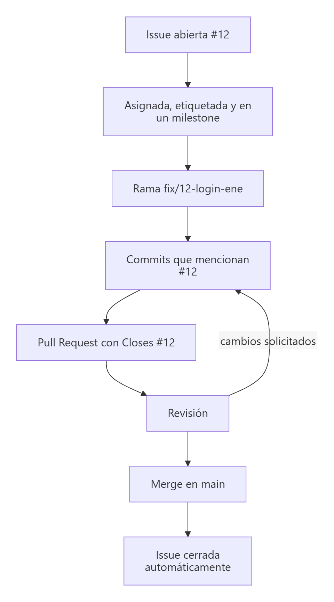
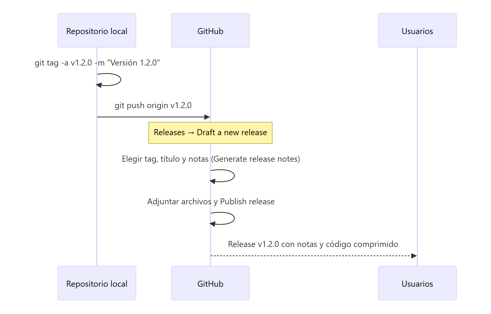
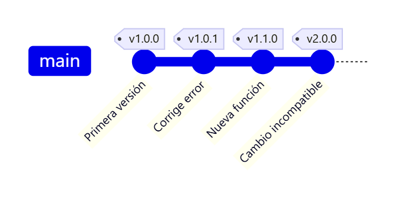

# Gestión del proyecto en GitHub: Issues, Projects y Releases

> **Autor:** Martín Gil Blanco  
> **Curso:** Control de versiones con Git en contextos académicos y profesionales  
> **Tema 18** · Última revisión: octubre de 2026

---

## Índice

- [1. Más allá del código](#1-más-allá-del-código)
- [2. Issues](#2-issues)
  - [2.1. Crear una issue](#21-crear-una-issue)
  - [2.2. Etiquetas, responsables e hitos](#22-etiquetas-responsables-e-hitos)
  - [2.3. Plantillas de issues](#23-plantillas-de-issues)
- [3. Enlazar issues con commits y Pull Requests](#3-enlazar-issues-con-commits-y-pull-requests)
- [4. Ciclo de vida de una issue](#4-ciclo-de-vida-de-una-issue)
- [5. Projects: tableros de trabajo](#5-projects-tableros-de-trabajo)
- [6. Releases](#6-releases)
  - [6.1. Tags frente a releases](#61-tags-frente-a-releases)
  - [6.2. Crear una release](#62-crear-una-release-desde-la-web)
  - [6.3. Versionado semántico](#63-versionado-semántico-en-las-releases)
- [7. La CLI de GitHub: `gh`](#7-la-cli-de-github-gh)
- [8. Equivalencias en GitLab](#8-equivalencias-en-gitlab)
- [9. Resumen](#9-resumen)
- [Actividad práctica](#actividad-práctica)

---

## 1. Más allá del código

Git guarda el **código**; las plataformas como GitHub o GitLab añaden herramientas para **organizar el trabajo** del equipo:

| Herramienta | Para qué sirve |
|---|---|
| **Issues** | Registrar tareas, errores, mejoras y dudas |
| **Labels / Milestones** | Clasificar issues y agruparlas por entregas |
| **Projects** | Tableros (kanban) y tablas para planificar |
| **Pull Requests** | Revisar e integrar cambios ([Tema 15](15-flujos-de-trabajo.md)) |
| **Releases** | Publicar versiones del proyecto a partir de etiquetas |

En un contexto académico, estas herramientas permiten repartir tareas en un trabajo en grupo, seguir el progreso y que el profesorado vea **quién ha hecho qué**.

---

## 2. Issues

Una **issue** es una ficha de trabajo asociada al repositorio: un error que hay que corregir, una funcionalidad nueva, una mejora de la documentación o una pregunta. Cada issue tiene un **número** (`#12`) único dentro del repositorio.

### 2.1. Crear una issue

En el repositorio: pestaña **Issues → New issue**.

| Campo | Recomendación |
|---|---|
| **Título** | Breve y concreto: *"El login falla con contraseñas que contienen ñ"* |
| **Descripción** | Contexto, pasos para reproducir, resultado esperado y resultado obtenido. Admite Markdown, imágenes y listas de tareas (`- [ ] …`) |
| **Assignees** | Persona o personas responsables |
| **Labels** | Tipo y prioridad |
| **Milestone** | Entrega o versión a la que pertenece |

Ejemplo de descripción de un error:

```markdown
**Pasos para reproducir**
1. Ir a la página de inicio de sesión.
2. Introducir una contraseña con la letra ñ.
3. Pulsar "Entrar".

**Resultado esperado:** se inicia sesión.
**Resultado obtenido:** aparece "Contraseña incorrecta".

- [ ] Reproducir el error
- [ ] Corregir la codificación
- [ ] Añadir prueba
```

> 💡 Dentro de cualquier issue, PR o comentario puedes **mencionar** a una persona con `@usuario` y **enlazar** otra issue con `#numero`.

### 2.2. Etiquetas, responsables e hitos

**Labels** (etiquetas): GitHub crea algunas por defecto y puedes añadir las tuyas en **Issues → Labels**.

| Etiqueta | Uso |
|---|---|
| `bug` | Algo no funciona |
| `enhancement` | Nueva funcionalidad o mejora |
| `documentation` | Cambios en la documentación |
| `good first issue` | Tarea sencilla para quien empieza |
| `help wanted` | Se necesita ayuda |
| `question` | Duda o consulta |

**Milestones** (hitos): agrupan issues bajo una **entrega con fecha** (por ejemplo, *"Entrega 1 – 15 de noviembre"* o *"v1.0"*) y muestran una barra de progreso con el porcentaje de issues cerradas.

### 2.3. Plantillas de issues

Para que todas las issues sigan el mismo formato, se pueden crear plantillas en la carpeta `.github/ISSUE_TEMPLATE/` del repositorio (o desde **Settings → Features → Issues → Set up templates**):

```markdown
---
name: Informe de error
about: Describe un error para ayudarnos a corregirlo
labels: bug
---

**Descripción del error**

**Pasos para reproducir**

**Resultado esperado**

**Capturas de pantalla**
```

---

## 3. Enlazar issues con commits y Pull Requests

Si escribes `#12` en el **mensaje de un commit** o en una **Pull Request**, GitHub crea un enlace y lo muestra en la línea temporal de la issue:

```bash
git commit -m "Corrige la codificación de la contraseña (#12)"
```

Además, ciertas **palabras clave** seguidas del número **cierran la issue automáticamente** cuando la PR se fusiona en la **rama por defecto** (`main`):

| Palabras clave (en inglés) |
|---|
| `close`, `closes`, `closed` |
| `fix`, `fixes`, `fixed` |
| `resolve`, `resolves`, `resolved` |

En la descripción de la PR:

```markdown
Corrige el error de codificación del formulario de acceso.

Closes #12
Fixes #15
```

> ⚠️ Las palabras clave en **commits** solo cierran la issue cuando ese commit llega a la rama por defecto. En PR hacia otras ramas (por ejemplo `dev`) **no** se cierran automáticamente.

> 💡 Una convención útil es incluir el número de la issue en el nombre de la rama: `fix/12-login-ene`, `feature/15-modo-oscuro`. Desde la propia issue, el enlace **Development → Create a branch** crea la rama ya vinculada.

---

## 4. Ciclo de vida de una issue



```bash
git switch main && git pull
git switch -c fix/12-login-ene
# … cambios …
git commit -am "Corrige la codificación de la contraseña (#12)"
git push -u origin fix/12-login-ene
# → abrir PR con "Closes #12" en la descripción, revisar y fusionar
```

---

## 5. Projects: tableros de trabajo

**GitHub Projects** permite organizar issues y PR en **tableros kanban**, **tablas** o **calendarios (*roadmap*)**. Se crea desde la pestaña **Projects** del repositorio o del perfil/organización.

Ejemplo de tablero kanban:

| 📋 Por hacer | 🔨 En curso | 👀 En revisión | ✅ Hecho |
|---|---|---|---|
| #14 Validar formulario | #12 Error en el login | #11 Mejorar README | #10 Estructura inicial |
| #15 Modo oscuro | | | |

Características principales:

- **Columnas** configurables (*Todo*, *In progress*, *In review*, *Done*…).
- Las tarjetas son **issues o PR reales**: al cerrarse una issue, puede moverse sola a *Done* (automatizaciones del proyecto).
- **Campos personalizados**: prioridad, estimación, iteración (*sprint*), fechas.
- **Vistas** distintas sobre los mismos datos: tablero, tabla o cronograma.

> 🎓 En un trabajo en grupo, un tablero con una issue por tarea y una persona asignada a cada una facilita repartir el trabajo y demostrar la participación de cada miembro.

---

## 6. Releases

### 6.1. Tags frente a releases

| Tag (Git) | Release (GitHub) |
|---|---|
| Puntero fijo a un commit ([Tema 4](04-etiquetas-y-diferencias.md)) | Página de publicación **basada en un tag** |
| Existe en cualquier repositorio Git | Funcionalidad de la plataforma |
| Solo nombre (y mensaje si es anotado) | Título, **notas de la versión**, archivos adjuntos (binarios, instaladores, PDF…), marca de *pre-release* o *latest* |
| `git tag -a v1.2.0 -m "…"` + `git push origin v1.2.0` | Se crea en **Releases → Draft a new release** |

GitHub añade automáticamente a cada release el **código fuente comprimido** (`.zip` y `.tar.gz`).

### 6.2. Crear una release desde la web



1. Crea y sube el tag (o créalo directamente desde el formulario de la release):

   ```bash
   git tag -a v1.2.0 -m "Versión 1.2.0"
   git push origin v1.2.0
   ```

2. En el repositorio: **Releases → Draft a new release**.
3. **Choose a tag**: selecciona `v1.2.0`.
4. **Release title**: por ejemplo, *"v1.2.0 – Modo oscuro y corrección del login"*.
5. **Descripción**: escribe las notas o pulsa **Generate release notes** para que GitHub las genere a partir de las PR fusionadas desde la release anterior.
6. Adjunta archivos si procede (por ejemplo, el PDF de los apuntes o un ejecutable).
7. Marca **Set as a pre-release** si es una versión de prueba, o **Set as the latest release** si es la versión estable actual.
8. **Publish release**.

Ejemplo de notas de versión:

```markdown
## Novedades
- Modo oscuro (#15)

## Correcciones
- El login ya acepta contraseñas con ñ (#12)

**Changelog completo**: v1.1.0...v1.2.0
```

> 💡 Para estos apuntes, una release es una forma excelente de **publicar el PDF** de cada versión: se adjunta el PDF exportado a la release `v1.0`, `v1.1`…

### 6.3. Versionado semántico en las releases



| Cambio | Versión |
|---|---|
| Corrección de errores | `v1.0.0` → `v1.0.1` (PARCHE) |
| Nueva funcionalidad compatible | `v1.0.1` → `v1.1.0` (MENOR) |
| Cambio incompatible | `v1.1.0` → `v2.0.0` (MAYOR) |
| Versión previa | `v2.0.0-beta.1`, `v2.0.0-rc.1` |

---

## 7. La CLI de GitHub: `gh`

**GitHub CLI** (<https://cli.github.com>) permite gestionar issues, PR y releases desde la terminal. Tras instalarla, se inicia sesión una vez:

```bash
gh auth login
```

| Comando | Descripción |
|---|---|
| `gh issue list` | Lista las issues abiertas |
| `gh issue create --title "Título" --body "Descripción" --label bug` | Crea una issue |
| `gh issue view 12` | Muestra la issue 12 |
| `gh issue close 12` | Cierra la issue 12 |
| `gh issue develop 12 --checkout` | Crea una rama vinculada a la issue y se cambia a ella |
| `gh pr create --fill` | Crea una PR con el título y la descripción de los commits |
| `gh pr list` / `gh pr checkout 7` | Lista PR / descarga la PR 7 en local para probarla |
| `gh pr merge 7 --squash` | Fusiona la PR 7 |
| `gh release create v1.2.0 --generate-notes` | Crea una release con notas automáticas |
| `gh release create v1.2.0 apuntes.pdf --title "v1.2.0"` | Crea una release y adjunta un archivo |
| `gh repo view --web` | Abre el repositorio en el navegador |

---

## 8. Equivalencias en GitLab

| GitHub | GitLab |
|---|---|
| Issues | Issues |
| Labels / Milestones | Labels / Milestones |
| Projects | **Boards** (tableros de issues) |
| Pull Request | **Merge Request** |
| `Closes #12` | `Closes #12` (mismas palabras clave) |
| Releases | Releases (*Deploy → Releases*) |
| `gh` | `glab` |

---

## 9. Resumen

- Las **issues** registran tareas y errores; se clasifican con **labels**, se asignan a personas y se agrupan en **milestones**.
- `#12` enlaza una issue; `Closes #12` en una PR la **cierra al fusionar** en `main`.
- **Projects** organiza las issues en tableros kanban.
- Una **release** es la publicación de una versión basada en un **tag**, con notas y archivos adjuntos.
- La CLI **`gh`** permite hacer todo esto desde la terminal.

---

## Actividad práctica

1. En tu repositorio, crea tres issues con etiquetas distintas (`bug`, `enhancement`, `documentation`) y un milestone *"Entrega 1"*.
2. Crea un Project de tipo tablero y coloca las issues en sus columnas.
3. Resuelve una issue en una rama propia, abre una PR con `Closes #N` y fusiónala; comprueba que la issue se cierra sola.
4. Crea la etiqueta `v1.0.0`, súbela y publica una release con notas generadas automáticamente y el PDF de tus apuntes adjunto.

Entrega un documento PDF con las capturas de pantalla y las explicaciones pertinentes.

---

[⬅ Anterior: Cherry-pick](17-cherry-pick.md) · [Índice](README.md) · [Siguiente: Git en VS Code ➡](19-git-en-vscode.md)
