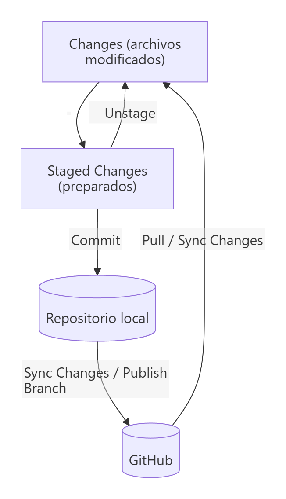
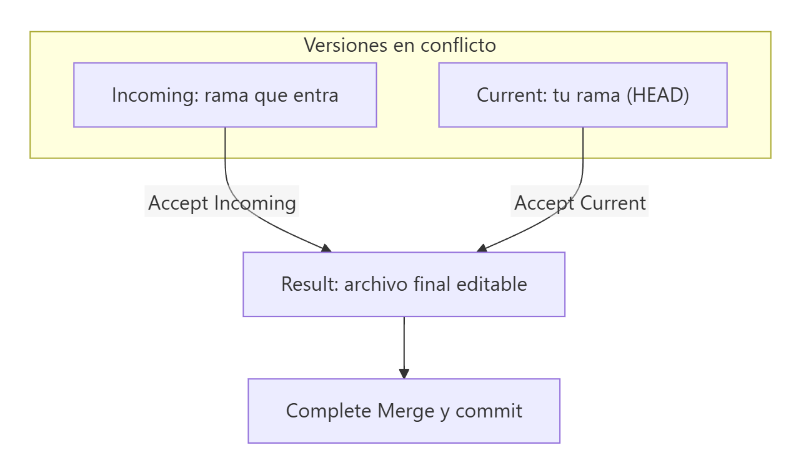

# Git en Visual Studio Code

> **Autor:** Martín Gil Blanco  
> **Curso:** Control de versiones con Git en contextos académicos y profesionales  
> **Tema 19** · Última revisión: octubre de 2026

---

## Índice

- [1. Por qué usar Git desde VS Code](#1-por-qué-usar-git-desde-vs-code)
- [2. Preparar el entorno](#2-preparar-el-entorno)
- [3. La vista de control de código fuente](#3-la-vista-de-control-de-código-fuente)
- [4. Crear o clonar un repositorio](#4-crear-o-clonar-un-repositorio)
- [5. Preparar y confirmar cambios](#5-preparar-y-confirmar-cambios)
- [6. Ver diferencias](#6-ver-diferencias)
- [7. Ramas](#7-ramas)
- [8. Sincronizar con el remoto](#8-sincronizar-con-el-remoto)
- [9. Resolver conflictos con el editor de fusión](#9-resolver-conflictos-con-el-editor-de-fusión)
- [10. Stash, historial y otras acciones](#10-stash-historial-y-otras-acciones)
- [11. Extensiones recomendadas](#11-extensiones-recomendadas)
- [12. Ajustes útiles](#12-ajustes-útiles)
- [13. Atajos de teclado](#13-atajos-de-teclado)
- [14. Equivalencias: botón ↔ comando](#14-equivalencias-botón--comando)
- [Actividad práctica](#actividad-práctica)

---

## 1. Por qué usar Git desde VS Code

VS Code integra Git de serie: permite hacer casi todas las operaciones habituales **sin salir del editor** y con apoyo visual (colores en el margen, comparaciones lado a lado, editor de fusión…).

> ⚠️ La interfaz gráfica **ejecuta los mismos comandos de Git** que la terminal. Conviene conocer primero los comandos (temas anteriores) para entender qué hace cada botón y poder resolver problemas cuando la interfaz no basta. VS Code tiene además un **terminal integrado** (`` Ctrl+` ``) donde puedes usar Git directamente.

---

## 2. Preparar el entorno

1. **Instala Git** ([Tema 0](00-introduccion-y-configuracion.md)). VS Code no lo incluye: usa el Git del sistema.
2. Configura tu **identidad** (`user.name` y `user.email`).
3. En Windows, usa **Git Bash** como terminal integrado: paleta de comandos (`Ctrl+Shift+P`) → *Terminal: Select Default Profile* → **Git Bash**.
4. (Opcional) Usa VS Code como editor de Git para mensajes, diferencias y fusiones:

   ```bash
   git config --global core.editor "code --wait"
   ```

5. Inicia sesión con tu cuenta de GitHub (icono de **Cuentas**, abajo a la izquierda) para poder publicar repositorios y usar las Pull Requests.

---

## 3. La vista de control de código fuente

Se abre con el icono de ramas de la barra lateral o con **`Ctrl+Shift+G`**.

| Zona | Equivale a |
|---|---|
| Cuadro de texto **Message** | Mensaje del commit (`-m`) |
| Botón **✓ Commit** | `git commit` |
| Sección **Changes** | Archivos modificados o sin seguimiento (`git status`) |
| Sección **Staged Changes** | Área de preparación |
| **Graph** (Source Control Graph) | `git log --graph` |
| Barra de estado: **nombre de la rama** | `git branch` / `git switch` |
| Barra de estado: **↓0 ↑1** | Commits por traer / por subir respecto al *upstream* |

Letras que aparecen junto a cada archivo:

| Letra | Significado |
|---|---|
| `U` | *Untracked*: sin seguimiento |
| `A` | *Added*: nuevo y preparado |
| `M` | *Modified*: modificado |
| `D` | *Deleted*: eliminado |
| `R` | *Renamed*: renombrado |
| `C` | *Conflict*: en conflicto |



---

## 4. Crear o clonar un repositorio

| Acción | Cómo |
|---|---|
| **Inicializar** un repositorio en la carpeta abierta | Vista de control de código fuente → **Initialize Repository** (`git init`) |
| **Publicar** directamente en GitHub | **Publish to GitHub**: crea el repositorio remoto (público o privado), configura `origin` y hace el primer `push` |
| **Clonar** | Paleta de comandos → *Git: Clone* → pega la URL o elige uno de tus repositorios de GitHub → elige la carpeta |

---

## 5. Preparar y confirmar cambios

1. En **Changes**, pasa el ratón sobre un archivo y pulsa **+** (*Stage Changes*) para prepararlo; **+** en el título de la sección prepara todos.
2. Para preparar **solo algunas líneas**: abre la comparación del archivo, selecciona las líneas y usa clic derecho → **Stage Selected Ranges** (equivale a `git add -p`).
3. Escribe el mensaje en el cuadro **Message**.
4. Pulsa **✓ Commit** o `Ctrl+Enter`.

| Acción | Botón / menú | Comando |
|---|---|---|
| Quitar del área de preparación | **−** en *Staged Changes* | `git restore --staged` |
| Descartar cambios de un archivo | **↶** (*Discard Changes*) | `git restore` |
| Corregir el último commit | Menú **…** → *Commit → Commit (Amend)* | `git commit --amend` |
| Deshacer el último commit | Menú **…** → *Commit → Undo Last Commit* | `git reset --soft HEAD~1` |

> ⚠️ **Discard Changes** sobre un archivo sin seguimiento lo **borra** del disco. VS Code pide confirmación: léela bien.

> 💡 Si pulsas *Commit* sin nada preparado, VS Code pregunta si quieres preparar todo y confirmar (*smart commit*), equivalente a `git commit -a` (más los archivos nuevos).

---

## 6. Ver diferencias

- **Indicadores en el margen** del editor:

  | Color | Significado |
  |---|---|
  | 🟩 Verde | Líneas añadidas |
  | 🟦 Azul | Líneas modificadas |
  | 🔺 Triángulo rojo | Líneas eliminadas |

  Al hacer clic en el indicador se ve el cambio en línea y se puede revertir solo ese fragmento.

- **Comparación lado a lado**: clic sobre un archivo en *Changes* abre el editor de diferencias (izquierda: versión del último commit o del índice; derecha: tu versión).
- **Comparar con otra rama o commit**: paleta → *Git: Open Changes*, o con extensiones como GitLens.

---

## 7. Ramas

| Acción | Cómo | Comando |
|---|---|---|
| Ver/cambiar de rama | Clic en el **nombre de la rama** (barra de estado) | `git switch` |
| Crear rama | Mismo menú → **+ Create new branch…** (o *Create new branch from…*) | `git switch -c` |
| Fusionar | Paleta → *Git: Merge…* | `git merge` |
| Rebase | Paleta → *Git: Rebase Branch…* | `git rebase` |
| Cherry-pick | Paleta → *Git: Cherry Pick…* | `git cherry-pick` |
| Borrar rama | Paleta → *Git: Delete Branch…* | `git branch -d` |
| Etiquetar | Paleta → *Git: Create Tag* | `git tag` |

---

## 8. Sincronizar con el remoto

| Botón | Qué hace |
|---|---|
| **Publish Branch** | Sube una rama nueva y establece el *upstream* (`git push -u origin rama`) |
| **Sync Changes ↓↑** | `git pull` seguido de `git push` |
| Menú **…** → *Pull* / *Push* / *Fetch* | Cada operación por separado |

Con el ajuste `git.autofetch` activado, VS Code ejecuta `git fetch` periódicamente y el indicador **↓** de la barra de estado avisa cuando hay commits nuevos en el remoto.

> 💡 La extensión **GitHub Pull Requests** permite crear, revisar, comentar y fusionar Pull Requests sin salir de VS Code.

---

## 9. Resolver conflictos con el editor de fusión

Cuando una fusión, un *pull*, un *rebase* o un *cherry-pick* produce conflictos, los archivos aparecen en **Merge Changes** con la letra `C`.

Al abrir el archivo, VS Code resalta cada bloque en conflicto y ofrece acciones rápidas sobre él:

| Acción | Resultado |
|---|---|
| **Accept Current Change** | Te quedas con tu versión (`HEAD`) |
| **Accept Incoming Change** | Te quedas con la versión entrante |
| **Accept Both Changes** | Mantiene ambas, una debajo de otra |
| **Compare Changes** | Muestra las dos versiones lado a lado |

Para conflictos más complejos, pulsa **Resolve in Merge Editor**, que abre el **editor de fusión de 3 vías**:



- Arriba, las dos versiones: **Incoming** (la que entra) y **Current** (la tuya), con casillas para aceptar cada cambio.
- Abajo, **Result**: el archivo final, editable.
- Al terminar, **Complete Merge**. Después haz el commit de la fusión (o continúa el rebase/cherry-pick).

---

## 10. Stash, historial y otras acciones

| Acción | Cómo |
|---|---|
| **Stash** | Menú **…** → *Stash → Stash* / *Stash (Include Untracked)* |
| Recuperar stash | Menú **…** → *Stash → Pop Stash…* / *Apply Stash…* |
| **Historial de un archivo** | Explorador → panel **Timeline** (commits que modificaron ese archivo) |
| **Grafo del repositorio** | Sección **Graph** de la vista de control de código fuente |
| **Ver el log de Git** | Panel **Output** → seleccionar **Git**: muestra los comandos exactos que ejecuta VS Code |

> 💡 El panel **Output → Git** es muy útil para aprender: cada botón que pulsas aparece ahí como comando de Git.

---

## 11. Extensiones recomendadas

| Extensión | Para qué |
|---|---|
| **GitLens** | Autoría de cada línea (*blame*) en el editor, historial detallado, comparaciones entre ramas |
| **Git Graph** | Grafo interactivo del repositorio con acciones (checkout, merge, cherry-pick, rebase…) desde el propio grafo |
| **GitHub Pull Requests** | Crear, revisar y fusionar PR e issues desde VS Code |
| **GitLab Workflow** | Lo mismo para GitLab (Merge Requests, issues, pipelines) |
| **Markdown Preview Mermaid Support** | Previsualizar diagramas Mermaid en archivos Markdown |

---

## 12. Ajustes útiles

Se configuran en **File → Preferences → Settings** (o editando `settings.json`):

```jsonc
{
  "git.autofetch": true,              // fetch periódico en segundo plano
  "git.confirmSync": true,            // pedir confirmación antes de Sync
  "git.enableSmartCommit": false,     // no preparar todo automáticamente al hacer commit
  "git.pruneOnFetch": true,           // fetch --prune
  "git.inputValidation": true,        // avisar si el mensaje de commit es demasiado largo
  "files.eol": "\n",                  // finales de línea LF (ver Tema 21)
  "terminal.integrated.defaultProfile.windows": "Git Bash"
}
```

---

## 13. Atajos de teclado

| Atajo | Acción |
|---|---|
| `Ctrl+Shift+G` | Abrir la vista de control de código fuente |
| `Ctrl+Enter` (en el cuadro de mensaje) | Confirmar (commit) |
| `Ctrl+Shift+P` → escribir *Git:* | Ver todos los comandos de Git |
| `` Ctrl+` `` | Abrir/cerrar el terminal integrado |
| `Alt+F5` / `Shift+Alt+F5` | Ir al siguiente / anterior cambio en el editor de diferencias |

---

## 14. Equivalencias: botón ↔ comando

| VS Code | Git |
|---|---|
| Initialize Repository | `git init` |
| Clone | `git clone <url>` |
| + (Stage) | `git add <archivo>` |
| − (Unstage) | `git restore --staged <archivo>` |
| ↶ (Discard) | `git restore <archivo>` |
| ✓ Commit | `git commit -m "..."` |
| Commit (Amend) | `git commit --amend` |
| Undo Last Commit | `git reset --soft HEAD~1` |
| Create new branch | `git switch -c <rama>` |
| Publish Branch | `git push -u origin <rama>` |
| Sync Changes | `git pull` + `git push` |
| Stash / Pop Stash | `git stash` / `git stash pop` |

---

## Actividad práctica

Repite, **solo con la interfaz de VS Code**, el flujo completo de un tema anterior:

1. Clona tu repositorio, crea una rama, modifica dos archivos y prepara **solo algunas líneas** de uno de ellos con *Stage Selected Ranges*.
2. Haz el commit, publica la rama y crea una Pull Request con la extensión *GitHub Pull Requests*.
3. Provoca un conflicto y resuélvelo con el **editor de fusión de 3 vías**.
4. Abre el panel **Output → Git** y explica qué comandos ha ejecutado VS Code en cada paso.

Entrega un documento PDF con las capturas de pantalla y las explicaciones pertinentes.

---

[⬅ Anterior: Issues, Projects y Releases](18-issues-y-releases.md) · [Índice](README.md) · [Siguiente: Errores frecuentes ➡](20-errores-frecuentes.md)
