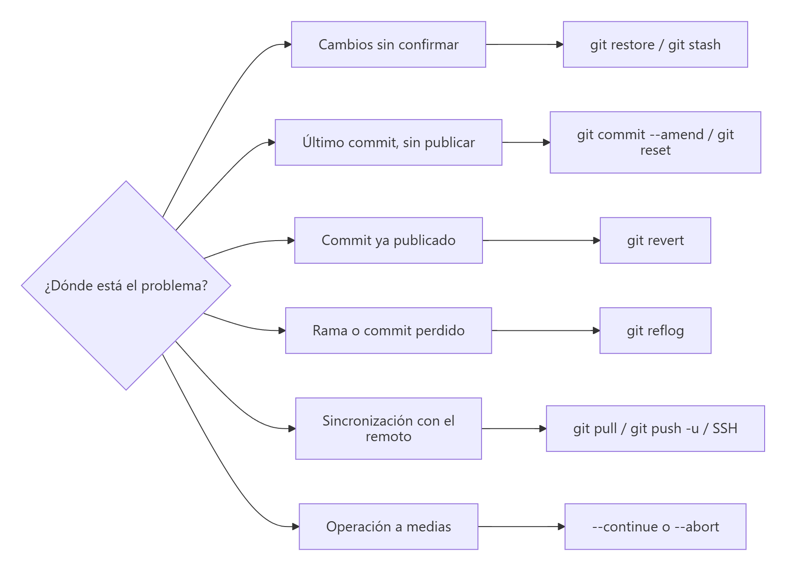

# Errores frecuentes y cómo resolverlos

> **Autor:** Martín Gil Blanco  
> **Curso:** Control de versiones con Git en contextos académicos y profesionales  
> **Tema 20** · Última revisión: octubre de 2026

---

## Índice

- [Antes de nada: mantener la calma](#antes-de-nada-mantener-la-calma)
- [¿Qué he roto? Guía rápida](#qué-he-roto-guía-rápida)
- **Configuración y entorno**
  - [1. Estoy atrapado en Vim](#1-estoy-atrapado-en-vim)
  - [2. *Please tell me who you are*](#2-please-tell-me-who-you-are)
  - [3. *not a git repository*](#3-not-a-git-repository)
  - [4. Avisos de *LF will be replaced by CRLF*](#4-avisos-de-lf-will-be-replaced-by-crlf)
- **Commits y ramas locales**
  - [5. Me he equivocado en el mensaje o me falta un archivo](#5-me-he-equivocado-en-el-mensaje-o-me-falta-un-archivo)
  - [6. He hecho commits en la rama equivocada](#6-he-hecho-commits-en-la-rama-equivocada)
  - [7. He hecho commits en *detached HEAD*](#7-he-hecho-commits-en-detached-head)
  - [8. He confirmado un archivo que debía ignorarse](#8-he-confirmado-un-archivo-que-debía-ignorarse)
  - [9. He borrado una rama o hecho un `reset --hard` por error](#9-he-borrado-una-rama-o-hecho-un-reset---hard-por-error)
  - [10. No me deja cambiar de rama](#10-no-me-deja-cambiar-de-rama)
- **Fusiones, rebase y conflictos**
  - [11. Estoy en mitad de una fusión con conflictos](#11-estoy-en-mitad-de-una-fusión-con-conflictos)
  - [12. Tengo un rebase a medias](#12-tengo-un-rebase-a-medias)
  - [13. *You have divergent branches*](#13-you-have-divergent-branches)
- **Repositorios remotos**
  - [14. *push rejected* (*fetch first* / *non-fast-forward*)](#14-push-rejected-fetch-first--non-fast-forward)
  - [15. *refusing to merge unrelated histories*](#15-refusing-to-merge-unrelated-histories)
  - [16. *src refspec main does not match any*](#16-src-refspec-main-does-not-match-any)
  - [17. *remote origin already exists*](#17-remote-origin-already-exists)
  - [18. *has no upstream branch* / *no tracking information*](#18-has-no-upstream-branch--no-tracking-information)
  - [19. *Authentication failed* / *password authentication was removed*](#19-authentication-failed--password-authentication-was-removed)
  - [20. *Permission denied (publickey)*](#20-permission-denied-publickey)
  - [21. *File … exceeds GitHub's file size limit*](#21-file--exceeds-githubs-file-size-limit)
  - [22. He subido algo mal a una rama compartida](#22-he-subido-algo-mal-a-una-rama-compartida)
  - [23. He subido una contraseña o un token](#23-he-subido-una-contraseña-o-un-token)
- [Comandos de rescate](#comandos-de-rescate)
- [Actividad práctica](#actividad-práctica)

---

## Antes de nada: mantener la calma

1. **Lee el mensaje completo**: Git casi siempre explica el problema y sugiere la solución (líneas `hint:`).
2. Ejecuta **`git status`**: indica en qué rama estás, si hay una fusión o un rebase en curso y qué hacer a continuación.
3. **Lo que se ha confirmado casi nunca se pierde**: `git reflog` guarda los movimientos de `HEAD` durante unos 90 días.
4. Si vas a probar algo arriesgado, crea antes una **rama de seguridad**: `git branch copia-seguridad`.

---

## ¿Qué he roto? Guía rápida



---

## 1. Estoy atrapado en Vim

**Síntoma:** tras `git commit` (sin `-m`) o `git merge` se abre una pantalla de terminal con `~` a la izquierda y no sabes salir.

**Causa:** Git ha abierto su editor por defecto (Vim) para que escribas el mensaje.

**Solución:**

| Quiero… | Teclas |
|---|---|
| Escribir | `i` (modo inserción) |
| Guardar y salir | `Esc` y después `:wq` + Intro |
| Salir sin guardar (cancela el commit) | `Esc` y después `:q!` + Intro |

Para no volver a encontrarlo, configura otro editor ([Tema 0](00-introduccion-y-configuracion.md#63-editor-por-defecto)):

```bash
git config --global core.editor "nano"            # o "code --wait"
```

---

## 2. *Please tell me who you are*

```text
Author identity unknown

*** Please tell me who you are.
```

**Causa:** no has configurado tu nombre y correo.

**Solución:**

```bash
git config --global user.name "Martín Gil Blanco"
git config --global user.email "tu_correo@ejemplo.com"
```

---

## 3. *not a git repository*

```text
fatal: not a git repository (or any of the parent directories): .git
```

**Causa:** estás en una carpeta que no es un repositorio (o en la carpeta padre del repositorio).

**Solución:** entra en la carpeta correcta (`cd mi-proyecto`) o, si es un proyecto nuevo, ejecuta `git init`. Comprueba dónde estás con `pwd` y `ls -a` (debe existir `.git`).

---

## 4. Avisos de *LF will be replaced by CRLF*

```text
warning: in the working copy of 'README.md', LF will be replaced by CRLF the next time Git touches it
```

**Causa:** diferencias de finales de línea entre Windows y Linux/macOS.

**Solución:** es solo un **aviso**, no un error. Se explica en detalle y se configura correctamente en el [Tema 21](21-finales-de-linea.md).

---

## 5. Me he equivocado en el mensaje o me falta un archivo

**Solución** (solo si el commit **no** se ha subido):

```bash
git commit --amend -m "Mensaje corregido"     # cambiar el mensaje

git add archivo-olvidado
git commit --amend --no-edit                  # añadir el archivo sin cambiar el mensaje
```

Si ya lo habías subido y trabajas solo en esa rama, tendrás que forzar: `git push --force-with-lease`. En ramas compartidas, mejor haz un **commit nuevo**.

---

## 6. He hecho commits en la rama equivocada

**Síntoma:** has hecho 2 commits en `main` que debían ir en una rama nueva `feature/login` (y no los has subido).

**Solución A — la rama aún no existe:**

```bash
git branch feature/login      # 1. crea la rama apuntando a tus commits
git reset --hard HEAD~2       # 2. devuelve main 2 commits atrás
git switch feature/login      # 3. sigue trabajando en la rama correcta
```

**Solución B — la rama ya existe:**

```bash
git switch feature/login
git cherry-pick <hash1> <hash2>   # copia los commits (Tema 17)
git switch main
git reset --hard HEAD~2           # elimina los commits de main
```

> ⚠️ Haz `git reset --hard` **solo con el directorio de trabajo limpio** y si los commits no estaban publicados.

---

## 7. He hecho commits en *detached HEAD*

**Síntoma:** `git status` muestra `HEAD detached at …` y has hecho commits.

**Solución:** crea una rama **antes** de cambiar a otra:

```bash
git switch -c rescate
```

Si ya cambiaste de rama y los commits "desaparecieron", búscalos con `git reflog` (apartado 9).

---

## 8. He confirmado un archivo que debía ignorarse

**Solución:**

```bash
echo "build/" >> .gitignore
git rm -r --cached build/        # deja de rastrearlo, pero no lo borra del disco
git commit -m "Deja de rastrear build/"
```

Más detalles en el [Tema 7](07-gitignore.md#8-situaciones-habituales).

---

## 9. He borrado una rama o hecho un `reset --hard` por error

**Solución:** `git reflog` muestra todos los puntos por los que ha pasado `HEAD`:

```bash
git reflog
```

```text
a1b2c3d HEAD@{0}: reset: moving to HEAD~3
9f8e7d6 HEAD@{1}: commit: Último commit bueno
```

```bash
git branch recuperada 9f8e7d6      # recupera el trabajo en una rama
# o bien, volver la rama actual a ese punto:
git reset --hard 9f8e7d6
```

> ⚠️ `reflog` solo recupera lo que estuvo **confirmado**. Los cambios nunca confirmados que se descartaron con `reset --hard` o `restore` no se pueden recuperar.

---

## 10. No me deja cambiar de rama

```text
error: Your local changes to the following files would be overwritten by checkout:
        index.html
Please commit your changes or stash them before you switch branches.
```

**Solución:** confirma los cambios o guárdalos temporalmente ([Tema 14](14-stash.md)):

```bash
git stash
git switch otra-rama
# … más tarde …
git switch -
git stash pop
```

Variante con archivos **sin seguimiento**:

```text
error: The following untracked working tree files would be overwritten by checkout
```

Muévelos, bórralos o guárdalos con `git stash -u`.

---

## 11. Estoy en mitad de una fusión con conflictos

```text
fatal: You have not concluded your merge (MERGE_HEAD exists).
```

**Solución:** termina la fusión o cancélala ([Tema 9](09-resolucion-de-conflictos.md)):

```bash
# Terminar
git status                   # ver archivos en conflicto
# editar y quitar los marcadores <<<<<<< ======= >>>>>>>
git add <archivos>
git commit

# o cancelar
git merge --abort
```

---

## 12. Tengo un rebase a medias

```text
It seems that there is already a rebase-merge directory, and
I wonder if you are in the middle of another rebase.
```

**Solución** ([Tema 13](13-rebase.md)):

```bash
git rebase --continue      # tras resolver y hacer git add
git rebase --skip          # saltar el commit problemático
git rebase --abort         # volver al estado anterior al rebase
```

---

## 13. *You have divergent branches*

```text
hint: You have divergent branches and need to specify how to reconcile them.
fatal: Need to specify how to reconcile divergent branches.
```

**Causa:** tú y el remoto tenéis commits distintos y Git (2.27+) quiere que elijas cómo integrar con `git pull`.

**Solución:** elige una estrategia una vez:

```bash
git config --global pull.rebase false   # fusionar (merge) – comportamiento clásico
# o
git config --global pull.rebase true    # reorganizar (rebase) – historial lineal
```

---

## 14. *push rejected* (*fetch first* / *non-fast-forward*)

```text
 ! [rejected]        main -> main (fetch first)
error: failed to push some refs to 'github.com:usuario/repo.git'
hint: Updates were rejected because the remote contains work that you do not have locally.
```

**Causa:** el remoto tiene commits que tú no tienes (alguien subió cambios o editaste en GitHub).

**Solución:**

```bash
git pull           # integra los cambios (puede haber conflictos, Tema 9)
git push
```

> ⚠️ **No** uses `git push --force` para "arreglarlo": borrarías el trabajo de otras personas.

---

## 15. *refusing to merge unrelated histories*

```text
fatal: refusing to merge unrelated histories
```

**Causa típica:** creaste el repositorio en GitHub **con README** (o licencia) y también un repositorio local con sus propios commits: son dos historias sin ningún commit en común.

**Solución:**

```bash
git pull origin main --allow-unrelated-histories
# resolver conflictos si los hay (por ejemplo en README.md)
git push -u origin main
```

> 💡 Para evitarlo: si vas a subir un repositorio local existente, crea el remoto **vacío** ([Tema 5](05-repositorios-remotos.md)).

---

## 16. *src refspec main does not match any*

```text
error: src refspec main does not match any
```

**Causas posibles:**

| Causa | Solución |
|---|---|
| Aún no has hecho **ningún commit** | `git add .` y `git commit -m "Commit inicial"` |
| Tu rama se llama **`master`**, no `main` | `git push -u origin master`, o renómbrala: `git branch -M main` |

Comprueba el nombre con `git branch`.

---

## 17. *remote origin already exists*

```text
error: remote origin already exists.
```

**Solución:** cambia la URL en lugar de volver a añadirlo:

```bash
git remote -v
git remote set-url origin <nueva-url>
```

---

## 18. *has no upstream branch* / *no tracking information*

```text
fatal: The current branch feature/login has no upstream branch.
```

```text
There is no tracking information for the current branch.
```

**Causa:** la rama local no está asociada a ninguna rama remota ([Tema 12](12-ramas-remotas.md)).

**Solución:**

```bash
git push -u origin feature/login          # al subirla por primera vez
git branch -u origin/feature/login        # si la rama remota ya existe
```

---

## 19. *Authentication failed* / *password authentication was removed*

```text
remote: Support for password authentication was removed on August 13, 2021.
fatal: Authentication failed for 'https://github.com/usuario/repo.git/'
```

**Causa:** GitHub ya no acepta la contraseña de la cuenta para operaciones Git por HTTPS.

**Solución** (una de las dos):

- Usar **SSH** ([Tema 8](08-claves-ssh.md)) y cambiar el remoto: `git remote set-url origin git@github.com:usuario/repo.git`.
- Crear un **token de acceso personal** (*Settings → Developer settings → Personal access tokens*) y usarlo como contraseña. En Windows, *Git Credential Manager* lo gestiona automáticamente con un inicio de sesión en el navegador.

---

## 20. *Permission denied (publickey)*

```text
git@github.com: Permission denied (publickey).
fatal: Could not read from remote repository.
```

**Causa:** tu clave SSH no está añadida a la cuenta, o SSH está usando otra clave.

**Solución:** revisa el [Tema 8](08-claves-ssh.md#10-problemas-frecuentes):

```bash
ls -al ~/.ssh                  # ¿existe la clave?
ssh -vT git@github.com         # ¿qué clave ofrece?
ssh-add ~/.ssh/id_ed25519      # cargarla en el agente
```

---

## 21. *File … exceeds GitHub's file size limit*

```text
remote: error: File video.mp4 is 150.00 MB; this exceeds GitHub's file size limit of 100.00 MB
remote: error: GH001: Large files detected.
```

**Causa:** GitHub rechaza archivos de más de **100 MB** (y avisa a partir de 50 MB).

**Solución** si el archivo está en el **último commit** (no subido):

```bash
git rm --cached video.mp4
echo "video.mp4" >> .gitignore
git commit --amend --no-edit
git push
```

Si está en commits anteriores, hay que eliminarlo del historial (con `git filter-repo` o *BFG Repo-Cleaner*) o usar **Git LFS** para archivos grandes.

---

## 22. He subido algo mal a una rama compartida

**Solución:** **no reescribas la historia**; crea un commit que deshaga el error ([Tema 6](06-deshacer-cambios.md#7-deshacer-commits-ya-publicados-git-revert)):

```bash
git revert <hash>
git push
```

---

## 23. He subido una contraseña o un token

**Solución, por este orden:**

1. **Revoca o cambia inmediatamente** la contraseña/token en el servicio correspondiente. Considera que **ya está comprometido**: borrarlo del repositorio no basta, porque sigue en el historial y puede haber copias (clones, *forks*, cachés).
2. Elimina el archivo del seguimiento y añádelo a `.gitignore` (usa un `.env.example` sin valores reales como plantilla).
3. Si el repositorio es público o importante, limpia el historial con `git filter-repo` o *BFG Repo-Cleaner* y fuerza el push (avisando al equipo).
4. Activa **Secret scanning** y **Push protection** en GitHub (*Settings → Code security*) para que bloquee futuros secretos.

---

## Comandos de rescate

| Comando | Para qué |
|---|---|
| `git status` | Diagnóstico: rama, operaciones en curso y sugerencias |
| `git log --oneline --graph --all` | Ver dónde está cada rama |
| `git reflog` | Encontrar commits "perdidos" |
| `git branch copia-seguridad` | Rama de seguridad antes de algo arriesgado |
| `git stash` | Apartar cambios sin confirmar |
| `git merge --abort` / `git rebase --abort` / `git cherry-pick --abort` | Cancelar una operación en curso |
| `git restore <archivo>` | Descartar cambios de un archivo |
| `git reset --hard origin/main` | Dejar la rama igual que el remoto (⚠️ descarta todo lo local) |
| `git revert <hash>` | Deshacer un commit publicado |

---

## Actividad práctica

Provoca y resuelve **al menos cinco** de los errores de este tema (por ejemplo: 6, 9, 14, 15 y 16). Para cada uno, documenta el mensaje de error, la causa y los comandos usados para solucionarlo.

Entrega un documento PDF con las capturas de pantalla y las explicaciones pertinentes.

---

[⬅ Anterior: Git en VS Code](19-git-en-vscode.md) · [Índice](README.md) · [Siguiente: Finales de línea ➡](21-finales-de-linea.md)
