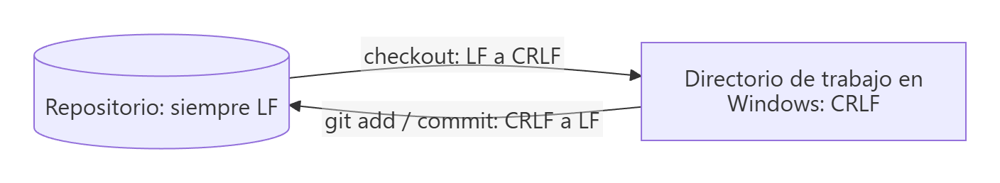
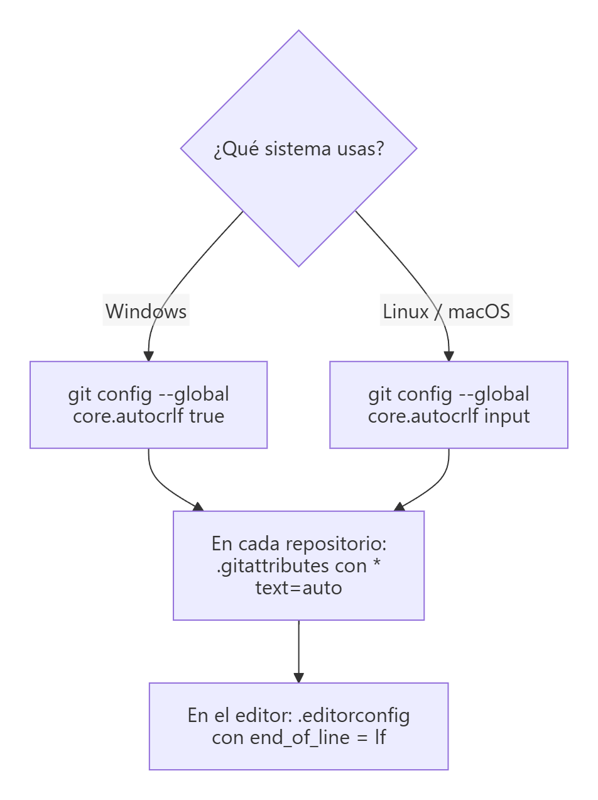

# Finales de línea (LF/CRLF) y `.gitattributes`

> **Autor:** Martín Gil Blanco  
> **Curso:** Control de versiones con Git en contextos académicos y profesionales  
> **Tema 21** · Última revisión: octubre de 2026

---

## Índice

- [1. ¿Qué es un final de línea?](#1-qué-es-un-final-de-línea)
- [2. ¿Por qué es un problema?](#2-por-qué-es-un-problema)
- [3. El aviso *LF will be replaced by CRLF*](#3-el-aviso-lf-will-be-replaced-by-crlf)
- [4. `core.autocrlf`: configuración por equipo](#4-coreautocrlf-configuración-por-equipo)
- [5. `.gitattributes`: configuración por repositorio](#5-gitattributes-configuración-por-repositorio)
- [6. Normalizar un repositorio existente](#6-normalizar-un-repositorio-existente)
- [7. Comprobar los finales de línea](#7-comprobar-los-finales-de-línea)
- [8. El editor: VS Code y `.editorconfig`](#8-el-editor-vs-code-y-editorconfig)
- [9. Problemas típicos y soluciones](#9-problemas-típicos-y-soluciones)
- [10. Configuración recomendada](#10-configuración-recomendada)
- [Actividad práctica](#actividad-práctica)

---

## 1. ¿Qué es un final de línea?

Al pulsar Intro en un archivo de texto, el editor guarda uno o dos **caracteres invisibles** que marcan el final de la línea. Cada sistema operativo usa una convención distinta:

| Nombre | Caracteres | Escape | Sistemas |
|---|---|---|---|
| **LF** (*Line Feed*) | 1 byte (`0x0A`) | `\n` | Linux, macOS, Unix |
| **CRLF** (*Carriage Return + Line Feed*) | 2 bytes (`0x0D 0x0A`) | `\r\n` | Windows |
| **CR** | 1 byte (`0x0D`) | `\r` | Mac OS clásico (anterior a 2001) |

> 💡 Los nombres vienen de las máquinas de escribir: *carriage return* devuelve el carro al principio y *line feed* avanza el papel una línea.

---

## 2. ¿Por qué es un problema?

Cuando en un mismo proyecto colaboran personas con Windows y con Linux/macOS, sin una configuración común aparecen problemas:

- **Diffs gigantes**: un editor cambia todos los finales de línea de un archivo y Git muestra **todas las líneas como modificadas**, aunque el contenido sea el mismo.
- **Conflictos falsos** al fusionar.
- **Scripts que fallan**: un script de Bash con CRLF no funciona en Linux:

  ```text
  /bin/bash^M: bad interpreter: No such file or directory
  ```

  (`^M` es el carácter `\r` sobrante). Si se ejecuta con `bash script.sh`, el síntoma es `$'\r': command not found`.
- Archivos de configuración (Docker, YAML…) que se leen mal en servidores Linux.

La solución es que **el repositorio guarde siempre LF** y que cada equipo convierta, si lo necesita, al hacer *checkout*.

---

## 3. El aviso *LF will be replaced by CRLF*

Es el aviso que aparece en Windows al hacer `git add`:

```text
warning: in the working copy of 'README.md', LF will be replaced by CRLF the next time Git touches it
```

Significa:

- Tienes `core.autocrlf=true` (lo configura por defecto el instalador de Git for Windows).
- El archivo de tu directorio de trabajo tiene **LF** (por ejemplo, porque lo creó una herramienta que escribe LF).
- En el repositorio se guardará con **LF** (correcto).
- La **próxima vez** que Git escriba ese archivo en tu disco (checkout, cambio de rama…) lo pondrá con **CRLF**.

> ✅ **Es solo un aviso, no un error.** No se pierde nada y el contenido del repositorio es correcto.

---

## 4. `core.autocrlf`: configuración por equipo

La variable `core.autocrlf` controla la conversión automática que hace Git **en tu equipo**:

| Valor | Al hacer commit (disco → repositorio) | Al hacer checkout (repositorio → disco) | Recomendado para |
|---|---|---|---|
| `true` | CRLF → **LF** | LF → **CRLF** | Windows |
| `input` | CRLF → **LF** | Sin cambios (LF) | Linux y macOS |
| `false` | Sin conversión | Sin conversión | Solo si el proyecto usa `.gitattributes` o todo el equipo usa el mismo sistema |



```bash
git config --global core.autocrlf true     # Windows
git config --global core.autocrlf input    # Linux / macOS
git config --get core.autocrlf             # ver el valor actual
```

> ⚠️ `core.autocrlf` depende de la configuración **de cada persona**: si alguien la tiene mal, el problema vuelve. Por eso la solución robusta es `.gitattributes`.



---

## 5. `.gitattributes`: configuración por repositorio

El archivo **`.gitattributes`**, en la raíz del repositorio, define cómo tratar cada tipo de archivo. Al **confirmarse** junto con el proyecto, se aplica **igual para todo el equipo** y tiene prioridad sobre `core.autocrlf`.

```gitattributes
# Detección automática: los archivos de texto se guardan con LF en el repositorio
* text=auto

# Forzar LF en el disco (scripts y configuración que se ejecutan en Linux)
*.sh      text eol=lf
*.yml     text eol=lf
*.yaml    text eol=lf
Dockerfile text eol=lf

# Forzar CRLF en el disco (scripts exclusivos de Windows)
*.bat     text eol=crlf
*.cmd     text eol=crlf
*.ps1     text eol=crlf

# Archivos binarios: nunca convertir ni intentar mostrar diffs de texto
*.png     binary
*.jpg     binary
*.pdf     binary
*.zip     binary
```

| Atributo | Significado |
|---|---|
| `text=auto` | Git decide si el archivo es de texto; si lo es, lo guarda con LF |
| `text` | Tratar siempre como texto (normalizar a LF en el repositorio) |
| `eol=lf` / `eol=crlf` | Final de línea que tendrá el archivo **en el disco** al hacer checkout |
| `-text` | No convertir nunca |
| `binary` | Equivale a `-text -diff`: sin conversión y sin diff de texto |

> 💡 También sirve para otras cosas: `*.md linguist-documentation` (estadísticas de lenguajes en GitHub), `*.lock -diff`, etc.

---

## 6. Normalizar un repositorio existente

Si añades `.gitattributes` a un repositorio que ya tiene archivos con CRLF guardados, hay que **renormalizarlos** una vez:

```bash
# 1. Crear .gitattributes y confirmarlo
git add .gitattributes
git commit -m "Añade .gitattributes para normalizar finales de línea"

# 2. Reaplicar las reglas a todos los archivos rastreados
git add --renormalize .
git status                 # archivos cuyo final de línea cambia en el repositorio
git commit -m "Normaliza finales de línea"
```

> ⚠️ Este commit puede tocar muchos archivos. Avisa al equipo y hazlo cuando no haya ramas largas pendientes de fusionar, para evitar conflictos.

---

## 7. Comprobar los finales de línea

```bash
git ls-files --eol
```

```text
i/lf    w/crlf  attr/text=auto          README.md
i/lf    w/lf    attr/text eol=lf        deploy.sh
i/-text w/-text attr/binary             logo.png
```

| Columna | Significado |
|---|---|
| `i/…` | Final de línea en el **índice/repositorio** (debería ser `lf`) |
| `w/…` | Final de línea en tu **directorio de trabajo** |
| `attr/…` | Atributos aplicados desde `.gitattributes` |

Otras comprobaciones:

```bash
file script.sh                   # "with CRLF line terminators" si tiene CRLF
git diff --check                 # detecta espacios en blanco problemáticos
```

---

## 8. El editor: VS Code y `.editorconfig`

En **VS Code**, la barra de estado (abajo a la derecha) muestra **`LF`** o **`CRLF`**: al hacer clic se puede cambiar el final de línea del archivo actual. Para que los archivos nuevos usen LF:

```jsonc
// settings.json
{
  "files.eol": "\n"
}
```

**`.editorconfig`** es un estándar que entienden la mayoría de editores e IDE (VS Code con extensión, JetBrains de serie…) para unificar el estilo en el equipo:

```ini
# .editorconfig
root = true

[*]
end_of_line = lf
charset = utf-8
insert_final_newline = true
trim_trailing_whitespace = true

[*.{bat,cmd,ps1}]
end_of_line = crlf
```

| Herramienta | Qué controla |
|---|---|
| `.editorconfig` | Cómo **escribe** el editor los archivos |
| `.gitattributes` | Cómo **guarda y extrae** Git los archivos |

Lo ideal es usar **ambos**.

---

## 9. Problemas típicos y soluciones

| Problema | Solución |
|---|---|
| `bad interpreter: /bin/bash^M` | Convertir el script a LF: `sed -i 's/\r$//' script.sh` (o `dos2unix script.sh`) y añadir `*.sh text eol=lf` a `.gitattributes` |
| `git diff` muestra **todo el archivo** cambiado | Diferencia solo de finales de línea: `git diff --ignore-cr-at-eol` para confirmarlo; normalizar con `.gitattributes` |
| Muchos avisos *LF will be replaced by CRLF* | Inofensivos; para silenciarlos, añade `.gitattributes` con `* text=auto` o configura `core.autocrlf` de forma coherente |
| Un archivo binario aparece "modificado" tras un checkout | Márcalo como `binary` en `.gitattributes` |
| Quiero que Git rechace mezclas de finales de línea | `git config --global core.safecrlf true` |

---

## 10. Configuración recomendada

1. **En cada equipo** (una sola vez):

   ```bash
   # Windows
   git config --global core.autocrlf true
   # Linux / macOS
   git config --global core.autocrlf input
   ```

2. **En cada repositorio**: un `.gitattributes` con, al menos:

   ```gitattributes
   * text=auto
   *.sh text eol=lf
   *.png binary
   *.jpg binary
   *.pdf binary
   ```

3. **En el editor**: un `.editorconfig` con `end_of_line = lf`.

---

## Actividad práctica

1. Ejecuta `git ls-files --eol` en tu repositorio de apuntes y explica las columnas `i/`, `w/` y `attr/` de tres archivos.
2. Crea un script `hola.sh` con CRLF (por ejemplo, con el Bloc de notas de Windows), ejecútalo en Linux o WSL con `./hola.sh` y documenta el error (en Git Bash el síntoma suele ser `$'\r': command not found`).
3. Añade un `.gitattributes` adecuado, renormaliza el repositorio con `git add --renormalize .` y comprueba que el script ya funciona.

Entrega un documento PDF con las capturas de pantalla y las explicaciones pertinentes.

---

[⬅ Anterior: Errores frecuentes](20-errores-frecuentes.md) · [Índice](README.md)
