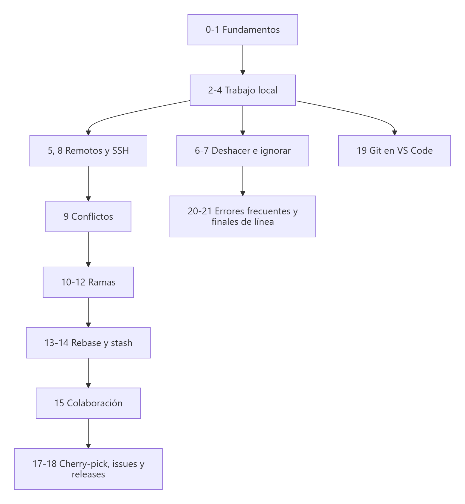
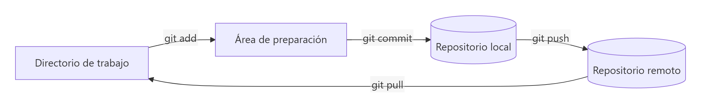

# Curso de Git y GitHub con VS Code

> **Autor:** Martín Gil Blanco  
> **Curso:** Control de versiones con Git en contextos académicos y profesionales  
> Última revisión: octubre de 2026

Apuntes completos de **Git** y **GitHub**: desde los fundamentos del control de versiones hasta el trabajo colaborativo con ramas, *rebase* y *Pull Requests*.


📄 [Apuntes PDF](./Apuntes/Temario/Curso%20GIT%20y%20GITHUB.pdf) · 📋 [Cheat Sheet](./Apuntes/Temario/cheat%20sheet.pdf)

---

## Temario

### Bloque I · Fundamentos

| Tema | Contenido |
|---|---|
| [0. Introducción, instalación y configuración](00-introduccion-y-configuracion.md) | Control de versiones, historia de Git, instalación, `git config`, alias |
| [1. Áreas de un repositorio Git](01-areas-y-estados.md) | Directorio de trabajo, área de preparación, repositorio, estados de los archivos |
| [2. Inicializar un repositorio y registrar cambios](02-inicializar-repositorio.md) | `git init`, `git add`, `git commit`, `git rm`, `git mv`, `git clone` |
| [3. Revisar el historial y moverse entre commits](03-historial-de-commits.md) | `git log`, `HEAD`, *detached HEAD*, referencias `~` y `^` |
| [4. Etiquetar commits y ver diferencias](04-etiquetas-y-diferencias.md) | `git tag`, `git show`, `git diff`, `git difftool` |

### Bloque II · Repositorios remotos y seguridad

| Tema | Contenido |
|---|---|
| [5. Repositorios remotos](05-repositorios-remotos.md) | GitHub, GitLab, `git remote`, `git push`, `git fetch`, `git pull` |
| [6. Deshacer cambios](06-deshacer-cambios.md) | `git restore`, `git reset` (soft/mixed/hard), `--amend`, `git revert`, `git reflog` |
| [7. Archivo .gitignore](07-gitignore.md) | Patrones, plantillas, dejar de rastrear archivos |
| [8. Claves SSH](08-claves-ssh.md) | ED25519/RSA, GitHub y GitLab, agente SSH, problemas frecuentes |
| [9. Resolución de conflictos](09-resolucion-de-conflictos.md) | Marcadores, `git mergetool`, `git merge --abort` |

### Bloque III · Ramas y colaboración

| Tema | Contenido |
|---|---|
| [10. Ramas: concepto y creación](10-creacion-de-ramas.md) | Punteros, `HEAD`, `git branch`, `git switch`, `git checkout -b` |
| [11. Fusión y eliminación de ramas](11-fusion-de-ramas.md) | *Fast-forward*, 3 vías, `--no-ff`, borrar ramas locales y remotas |
| [12. Ramas remotas y de seguimiento](12-ramas-remotas.md) | `origin/main`, *upstream*, `git branch -vv`, `fetch --prune` |
| [13. Rebase](13-rebase.md) | Rebase básico, `--onto`, peligros, `pull --rebase`, rebase interactivo |
| [14. Stash](14-stash.md) | Guardar y recuperar cambios temporalmente |
| [15. Flujos de trabajo y colaboración](15-flujos-de-trabajo.md) | GitHub Flow, Git Flow, Pull Requests, *forks* |
| [16. Referencia rápida de comandos](16-referencia-rapida.md) | Chuleta de comandos y glosario |

### Bloque IV · Herramientas y práctica profesional

| Tema | Contenido |
|---|---|
| [17. Cherry-pick](17-cherry-pick.md) | Llevar commits concretos de una rama a otra, rangos, conflictos |
| [18. Issues, Projects y Releases](18-issues-y-releases.md) | Gestión del proyecto en GitHub, `Closes #12`, tableros, publicación de versiones, CLI `gh` |
| [19. Git en VS Code](19-git-en-vscode.md) | Vista de control de código fuente, editor de fusión, extensiones, equivalencias botón ↔ comando |
| [20. Errores frecuentes](20-errores-frecuentes.md) | Guía de síntomas, causas y soluciones de los errores más habituales |
| [21. Finales de línea](21-finales-de-linea.md) | LF/CRLF, `core.autocrlf`, `.gitattributes`, `.editorconfig` |

### Tareas

- [Tarea 1: un repositorio local con dos remotos](./Apuntes/Tarea%201/Tarea%20de%20Git%20y%20GitHub.md)
- [Tarea 2: trabajo en equipo con Pull Requests](./Apuntes/Tarea%202/Tarea%20de%20Git%20y%20GitHub%202.md)

---

## Mapa del curso



## Flujo de trabajo básico



---

## Diagramas

Los diagramas de los apuntes son imágenes PNG guardadas en [`assets/diagramas/`](assets/diagramas/), para que se vean igual en GitHub, en cualquier visor de Markdown y al exportar a PDF. El código fuente de cada uno está en [`assets/diagramas/src/`](assets/diagramas/src/) en formato [Mermaid](https://mermaid.js.org/) (`.mmd`, mismo nombre que la imagen). Para modificar un diagrama, edita su `.mmd` y vuelve a exportarlo a PNG, por ejemplo con el [Mermaid Live Editor](https://mermaid.live) o con `mermaid-cli`:

```bash
npx -p @mermaid-js/mermaid-cli mmdc -i assets/diagramas/src/01-areas-y-estados-01.mmd -o assets/diagramas/01-areas-y-estados-01.png -b white -s 2
```

---

## Conceptos

- **Git:** sistema de control de versiones **distribuido**, libre y de código abierto, creado por Linus Torvalds en 2005. Registra los cambios en los archivos de un proyecto, permite recuperar cualquier versión anterior y facilita la colaboración.

- **GitHub:** plataforma de desarrollo colaborativo que aloja repositorios Git. Permite almacenar y gestionar proyectos, seguir los cambios, colaborar mediante *Pull Requests* y gestionar incidencias (*issues*). Alternativas: **GitLab** y **Bitbucket**.

- **VS Code:** editor de código abierto desarrollado por Microsoft. Es muy personalizable, admite multitud de lenguajes e integra control de versiones con Git (incluida la resolución visual de conflictos).

- **Repositorio:** espacio donde se almacenan los archivos de un proyecto junto con **todo su historial** de cambios, ramas y etiquetas.

- **Directorio de trabajo (*working directory*):** carpeta del proyecto con la versión de los archivos con la que se está trabajando. Cambia automáticamente al moverse entre commits o ramas.

- **Área de preparación (*staging area* / *index*):** zona intermedia donde se colocan los cambios que formarán parte del próximo commit.

- **Commit:** instantánea confirmada del proyecto. Incluye autor, fecha, un mensaje descriptivo y un identificador único (hash SHA‑1).

- **Rama (*branch*):** puntero móvil a un commit que representa una línea independiente de desarrollo. La rama principal se llama `main` (o `master` en repositorios antiguos).

- **HEAD:** puntero que indica la rama o el commit en el que estás situado.

- **Merge:** acción de combinar los cambios de una rama con otra.

- **Rebase:** forma alternativa de integrar cambios que reaplica los commits sobre otra base, dejando un historial lineal.

- **Push:** enviar los commits locales al repositorio remoto.

- **Pull:** traer los cambios del repositorio remoto e integrarlos en la rama local (`fetch` + `merge`).

- **Pull Request:** petición, desde la plataforma web, para fusionar una rama en otra tras una revisión.

- **Markdown:** lenguaje de marcado ligero para dar formato a texto de forma sencilla y legible. Se usa en la documentación de proyectos (como estos apuntes). Ver [ejemplos de sintaxis](./Recursos/comandosMarkDown.md).

---

## Bibliografía y referencias

- Chacon, S. y Straub, B. *Pro Git* (2.ª ed.). <https://git-scm.com/book/es/v2>
- Documentación oficial de Git: <https://git-scm.com/docs>
- Documentación de GitHub: <https://docs.github.com/es>
- Documentación de GitLab: <https://docs.gitlab.com>
- Plantillas de `.gitignore`: <https://github.com/github/gitignore>
- Atlassian, *Git tutorials*: <https://www.atlassian.com/git/tutorials>
- Material del curso *Control de versiones con Git en contextos académicos y profesionales* (Plataforma Platega).
